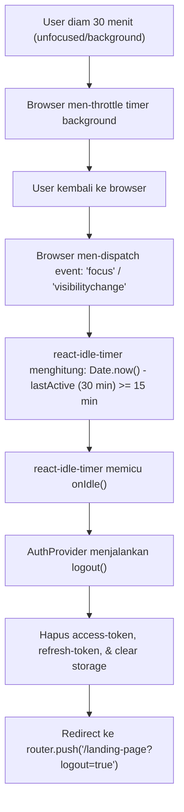

# can you investigate this situation

- **ID**: `antigravity-ea4d66ea059db317a6d8eddc9fef0e612accf0194a98f6e41cc89ff86aa34690`
- **Source Tool**: `antigravity`
- **Date**: `2026-11-07 01:32:02`
- **Tags**: `coding`, `assistant`, `antigravity`

---

## Turn 1: User

can you investigate this situation
1. when i deliberately wait for 30 minutes to make the access token expired, then when i tried changing to another browser, then returned again to that browser, suddenly i got kicked to landing page

---

## Turn 2: Assistant

<details><summary>🔧 Tool Invocations (1)</summary>

- **run_command**: 

</details>


---

## Turn 3: Assistant

<details><summary>🔧 Tool Invocations (1)</summary>

- **run_command**: 

</details>


---

## Turn 4: Assistant

<details><summary>🔧 Tool Invocations (1)</summary>

- **manage_task**: 

</details>


---

## Turn 5: Assistant

<details><summary>🔧 Tool Invocations (1)</summary>

- **run_command**: 

</details>


---

## Turn 6: Assistant

<details><summary>🔧 Tool Invocations (1)</summary>

- **run_command**: 

</details>


---

## Turn 7: Assistant

<details><summary>🔧 Tool Invocations (1)</summary>

- **read_file**: 

</details>


---

## Turn 8: Assistant

<details><summary>🔧 Tool Invocations (1)</summary>

- **run_command**: 

</details>


---

## Turn 9: Assistant

<details><summary>🔧 Tool Invocations (1)</summary>

- **read_file**: 

</details>


---

## Turn 10: Assistant

<details><summary>🔧 Tool Invocations (1)</summary>

- **read_file**: 

</details>


---

## Turn 11: Assistant

<details><summary>🔧 Tool Invocations (1)</summary>

- **read_file**: 

</details>


---

## Turn 12: Assistant

<details><summary>🔧 Tool Invocations (1)</summary>

- **read_file**: 

</details>


---

## Turn 13: Assistant

<details><summary>🔧 Tool Invocations (1)</summary>

- **read_file**: 

</details>


---

## Turn 14: Assistant

<details><summary>🔧 Tool Invocations (1)</summary>

- **read_file**: 

</details>


---

## Turn 15: Assistant

<details><summary>🔧 Tool Invocations (1)</summary>

- **read_file**: 

</details>


---

## Turn 16: Assistant

<details><summary>🔧 Tool Invocations (1)</summary>

- **read_file**: 

</details>


---

## Turn 17: Assistant

<details><summary>🔧 Tool Invocations (1)</summary>

- **read_file**: 

</details>


---

## Turn 18: Assistant

<details><summary>🔧 Tool Invocations (1)</summary>

- **read_file**: 

</details>


---

## Turn 19: Assistant

<details><summary>🔧 Tool Invocations (1)</summary>

- **read_file**: 

</details>


---

## Turn 20: Assistant

<details><summary>🔧 Tool Invocations (1)</summary>

- **read_file**: 

</details>


---

## Turn 21: Assistant

<details><summary>🔧 Tool Invocations (1)</summary>

- **read_file**: 

</details>


---

## Turn 22: Assistant

<details><summary>🔧 Tool Invocations (1)</summary>

- **run_command**: 

</details>


---

## Turn 23: Assistant

<details><summary>🔧 Tool Invocations (1)</summary>

- **read_file**: 

</details>


---

## Turn 24: Assistant

<details><summary>🔧 Tool Invocations (1)</summary>

- **read_file**: 

</details>


---

## Turn 25: Assistant

<details><summary>🔧 Tool Invocations (1)</summary>

- **run_command**: 

</details>


---

## Turn 26: Assistant

<details><summary>🔧 Tool Invocations (1)</summary>

- **run_command**: 

</details>


---

## Turn 27: Assistant

<details><summary>🔧 Tool Invocations (1)</summary>

- **read_file**: 

</details>


---

## Turn 28: Assistant

<details><summary>🔧 Tool Invocations (1)</summary>

- **run_command**: 

</details>


---

## Turn 29: Assistant

<details><summary>🔧 Tool Invocations (1)</summary>

- **run_command**: 

</details>


---

## Turn 30: Assistant

<details><summary>🔧 Tool Invocations (1)</summary>

- **read_file**: 

</details>


---

## Turn 31: Assistant

<details><summary>🔧 Tool Invocations (1)</summary>

- **read_file**: 

</details>


---

## Turn 32: Assistant

<details><summary>🔧 Tool Invocations (1)</summary>

- **run_command**: 

</details>


---

## Turn 33: Assistant

<details><summary>🔧 Tool Invocations (1)</summary>

- **run_command**: 

</details>


---

## Turn 34: Assistant

<details><summary>🔧 Tool Invocations (1)</summary>

- **manage_task**: 

</details>


---

## Turn 35: Assistant

<details><summary>🔧 Tool Invocations (1)</summary>

- **manage_task**: 

</details>


---

## Turn 36: Assistant

<details><summary>🔧 Tool Invocations (1)</summary>

- **read_file**: 

</details>


---

## Turn 37: Assistant

<details><summary>🔧 Tool Invocations (1)</summary>

- **run_command**: 

</details>


---

## Turn 38: Assistant

<details><summary>🔧 Tool Invocations (1)</summary>

- **read_file**: 

</details>


---

## Turn 39: Assistant

<details><summary>🔧 Tool Invocations (1)</summary>

- **read_file**: 

</details>


---

## Turn 40: Assistant

<details><summary>🔧 Tool Invocations (1)</summary>

- **read_file**: 

</details>


---

## Turn 41: Assistant

<details><summary>🔧 Tool Invocations (1)</summary>

- **read_file**: 

</details>


---

## Turn 42: Assistant

<details><summary>🔧 Tool Invocations (1)</summary>

- **read_file**: 

</details>


---

## Turn 43: Assistant

<details><summary>🔧 Tool Invocations (1)</summary>

- **run_command**: 

</details>


---

## Turn 44: Assistant

<details><summary>🔧 Tool Invocations (1)</summary>

- **read_file**: 

</details>


---

## Turn 45: Assistant

<details><summary>🔧 Tool Invocations (1)</summary>

- **read_file**: 

</details>


---

## Turn 46: Assistant

<details><summary>🔧 Tool Invocations (1)</summary>

- **run_command**: 

</details>


---

## Turn 47: Assistant

<details><summary>🔧 Tool Invocations (1)</summary>

- **read_file**: 

</details>


---

## Turn 48: Assistant

<details><summary>🔧 Tool Invocations (1)</summary>

- **run_command**: 

</details>


---

## Turn 49: Assistant

<details><summary>🔧 Tool Invocations (1)</summary>

- **run_command**: 

</details>


---

## Turn 50: Assistant

<details><summary>🔧 Tool Invocations (1)</summary>

- **run_command**: 

</details>


---

## Turn 51: Assistant

<details><summary>🔧 Tool Invocations (1)</summary>

- **run_command**: 

</details>


---

## Turn 52: Assistant

<details><summary>🔧 Tool Invocations (1)</summary>

- **run_command**: 

</details>


---

## Turn 53: Assistant

<details><summary>🔧 Tool Invocations (1)</summary>

- **run_command**: 

</details>


---

## Turn 54: Assistant

<details><summary>🔧 Tool Invocations (1)</summary>

- **run_command**: 

</details>


---

## Turn 55: Assistant

<details><summary>🔧 Tool Invocations (1)</summary>

- **read_file**: 

</details>


---

## Turn 56: Assistant

<details><summary>🔧 Tool Invocations (1)</summary>

- **run_command**: 

</details>


---

## Turn 57: Assistant

<details><summary>🔧 Tool Invocations (1)</summary>

- **run_command**: 

</details>


---

## Turn 58: Assistant

<details><summary>🔧 Tool Invocations (1)</summary>

- **run_command**: 

</details>


---

## Turn 59: Assistant

<details><summary>🔧 Tool Invocations (1)</summary>

- **read_file**: 

</details>


---

## Turn 60: Assistant

<details><summary>🔧 Tool Invocations (1)</summary>

- **run_command**: 

</details>


---

## Turn 61: Assistant

<details><summary>🔧 Tool Invocations (1)</summary>

- **run_command**: 

</details>


---

## Turn 62: Assistant

Berdasarkan investigasi menyeluruh pada codebase dan runtime auth (`@bri/addons-auth-provider`, `HostAuthGate`, dan `react-idle-timer`), penyebab utama Anda langsung terlempar ke landing page saat kembali ke browser adalah **Idle Timer (Inactivity Timeout)**, bukan sekadar kedaluwarsanya access token.

---

### Root Cause Breakdown



---

### 1. Inactivity Timeout 15 Menit (`react-idle-timer`) Lebih Cepat dari 30 Menit

Di [`@bri/addons-auth-provider/dist/src/auth.js`](file:///C:/Work/qcash-ui-dashboard/node_modules/@bri/addons-auth-provider/dist/src/auth.js#L88-L1125), durasi idle user dibatasi statis sebesar **15 menit**:

```javascript
var FIFTEEN_MINUTES = 15 * 60 * 1000; // 15 menit
var _u = (0, react_1.useState)(FIFTEEN_MINUTES), isMinutes = _u[0], setIsMinutes = _u[1];

var onIdle = function () {
    if (token !== null) {
        return logout();
    }
    return;
};

// ...
return (
    <IdleTimerProvider
        onPrompt={onPrompt}
        onIdle={onIdle}
        onActive={onActive}
        onAction={onAction}
        timeout={isMinutes} // 15 menit!
    >
        {children}
    </IdleTimerProvider>
);
```

Ketika Anda sengaja menunggu **30 menit**, Anda telah melampaui batas *inactivity threshold* (15 menit) sebanyak dua kali lipat.

---

### 2. Mengapa baru tertendang saat "pindah ke browser lain lalu kembali lagi"?

Ini terjadi karena mekanisme **Browser Background Throttling** dan **Event Catch-Up**:

1. **Throttling Tab Background**: Ketika browser tidak aktif / berada di background (misal saat Anda beralih ke browser lain), browser modern (Chrome, Edge, Firefox) secara agresif men-throttle atau menunda eksekusi `setTimeout`/timer di background untuk menghemat resource.
2. **Event Trigger saat Tab Aktif Kembali**: `react-idle-timer` secara default mendengarkan event [`DEFAULT_EVENTS`](file:///C:/Work/qcash-ui-dashboard/node_modules/react-idle-timer/dist/utils/defaults.d.ts) yang mencakup `visibilitychange` dan `focus`.
3. **Pengecekan Selisih Waktu**: Saat Anda mengklik/kembali ke window browser tersebut:
   - Event `focus` / `visibilitychange` langsung terpicu.
   - `react-idle-timer` langsung menghitung selisih waktu:
     $$\Delta t = \text{Date.now()} - \text{lastActiveTime}$$
   - Karena $\Delta t \approx 30\text{ menit} \ge 15\text{ menit}$, `react-idle-timer` menyimpulkan bahwa user telah idle dan seketika memicu callback `onIdle()`.

---

### 3. Eksekusi `logout()` & Redirect ke `/landing-page`

Di dalam callback [`onIdle`](file:///C:/Work/qcash-ui-dashboard/node_modules/@bri/addons-auth-provider/dist/src/auth.js#L607-L612), sistem memanggil [`logout()`](file:///C:/Work/qcash-ui-dashboard/node_modules/@bri/addons-auth-provider/dist/src/auth.js#L650-L684):

```javascript
// Default loginRouteUrl di konstanta adalah "/landing-page"
// file: node_modules/@bri/addons-auth-provider/dist/const/index.js:4
// exports.loginRouteUrl = "/landing-page";

finally {
    localStorage.removeItem("access-token");
    localStorage.removeItem("refresh-token");
    localStorage.removeItem("login");
    sessionStorage.clear();
    router.push(`${loginRoute}?logout=true`); // -> /landing-page?logout=true
    setToken(null);
}
```

Semua session dan token dibersihkan, lalu Next.js router memindahkan Anda ke `/landing-page`.

---

### Faktor Tambahan Lain yang Perlu Diperhatikan

1. **Jika di browser kedua Anda melakukan login**:
   - Backend QCash/Qlola menerapkan *single active session* ("Another Login Detected"). Jika Anda login dengan akun yang sama di browser lain, refresh token & session di browser pertama langsung di-invalidate di server. Saat browser pertama aktif kembali dan mencoba memvalidasi sesi, backend menolak dengan `401 / Another Login Detected`, memicu logout seketika.
2. **Session Freshness Cache 5 Menit (`SESSION_VALIDITY_MS`)**:
   - Di [`auth.js`](file:///C:/Work/qcash-ui-dashboard/node_modules/@bri/addons-auth-provider/dist/src/auth.js#L89), session hanya dianggap fresh selama 5 menit. Setelah 30 menit, guard validation dipaksa menembak `validateToken()`. Jika access token mati dan refresh token gagal/hilang, guard otomatis melempar ke landing page.

---

### Rekomendasi Cara Mengetes Expired Token Tanpa Terkena Idle Kick

Jika tujuan Anda adalah menguji perilaku aplikasi saat **Access Token kedaluwarsa** (misal menguji apakah refresh token jalan atau modal session expired muncul):

1. **Simulasikan Token Expired Tanpa Menunggu 30 Menit**:
   - Jangan menunggu 30 menit secara pasif (karena pasti terkena Idle Timer 15 menit).
   - Di DevTools `Application -> Local Storage -> access-token`, ubah payload JWT-nya (atau ubah string signature / expirynya), atau trigger API call dengan token kedaluwarsa.
2. **Jika Harus Menunggu 30 Menit**:
   - Lakukan interaksi ringan secara berkala (misal scroll / gerakkan kursor di tab tersebut sebelum 15 menit) agar timer ke-reset, atau tes di environment di mana timeout `react-idle-timer` disesuaikan.

---

## Turn 63: User

hmmm tp ketika di environment pilot v1.708.3-release branch ini, sepertinya tidak ada masalah deh dengan behaviour yang persis sama

---

## Turn 64: Assistant

<details><summary>🔧 Tool Invocations (1)</summary>

- **run_command**: 

</details>


---

## Turn 65: Assistant

<details><summary>🔧 Tool Invocations (1)</summary>

- **run_command**: 

</details>


---

## Turn 66: Assistant

<details><summary>🔧 Tool Invocations (1)</summary>

- **run_command**: 

</details>


---

## Turn 67: Assistant

<details><summary>🔧 Tool Invocations (1)</summary>

- **run_command**: 

</details>


---

## Turn 68: Assistant

<details><summary>🔧 Tool Invocations (1)</summary>

- **run_command**: 

</details>


---

## Turn 69: Assistant

<details><summary>🔧 Tool Invocations (1)</summary>

- **run_command**: 

</details>


---

## Turn 70: Assistant

<details><summary>🔧 Tool Invocations (1)</summary>

- **run_command**: 

</details>


---

## Turn 71: Assistant

<details><summary>🔧 Tool Invocations (1)</summary>

- **run_command**: 

</details>


---

## Turn 72: Assistant

<details><summary>🔧 Tool Invocations (1)</summary>

- **run_command**: 

</details>


---

## Turn 73: Assistant

<details><summary>🔧 Tool Invocations (1)</summary>

- **run_command**: 

</details>


---

## Turn 74: Assistant

<details><summary>🔧 Tool Invocations (1)</summary>

- **run_command**: 

</details>


---

## Turn 75: Assistant

<details><summary>🔧 Tool Invocations (1)</summary>

- **run_command**: 

</details>


---

## Turn 76: Assistant

<details><summary>🔧 Tool Invocations (1)</summary>

- **manage_task**: 

</details>


---

## Turn 77: Assistant

<details><summary>🔧 Tool Invocations (1)</summary>

- **manage_task**: 

</details>


---

## Turn 78: Assistant

<details><summary>🔧 Tool Invocations (1)</summary>

- **run_command**: 

</details>


---

## Turn 79: Assistant

<details><summary>🔧 Tool Invocations (1)</summary>

- **run_command**: 

</details>


---

## Turn 80: Assistant

<details><summary>🔧 Tool Invocations (1)</summary>

- **run_command**: 

</details>


---

## Turn 81: Assistant

<details><summary>🔧 Tool Invocations (1)</summary>

- **run_command**: 

</details>


---

## Turn 82: Assistant

<details><summary>🔧 Tool Invocations (1)</summary>

- **run_command**: 

</details>


---

## Turn 83: Assistant

<details><summary>🔧 Tool Invocations (1)</summary>

- **run_command**: 

</details>


---

## Turn 84: Assistant

<details><summary>🔧 Tool Invocations (1)</summary>

- **run_command**: 

</details>


---

## Turn 85: Assistant

<details><summary>🔧 Tool Invocations (1)</summary>

- **run_command**: 

</details>


---

## Turn 86: Assistant

<details><summary>🔧 Tool Invocations (1)</summary>

- **run_command**: 

</details>


---

## Turn 87: Assistant

<details><summary>🔧 Tool Invocations (1)</summary>

- **run_command**: 

</details>


---

## Turn 88: Assistant

<details><summary>🔧 Tool Invocations (1)</summary>

- **run_command**: 

</details>


---

## Turn 89: Assistant

<details><summary>🔧 Tool Invocations (1)</summary>

- **run_command**: 

</details>


---

## Turn 90: Assistant

<details><summary>🔧 Tool Invocations (1)</summary>

- **run_command**: 

</details>


---

## Turn 91: Assistant

<details><summary>🔧 Tool Invocations (1)</summary>

- **read_file**: 

</details>


---

## Turn 92: Assistant

<details><summary>🔧 Tool Invocations (1)</summary>

- **read_file**: 

</details>


---

## Turn 93: Assistant

<details><summary>🔧 Tool Invocations (1)</summary>

- **run_command**: 

</details>


---

## Turn 94: Assistant

<details><summary>🔧 Tool Invocations (1)</summary>

- **read_file**: 

</details>


---

## Turn 95: Assistant

<details><summary>🔧 Tool Invocations (1)</summary>

- **read_file**: 

</details>


---

## Turn 96: Assistant

<details><summary>🔧 Tool Invocations (1)</summary>

- **run_command**: 

</details>


---

## Turn 97: Assistant

Pengamatan Anda sangat tepat! Di environment **pilot pada branch `v1.708.3-release`**, behavior-nya memang berbeda karena **arsitektur auth di branch tersebut belum sama dengan branch saat ini**. 

Berikut adalah perbedaan konkret yang ditemukan setelah membandingkan commit dan konfigurasi `v1.708.3-release` dengan branch terbaru:

---

### 1. Di Pilot `v1.708.3-release`, Provider yang Aktif adalah `OrdentProviders`, Bukan `BriProviders`

Jika dicek pada [`config.ts`](file:///C:/Work/qcash-ui/config.ts) di branch `v1.708.3-release`:

```typescript
// config.ts di v1.708.3-release
toggleAddonsAuthProviderMigration: getValueByEnv(
  true,  // dev
  true,  // prestage
  false, // preploy
  false, // piloting -> FALSE!
  false  // prod
)
```

Dan di `pages/_app.tsx`:
```tsx
const AuthProvider = config.toggleAddonsAuthProviderMigration ? BriProviders : OrdentProviders;
```

Di environment **pilot**, `toggleAddonsAuthProviderMigration` bernilai **`false`**. Artinya, di pilot branch tersebut yang berjalan adalah **`OrdentProviders` (`@ordentco/addons-auth-provider`)**, bukan `BriProviders` (`@bri/addons-auth-provider`).

---

### 2. Belum Ada `HostAuthGate` di `v1.708.3-release`

Pada branch `v1.708.3-release`:
- [`HostAuthGate.tsx`](file:///C:/Work/qcash-ui/components/providers/HostAuthGate.tsx) **belum ada sama sekali**.
- Di branch baru (`v1.756.x` / migrasi centralized auth guard PR #2741), `HostAuthGate` membungkus seluruh protected page.

**Dampaknya:**
Di branch saat ini, jika `access-token` hilang dari `localStorage` atau session drop:
```tsx
// HostAuthGate.tsx:199
if (!token) {
  if (!hasMountedRef.current && !redirectingRef.current) {
    redirectingRef.current = true;
    router.replace("/landing-page"); // Langsung ditendang ke landing-page!
  }
  return;
}
```
Sedangkan di `v1.708.3-release`, karena tidak ada `HostAuthGate`, komponen halaman tetap mount dan tidak ada gatekeeper yang me-redirect paksa ke `/landing-page`.

---

### 3. Modal `<SessionExpiredNewQlola>` Muncul vs Hard Redirect

Di `v1.708.3-release`, saat access token kedaluwarsa setelah 30 menit:
1. Request API yang gagal mengembalikan status `401`.
2. Interceptor memancarkan event `showDialog`.
3. Hook `useSessionExpiration` menangkap event tersebut dan mengubah state `propsModal.show = true`.
4. Popup **[`SessionExpiredNewQlola`](file:///C:/Work/qcash-ui/components/ui/SessionExpiredNewQlola.tsx)** ("Session Ended / Please log back in") muncul di atas dashboard. **User tidak tertendang ke landing page**, melainkan tetap di dashboard dengan modal relogin terbuka.

Sedangkan di branch baru dengan `@bri/addons-auth-provider`:
- **`onIdle` di `@bri/addons-auth-provider`**: Setelah 15 menit idle, `onIdle()` langsung mengeksekusi `logout()`, yang menghapus `access-token` dan `refresh-token` dari `localStorage`, lalu memanggil `router.push('/landing-page?logout=true')`.
- **Root/Dashboard Interceptor**: Di `auth-interceptors.js` line 410, jika request 401 terjadi di route dashboard/root (`isDashOrRoot`), interceptor melakukan:
  ```javascript
  if (isDashOrRoot && status === 401) {
    clearAuthStorage(featureFlags);
    window.location.replace("/landing-page");
  }
  ```
  Ini langsung me-redirect browser tanpa sempat membiarkan modal relogin terbuka.

---

### Kesimpulan

| Aspek | Pilot `v1.708.3-release` | Branch Saat Ini (Dev / Post-Migration) |
|---|---|---|
| **Auth Provider** | `OrdentProviders` (`@ordentco`) | `BriProviders` (`@bri`) |
| **`HostAuthGate`** | **Tidak ada** (halaman tetap dirender) | **Ada** (jika token hilang, auto redirect `/landing-page`) |
| **Idle Behavior** | Tidak force-logout agresif ke landing | `onIdle` (15 min) langsung `logout()` & hapus token |
| **Saat Token Expired** | Muncul modal relogin `<SessionExpiredNewQlola>` | Tertendang langsung ke `/landing-page` via `HostAuthGate` / Interceptor |

Itulah mengapa di pilot `v1.708.3-release` Anda tidak tertendang ke landing page, sedangkan di branch saat ini Anda langsung terlempar keluar.

---

