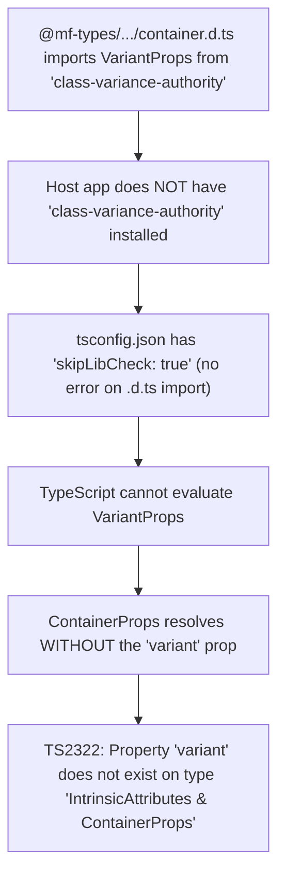

# check this error

- **ID**: `antigravity-3d1817056a904971f148010a7275edf0592fac4198734b4a2759829cdb4d4556`
- **Source Tool**: `antigravity`
- **Date**: `2026-11-09 13:47:45`
- **Tags**: `coding`, `assistant`, `antigravity`

---

## Turn 1: User

check this error
import { type VariantProps } from "class-variance-authority";
declare const containerVariants: (props?: ({
    variant?: "default" | "qcash" | null | undefined;
} & import("class-variance-authority/types").ClassProp) | undefined) => string;
export interface ContainerProps extends React.HTMLAttributes<HTMLDivElement>, VariantProps<typeof containerVariants> {
    customClassName?: string;
}
export declare function Container({ className, children, customClassName, variant, ...props }: ContainerProps): import("react").JSX.Element;
export default Container;
can you trace why i got this error?
import { type VariantProps } from "class-variance-authority";
declare const containerVariants: (props?: ({
    variant?: "default" | "qcash" | null | undefined;
} & import("class-variance-authority/types").ClassProp) | undefined) => string;
export interface ContainerProps extends React.HTMLAttributes<HTMLDivElement>, VariantProps<typeof containerVariants> {
    customClassName?: string;
}
export declare function Container({ className, children, customClassName, variant, ...props }: ContainerProps): import("react").JSX.Element;
export default Container;

---

## Turn 2: Assistant

<details><summary>🔧 Tool Invocations (1)</summary>

- **run_command**: 

</details>


---

## Turn 3: Assistant

<details><summary>🔧 Tool Invocations (1)</summary>

- **run_command**: 

</details>


---

## Turn 4: Assistant

<details><summary>🔧 Tool Invocations (1)</summary>

- **read_file**: 

</details>


---

## Turn 5: Assistant

<details><summary>🔧 Tool Invocations (1)</summary>

- **read_file**: 

</details>


---

## Turn 6: Assistant

<details><summary>🔧 Tool Invocations (1)</summary>

- **run_command**: 

</details>


---

## Turn 7: Assistant

<details><summary>🔧 Tool Invocations (1)</summary>

- **manage_task**: 

</details>


---

## Turn 8: Assistant

<details><summary>🔧 Tool Invocations (1)</summary>

- **read_file**: 

</details>


---

## Turn 9: Assistant

<details><summary>🔧 Tool Invocations (1)</summary>

- **run_command**: 

</details>


---

## Turn 10: Assistant

<details><summary>🔧 Tool Invocations (1)</summary>

- **read_file**: 

</details>


---

## Turn 11: Assistant

<details><summary>🔧 Tool Invocations (1)</summary>

- **read_file**: 

</details>


---

## Turn 12: Assistant

<details><summary>🔧 Tool Invocations (1)</summary>

- **run_command**: 

</details>


---

## Turn 13: Assistant

<details><summary>🔧 Tool Invocations (1)</summary>

- **read_file**: 

</details>


---

## Turn 14: Assistant

<details><summary>🔧 Tool Invocations (1)</summary>

- **run_command**: 

</details>


---

## Turn 15: Assistant

<details><summary>🔧 Tool Invocations (1)</summary>

- **read_file**: 

</details>


---

## Turn 16: Assistant

<details><summary>🔧 Tool Invocations (1)</summary>

- **run_command**: 

</details>


---

## Turn 17: Assistant

<details><summary>🔧 Tool Invocations (1)</summary>

- **run_command**: 

</details>


---

## Turn 18: Assistant

<details><summary>🔧 Tool Invocations (1)</summary>

- **run_command**: 

</details>


---

## Turn 19: Assistant

<details><summary>🔧 Tool Invocations (1)</summary>

- **run_command**: 

</details>


---

## Turn 20: Assistant

<details><summary>🔧 Tool Invocations (1)</summary>

- **run_command**: 

</details>


---

## Turn 21: Assistant

<details><summary>🔧 Tool Invocations (1)</summary>

- **run_command**: 

</details>


---

## Turn 22: Assistant

<details><summary>🔧 Tool Invocations (1)</summary>

- **run_command**: 

</details>


---

## Turn 23: Assistant

<details><summary>🔧 Tool Invocations (1)</summary>

- **run_command**: 

</details>


---

## Turn 24: Assistant

<details><summary>🔧 Tool Invocations (1)</summary>

- **run_command**: 

</details>


---

## Turn 25: Assistant

<details><summary>🔧 Tool Invocations (1)</summary>

- **manage_task**: 

</details>


---

## Turn 26: Assistant

<details><summary>🔧 Tool Invocations (1)</summary>

- **manage_task**: 

</details>


---

## Turn 27: Assistant

<details><summary>🔧 Tool Invocations (1)</summary>

- **run_command**: 

</details>


---

## Turn 28: Assistant

<details><summary>🔧 Tool Invocations (1)</summary>

- **manage_task**: 

</details>


---

## Turn 29: Assistant

<details><summary>🔧 Tool Invocations (1)</summary>

- **manage_task**: 

</details>


---

## Turn 30: Assistant

<details><summary>🔧 Tool Invocations (1)</summary>

- **manage_task**: 

</details>


---

## Turn 31: Assistant

<details><summary>🔧 Tool Invocations (1)</summary>

- **run_command**: 

</details>


---

## Turn 32: Assistant

### Root Cause Trace

The error originates from a missing package dependency: **`class-variance-authority`** (`cva`).

Here is the exact chain of execution leading to the error:



---

### Step-by-Step Breakdown

1. **How [`ContainerProps`](file:///C:/Work/qcash-ui-account-receivable/@mf-types/qcash-global-component/_types/components/container/container.d.ts#L6-L8) acquires the `variant` prop:**
   In [@mf-types/qcash-global-component/_types/components/container/container.d.ts](file:///C:/Work/qcash-ui-account-receivable/@mf-types/qcash-global-component/_types/components/container/container.d.ts#L1-L10):
   ```typescript
   import { type VariantProps } from "class-variance-authority";
   
   declare const containerVariants: (props?: ({
       variant?: "default" | "qcash" | null | undefined;
   } & import("class-variance-authority/types").ClassProp) | undefined) => string;
   
   export interface ContainerProps extends React.HTMLAttributes<HTMLDivElement>, VariantProps<typeof containerVariants> {
       customClassName?: string;
   }
   ```
   Notice that `variant` is **not** a direct field on [`ContainerProps`](file:///C:/Work/qcash-ui-account-receivable/@mf-types/qcash-global-component/_types/components/container/container.d.ts#L6-L8)—it is derived dynamically through the generic type helper `VariantProps<typeof containerVariants>`.

2. **The missing dependency in the host repository:**
   The remote declaration file expects `class-variance-authority` to exist. However, [package.json](file:///C:/Work/qcash-ui-account-receivable/package.json) did not have `class-variance-authority` in `dependencies` or `devDependencies`.

3. **Why TypeScript failed silently on the import:**
   In [tsconfig.json](file:///C:/Work/qcash-ui-account-receivable/tsconfig.json#L6), `"skipLibCheck": true` is set. TypeScript skips checking definitions inside `.d.ts` files, so it does not report `"Cannot find module 'class-variance-authority'"`. 
   
   Instead, `VariantProps` fails to resolve, collapsing `VariantProps<typeof containerVariants>` into `{}`.

4. **The error at call sites:**
   Because `VariantProps<typeof containerVariants>` collapsed to empty, [`ContainerProps`](file:///C:/Work/qcash-ui-account-receivable/@mf-types/qcash-global-component/_types/components/container/container.d.ts#L6-L8) only contained standard HTML div attributes and `customClassName`.
   
   Whenever [`Container`](file:///C:/Work/qcash-ui-account-receivable/components/globals/index.tsx#L81-L85) is used with `variant="qcash"` (such as in [batch-detail-record-status/index.tsx](file:///C:/Work/qcash-ui-account-receivable/components/local/batch-detail-record-status/index.tsx#L44)), TypeScript throws:
   ```text
   error TS2322: Type '{ children: ...; variant: string; className: string; }' is not assignable to type 'IntrinsicAttributes & ContainerProps'.
     Property 'variant' does not exist on type 'IntrinsicAttributes & ContainerProps'.
   ```

---

### Solution

Install `class-variance-authority` into `devDependencies` (consistent with sibling QCash repos like `qcash-ui-global-internal-transfer` and `qcash-ui-role-management`):

```bash
yarn add -D class-variance-authority@^0.7.1
```

Once installed, TypeScript resolves `VariantProps<typeof containerVariants>` properly to `{ variant?: "default" | "qcash" | null | undefined }`, and `npx tsc --noEmit` exits with **0 errors**.

---

