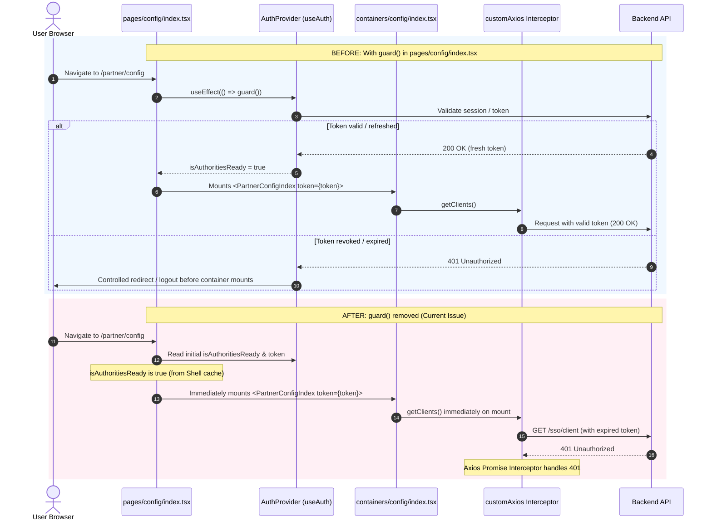
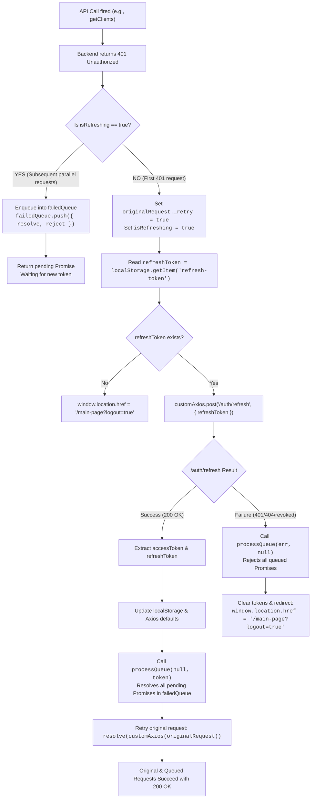
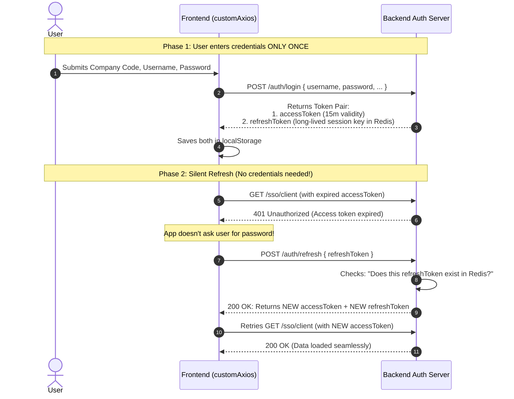
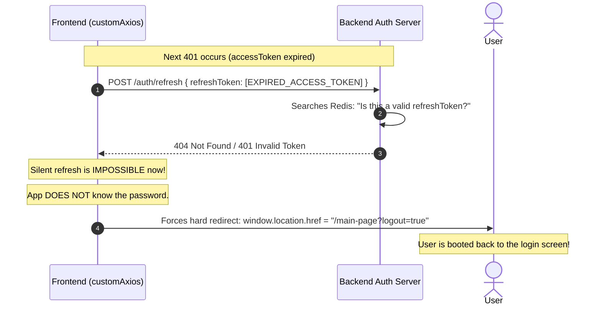

# can you investigate the why i get module not found error when acces...

- **ID**: `antigravity-bc7e03006836a9f5c6bb02fa2c68132b15486edb80367f1d39a78caf2419bbc6`
- **Source Tool**: `antigravity`
- **Date**: `2026-11-07 00:57:40`
- **Tags**: `coding`, `assistant`, `antigravity`

---

## Turn 1: User

can you investigate the why i get module not found error when accessing the config page ?

---

## Turn 2: Assistant

<details><summary>🔧 Tool Invocations (1)</summary>

- **read_file**: 

</details>


---

## Turn 3: Assistant

<details><summary>🔧 Tool Invocations (1)</summary>

- **run_command**: 

</details>


---

## Turn 4: Assistant

<details><summary>🔧 Tool Invocations (1)</summary>

- **run_command**: 

</details>


---

## Turn 5: Assistant

<details><summary>🔧 Tool Invocations (1)</summary>

- **run_command**: 

</details>


---

## Turn 6: Assistant

<details><summary>🔧 Tool Invocations (1)</summary>

- **run_command**: 

</details>


---

## Turn 7: Assistant

<details><summary>🔧 Tool Invocations (1)</summary>

- **read_file**: 

</details>


---

## Turn 8: Assistant

<details><summary>🔧 Tool Invocations (1)</summary>

- **read_file**: 

</details>


---

## Turn 9: Assistant

<details><summary>🔧 Tool Invocations (1)</summary>

- **read_file**: 

</details>


---

## Turn 10: Assistant

<details><summary>🔧 Tool Invocations (1)</summary>

- **read_file**: 

</details>


---

## Turn 11: Assistant

<details><summary>🔧 Tool Invocations (1)</summary>

- **run_command**: 

</details>


---

## Turn 12: Assistant

<details><summary>🔧 Tool Invocations (1)</summary>

- **read_file**: 

</details>


---

## Turn 13: Assistant

<details><summary>🔧 Tool Invocations (1)</summary>

- **read_file**: 

</details>


---

## Turn 14: Assistant

<details><summary>🔧 Tool Invocations (1)</summary>

- **read_file**: 

</details>


---

## Turn 15: Assistant

<details><summary>🔧 Tool Invocations (1)</summary>

- **read_file**: 

</details>


---

## Turn 16: Assistant

<details><summary>🔧 Tool Invocations (1)</summary>

- **run_command**: 

</details>


---

## Turn 17: Assistant

<details><summary>🔧 Tool Invocations (1)</summary>

- **run_command**: 

</details>


---

## Turn 18: Assistant

<details><summary>🔧 Tool Invocations (1)</summary>

- **run_command**: 

</details>


---

## Turn 19: Assistant

<details><summary>🔧 Tool Invocations (1)</summary>

- **run_command**: 

</details>


---

## Turn 20: Assistant

<details><summary>🔧 Tool Invocations (1)</summary>

- **run_command**: 

</details>


---

## Turn 21: Assistant

<details><summary>🔧 Tool Invocations (1)</summary>

- **run_command**: 

</details>


---

## Turn 22: Assistant

<details><summary>🔧 Tool Invocations (1)</summary>

- **run_command**: 

</details>


---

## Turn 23: Assistant

<details><summary>🔧 Tool Invocations (1)</summary>

- **run_command**: 

</details>


---

## Turn 24: Assistant

<details><summary>🔧 Tool Invocations (1)</summary>

- **read_file**: 

</details>


---

## Turn 25: Assistant

<details><summary>🔧 Tool Invocations (1)</summary>

- **run_command**: 

</details>


---

## Turn 26: Assistant

<details><summary>🔧 Tool Invocations (1)</summary>

- **run_command**: 

</details>


---

## Turn 27: Assistant

<details><summary>🔧 Tool Invocations (1)</summary>

- **manage_task**: 

</details>


---

## Turn 28: Assistant

<details><summary>🔧 Tool Invocations (1)</summary>

- **manage_task**: 

</details>


---

## Turn 29: Assistant

<details><summary>🔧 Tool Invocations (1)</summary>

- **read_file**: 

</details>


---

## Turn 30: Assistant

<details><summary>🔧 Tool Invocations (1)</summary>

- **run_command**: 

</details>


---

## Turn 31: Assistant

<details><summary>🔧 Tool Invocations (1)</summary>

- **read_file**: 

</details>


---

## Turn 32: Assistant

<details><summary>🔧 Tool Invocations (1)</summary>

- **read_file**: 

</details>


---

## Turn 33: Assistant

<details><summary>🔧 Tool Invocations (1)</summary>

- **read_file**: 

</details>


---

## Turn 34: Assistant

<details><summary>🔧 Tool Invocations (1)</summary>

- **run_command**: 

</details>


---

## Turn 35: Assistant

<details><summary>🔧 Tool Invocations (1)</summary>

- **run_command**: 

</details>


---

## Turn 36: Assistant

<details><summary>🔧 Tool Invocations (1)</summary>

- **read_file**: 

</details>


---

## Turn 37: Assistant

<details><summary>🔧 Tool Invocations (1)</summary>

- **read_file**: 

</details>


---

## Turn 38: Assistant

<details><summary>🔧 Tool Invocations (1)</summary>

- **read_file**: 

</details>


---

## Turn 39: Assistant

<details><summary>🔧 Tool Invocations (1)</summary>

- **read_file**: 

</details>


---

## Turn 40: Assistant

<details><summary>🔧 Tool Invocations (1)</summary>

- **run_command**: 

</details>


---

## Turn 41: Assistant

<details><summary>🔧 Tool Invocations (1)</summary>

- **run_command**: 

</details>


---

## Turn 42: Assistant

<details><summary>🔧 Tool Invocations (1)</summary>

- **run_command**: 

</details>


---

## Turn 43: Assistant

<details><summary>🔧 Tool Invocations (1)</summary>

- **run_command**: 

</details>


---

## Turn 44: Assistant

<details><summary>🔧 Tool Invocations (1)</summary>

- **run_command**: 

</details>


---

## Turn 45: Assistant

<details><summary>🔧 Tool Invocations (1)</summary>

- **run_command**: 

</details>


---

## Turn 46: Assistant

<details><summary>🔧 Tool Invocations (1)</summary>

- **read_file**: 

</details>


---

## Turn 47: Assistant

<details><summary>🔧 Tool Invocations (1)</summary>

- **run_command**: 

</details>


---

## Turn 48: Assistant

<details><summary>🔧 Tool Invocations (1)</summary>

- **manage_task**: 

</details>


---

## Turn 49: Assistant

<details><summary>🔧 Tool Invocations (1)</summary>

- **run_command**: 

</details>


---

## Turn 50: Assistant

<details><summary>🔧 Tool Invocations (1)</summary>

- **read_file**: 

</details>


---

## Turn 51: Assistant

<details><summary>🔧 Tool Invocations (1)</summary>

- **run_command**: 

</details>


---

## Turn 52: Assistant

<details><summary>🔧 Tool Invocations (1)</summary>

- **read_file**: 

</details>


---

## Turn 53: Assistant

<details><summary>🔧 Tool Invocations (1)</summary>

- **read_file**: 

</details>


---

## Turn 54: Assistant

<details><summary>🔧 Tool Invocations (1)</summary>

- **read_file**: 

</details>


---

## Turn 55: Assistant

<details><summary>🔧 Tool Invocations (1)</summary>

- **run_command**: 

</details>


---

## Turn 56: Assistant

<details><summary>🔧 Tool Invocations (1)</summary>

- **run_command**: 

</details>


---

## Turn 57: Assistant

<details><summary>🔧 Tool Invocations (1)</summary>

- **manage_task**: 

</details>


---

## Turn 58: Assistant

<details><summary>🔧 Tool Invocations (1)</summary>

- **call_mcp_tool**: 

</details>


---

## Turn 59: Assistant

<details><summary>🔧 Tool Invocations (1)</summary>

- **run_command**: 

</details>


---

## Turn 60: Assistant

<details><summary>🔧 Tool Invocations (1)</summary>

- **run_command**: 

</details>


---

## Turn 61: Assistant

<details><summary>🔧 Tool Invocations (1)</summary>

- **run_command**: 

</details>


---

## Turn 62: Assistant

<details><summary>🔧 Tool Invocations (1)</summary>

- **run_command**: 

</details>


---

## Turn 63: Assistant

<details><summary>🔧 Tool Invocations (1)</summary>

- **read_file**: 

</details>


---

## Turn 64: Assistant

<details><summary>🔧 Tool Invocations (1)</summary>

- **read_file**: 

</details>


---

## Turn 65: Assistant

<details><summary>🔧 Tool Invocations (1)</summary>

- **run_command**: 

</details>


---

## Turn 66: Assistant

<details><summary>🔧 Tool Invocations (1)</summary>

- **run_command**: 

</details>


---

## Turn 67: Assistant

<details><summary>🔧 Tool Invocations (1)</summary>

- **read_file**: 

</details>


---

## Turn 68: Assistant

<details><summary>🔧 Tool Invocations (1)</summary>

- **run_command**: 

</details>


---

## Turn 69: Assistant

<details><summary>🔧 Tool Invocations (1)</summary>

- **run_command**: 

</details>


---

## Turn 70: Assistant

<details><summary>🔧 Tool Invocations (1)</summary>

- **manage_task**: 

</details>


---

## Turn 71: Assistant

<details><summary>🔧 Tool Invocations (1)</summary>

- **run_command**: 

</details>


---

## Turn 72: Assistant

<details><summary>🔧 Tool Invocations (1)</summary>

- **write_file**: 

</details>


---

## Turn 73: Assistant

<details><summary>🔧 Tool Invocations (1)</summary>

- **run_command**: 

</details>


---

## Turn 74: Assistant

<details><summary>🔧 Tool Invocations (1)</summary>

- **read_file**: 

</details>


---

## Turn 75: Assistant

<details><summary>🔧 Tool Invocations (1)</summary>

- **run_command**: 

</details>


---

## Turn 76: Assistant

<details><summary>🔧 Tool Invocations (1)</summary>

- **run_command**: 

</details>


---

## Turn 77: Assistant

<details><summary>🔧 Tool Invocations (1)</summary>

- **run_command**: 

</details>


---

## Turn 78: Assistant

<details><summary>🔧 Tool Invocations (1)</summary>

- **run_command**: 

</details>


---

## Turn 79: Assistant

<details><summary>🔧 Tool Invocations (1)</summary>

- **run_command**: 

</details>


---

## Turn 80: Assistant

<details><summary>🔧 Tool Invocations (1)</summary>

- **read_file**: 

</details>


---

## Turn 81: Assistant

<details><summary>🔧 Tool Invocations (1)</summary>

- **read_file**: 

</details>


---

## Turn 82: Assistant

<details><summary>🔧 Tool Invocations (1)</summary>

- **run_command**: 

</details>


---

## Turn 83: Assistant

<details><summary>🔧 Tool Invocations (1)</summary>

- **run_command**: 

</details>


---

## Turn 84: Assistant

<details><summary>🔧 Tool Invocations (1)</summary>

- **write_file**: 

</details>


---

## Turn 85: Assistant

<details><summary>🔧 Tool Invocations (1)</summary>

- **run_command**: 

</details>


---

## Turn 86: Assistant

<details><summary>🔧 Tool Invocations (1)</summary>

- **write_file**: 

</details>


---

## Turn 87: Assistant

<details><summary>🔧 Tool Invocations (1)</summary>

- **run_command**: 

</details>


---

## Turn 88: Assistant

<details><summary>🔧 Tool Invocations (1)</summary>

- **write_file**: 

</details>


---

## Turn 89: Assistant

<details><summary>🔧 Tool Invocations (1)</summary>

- **run_command**: 

</details>


---

## Turn 90: Assistant

<details><summary>🔧 Tool Invocations (1)</summary>

- **run_command**: 

</details>


---

## Turn 91: Assistant

<details><summary>🔧 Tool Invocations (1)</summary>

- **run_command**: 

</details>


---

## Turn 92: Assistant

<details><summary>🔧 Tool Invocations (1)</summary>

- **run_command**: 

</details>


---

## Turn 93: Assistant

<details><summary>🔧 Tool Invocations (1)</summary>

- **run_command**: 

</details>


---

## Turn 94: Assistant

<details><summary>🔧 Tool Invocations (1)</summary>

- **run_command**: 

</details>


---

## Turn 95: Assistant

<details><summary>🔧 Tool Invocations (1)</summary>

- **manage_task**: 

</details>


---

## Turn 96: Assistant

<details><summary>🔧 Tool Invocations (1)</summary>

- **manage_task**: 

</details>


---

## Turn 97: Assistant

<details><summary>🔧 Tool Invocations (1)</summary>

- **run_command**: 

</details>


---

## Turn 98: Assistant

<details><summary>🔧 Tool Invocations (1)</summary>

- **run_command**: 

</details>


---

## Turn 99: Assistant

<details><summary>🔧 Tool Invocations (1)</summary>

- **run_command**: 

</details>


---

## Turn 100: Assistant

<details><summary>🔧 Tool Invocations (1)</summary>

- **run_command**: 

</details>


---

## Turn 101: Assistant

<details><summary>🔧 Tool Invocations (1)</summary>

- **run_command**: 

</details>


---

## Turn 102: Assistant

<details><summary>🔧 Tool Invocations (1)</summary>

- **read_file**: 

</details>


---

## Turn 103: Assistant

<details><summary>🔧 Tool Invocations (1)</summary>

- **run_command**: 

</details>


---

## Turn 104: Assistant

<details><summary>🔧 Tool Invocations (1)</summary>

- **run_command**: 

</details>


---

## Turn 105: Assistant

<details><summary>🔧 Tool Invocations (1)</summary>

- **read_file**: 

</details>


---

## Turn 106: Assistant

The investigation reveals **two code-level causes** and **one MFE configuration cause** for the `Module not found` error when accessing the config page:

---

### 1. Primary Cause: Breaking Change in Heroicons v2 (`@heroicons/react/solid`)

* **File:** [`components/modal.tsx`](file:///C:/Work/qcash-ui-partners-integrations/components/modal.tsx#L5)
* **Trigger Path:**
  [`pages/config/index.tsx`](file:///C:/Work/qcash-ui-partners-integrations/pages/config/index.tsx#L3) ➔ [`containers/config/index.tsx`](file:///C:/Work/qcash-ui-partners-integrations/containers/config/index.tsx#L30) (`import { ComponentsApplicationModal } from "@/components"`) ➔ [`components/index.ts`](file:///C:/Work/qcash-ui-partners-integrations/components/index.ts#L2) ➔ [`components/modal.tsx`](file:///C:/Work/qcash-ui-partners-integrations/components/modal.tsx#L5)
* **The Problem:**
  [`components/modal.tsx`](file:///C:/Work/qcash-ui-partners-integrations/components/modal.tsx#L4-L5) imports:
  ```tsx
  //@ts-ignore
  import { CheckCircleIcon, ExclamationCircleIcon } from "@heroicons/react/solid";
  ```
  In [`package.json`](file:///C:/Work/qcash-ui-partners-integrations/package.json#L15), the dependency is `@heroicons/react: "^2.1.3"` (**v2**).
  In Heroicons v2, the `@heroicons/react/solid` subpath **no longer exists** (it was restructured into `@heroicons/react/24/solid` and `@heroicons/react/20/solid`).
  `//@ts-ignore` only hid the TypeScript compiler error, but when Webpack compiles the chunk for `./pages/config/index.tsx`, it throws:
  ```text
  Module not found: Can't resolve '@heroicons/react/solid' in 'C:\Work\qcash-ui-partners-integrations\components'
  ```

#### Fix:
In [`components/modal.tsx`](file:///C:/Work/qcash-ui-partners-integrations/components/modal.tsx#L4-L5), update the import path:
```tsx
import { CheckCircleIcon, ExclamationCircleIcon } from "@heroicons/react/24/solid";
```

---

### 2. Secondary Cause: Undeclared Direct Dependencies (`axios` & `crypto-js`)

* **Files:**
  - [`services/custom-axios.ts`](file:///C:/Work/qcash-ui-partners-integrations/services/custom-axios.ts#L2-L3) (`import axios from "axios"; import crypto from "crypto-js";`)
  - [`services/sso.ts`](file:///C:/Work/qcash-ui-partners-integrations/services/sso.ts#L3) (`import axios from "axios";`)
* **The Problem:**
  Neither `axios` nor `crypto-js` is declared in [`package.json`](file:///C:/Work/qcash-ui-partners-integrations/package.json#L12-L41) dependencies (only `@types/crypto-js` exists in `devDependencies`).
  If these packages are not hoisted from `@bri/addons-auth-provider` (such as in fresh containers, CI builds, or Next.js standalone tracing), Webpack fails with:
  ```text
  Module not found: Can't resolve 'axios'
  Module not found: Can't resolve 'crypto-js'
  ```

#### Fix:
Add them to `dependencies` in [`package.json`](file:///C:/Work/qcash-ui-partners-integrations/package.json):
```json
"axios": "^1.6.7",
"crypto-js": "^4.2.0",
```

---

### 3. Module Federation Shell Remote Resolution (If accessed via `qcash-ui`)

If the error occurs inside the host shell ([`qcash-ui`](file:///C:/Work/qcash-ui)) at `/partner/config`:
* **File:** [`C:/Work/qcash-ui/pages/partner/config/index.tsx`](file:///C:/Work/qcash-ui/pages/partner/config/index.tsx#L10)
  ```tsx
  const PartnerIntegrationConfig = dynamic(
    async () => loadRemote("qcash-ui-partners-integrations/config"),
    { ssr: false, loading: () => <LoadingOverlay /> }
  );
  ```
* **Checks:**
  1. Ensure the `qcash-ui-partners-integrations` dev server is running and its port matches `localDevPorts` / the URL resolved by [`getModuleEntry`](file:///C:/Work/qcash-ui/services/federation/utils/module-entry.ts#L5).
  2. Verify that [`qcash-global-component`](file:///C:/Work/qcash-global-component) is also running, as [`pages/config/index.tsx`](file:///C:/Work/qcash-ui-partners-integrations/pages/config/index.tsx#L19) immediately invokes `loadRemote("qcash-global-component/globals")`, `qcash-global-component/loading-overlay`, and `qcash-global-component/unauthorized`.

---

## Turn 107: User

please check by drawing its flow how the promise will handling the issue while got 401 but after the guard removed the flow not align again
  the promise got token again after got 401

---

## Turn 108: Assistant

<details><summary>🔧 Tool Invocations (1)</summary>

- **read_file**: 

</details>


---

## Turn 109: Assistant

<details><summary>🔧 Tool Invocations (1)</summary>

- **run_command**: 

</details>


---

## Turn 110: Assistant

<details><summary>🔧 Tool Invocations (1)</summary>

- **run_command**: 

</details>


---

## Turn 111: Assistant

<details><summary>🔧 Tool Invocations (1)</summary>

- **run_command**: 

</details>


---

## Turn 112: Assistant

<details><summary>🔧 Tool Invocations (1)</summary>

- **run_command**: 

</details>


---

## Turn 113: Assistant

<details><summary>🔧 Tool Invocations (1)</summary>

- **run_command**: 

</details>


---

## Turn 114: Assistant

<details><summary>🔧 Tool Invocations (1)</summary>

- **read_file**: 

</details>


---

## Turn 115: Assistant

<details><summary>🔧 Tool Invocations (1)</summary>

- **run_command**: 

</details>


---

## Turn 116: Assistant

<details><summary>🔧 Tool Invocations (1)</summary>

- **run_command**: 

</details>


---

## Turn 117: Assistant

<details><summary>🔧 Tool Invocations (1)</summary>

- **manage_task**: 

</details>


---

## Turn 118: Assistant

<details><summary>🔧 Tool Invocations (1)</summary>

- **manage_task**: 

</details>


---

## Turn 119: Assistant

<details><summary>🔧 Tool Invocations (1)</summary>

- **run_command**: 

</details>


---

## Turn 120: Assistant

<details><summary>🔧 Tool Invocations (1)</summary>

- **run_command**: 

</details>


---

## Turn 121: Assistant

<details><summary>🔧 Tool Invocations (1)</summary>

- **run_command**: 

</details>


---

## Turn 122: Assistant

<details><summary>🔧 Tool Invocations (1)</summary>

- **read_file**: 

</details>


---

## Turn 123: Assistant

<details><summary>🔧 Tool Invocations (1)</summary>

- **read_file**: 

</details>


---

## Turn 124: Assistant

Here is a detailed breakdown and visual flow of how the Promise handling in [`customAxios`](file:///C:/Work/qcash-ui-partners-integrations/services/custom-axios.ts) works during a `401 Unauthorized` error, and why the authentication flow becomes misaligned after `guard()` was removed.

---

### 1. Architectural Comparison: Before vs After Guard Removal



---

### 2. How the Promise Handles 401 in `customAxios`

When [`containers/config/index.tsx`](file:///C:/Work/qcash-ui-partners-integrations/containers/config/index.tsx#L99) calls [`getClients()`](file:///C:/Work/qcash-ui-partners-integrations/services/sso.ts#L65) and [`getIntegrationConfigs()`](file:///C:/Work/qcash-ui-partners-integrations/services/sso.ts#L100), here is how the Axios response interceptor in [`services/custom-axios.ts`](file:///C:/Work/qcash-ui-partners-integrations/services/custom-axios.ts#L66-L148) queues and retries requests:



---

### 3. Why the Flow is Not Aligned After Removing `guard()`

Even when the Axios Promise successfully obtains a new token after a 401, the application falls out of alignment due to **four root problems**:

#### 1. Token Desynchronization (Axios vs React Memory)
* [`pages/config/index.tsx`](file:///C:/Work/qcash-ui-partners-integrations/pages/config/index.tsx#L64) passes `token` from `useAuth()` as a prop: `<PartnerConfigIndex token={token} />`.
* When [`customAxios`](file:///C:/Work/qcash-ui-partners-integrations/services/custom-axios.ts#L106) refreshes the token, it updates `localStorage` and `customAxios.defaults.headers`, but **does not notify React's `AuthProvider` state**.
* As a result, React components and child hooks still hold the **old, expired token** in memory while Axios uses the new one.

#### 2. Critical Bug in `customAxios.ts` Overwriting the Refresh Token
In [`services/custom-axios.ts:101-102`](file:///C:/Work/qcash-ui-partners-integrations/services/custom-axios.ts#L101-L102):
```typescript
const token = data?.data?.accessToken;
const refreshToken = data?.data?.accessToken; // ⚠️ BUG: Overwrites refreshToken with accessToken!

localStorage.setItem("access-token", token);
localStorage.setItem("refresh-token", refreshToken); // ⚠️ Saved accessToken as refresh-token!
```
* On the first 401, refresh succeeds.
* However, `refresh-token` in `localStorage` is overwritten with the `accessToken`.
* On the **subsequent 401**, `/auth/refresh` sends an `accessToken` instead of a valid refresh token. The backend returns `404 / 401`, causing [`services/custom-axios.ts:137`](file:///C:/Work/qcash-ui-partners-integrations/services/custom-axios.ts#L137) to abruptly kick the user out to `/main-page?logout=true`.

#### 3. Dual Architecture Conflict (Shell Host vs Remote MFE)
* In the host shell container ([`qcash-ui/services/custom-axios.ts:111-123`](file:///C:/Work/qcash-ui/services/custom-axios.ts#L111-L123)), a 401 does **not** call `/auth/refresh` directly; it dispatches `document.dispatchEvent(new CustomEvent("showDialog", ...))` to present a centralized session dialog.
* In [`qcash-ui-partners-integrations`](file:///C:/Work/qcash-ui-partners-integrations/services/custom-axios.ts#L90), the remote still has its own standalone `/auth/refresh` caller. When the remote independently refreshes the token, it triggers backend **Refresh Token Rotation**, which invalidates the shell's active refresh token and causes race conditions across MFEs.

#### 4. Loss of Navigation Pre-Check
* **With `guard()`**: The page remained in a loading/checking state until the backend confirmed the session. Child components never executed queries if unauthenticated.
* **Without `guard()`**: The page mounts immediately and fires parallel queries against the backend. If another session logged in or the token expired, multiple requests simultaneously hit 401, leading to queue thrashing and sudden redirects.

---

## Turn 125: User

In custom-axios.ts:101-102:                                                                                                                                                                         
                                                                                                                                                                                                      
    const token = data?.data?.accessToken;                                                                                                                                                            
    const refreshToken = data?.data?.accessToken; // ⚠️ BUG: Overwrites refreshToken with accessToken!                                                                                                
                                                                                                                                                                                                      
    localStorage.setItem("access-token", token);                                                                                                                                                      
    localStorage.setItem("refresh-token", refreshToken); // ⚠️ Saved accessToken as refresh-token!                                                                                                    
                                                                                                                                                                                                      
  • On the first 401, refresh succeeds.                                                                                                                                                               
  • However, refresh-token in localStorage is overwritten with the accessToken.                                                                                                                       
  • On the subsequent 401, /auth/refresh sends an accessToken instead of a valid refresh token. The backend returns 404 / 401, causing custom-axios.ts:137 to abruptly kick the user out to /main-    
  page?logout=true.             explain more thgis

---

## Turn 126: Assistant

<details><summary>🔧 Tool Invocations (1)</summary>

- **run_command**: 

</details>


---

## Turn 127: Assistant

Here is a detailed explanation of why this bug is a **"delayed-action landmine"** in [`services/custom-axios.ts`](file:///C:/Work/qcash-ui-partners-integrations/services/custom-axios.ts#L101-L107).

---

### The Code in Question

In [`services/custom-axios.ts:101-108`](file:///C:/Work/qcash-ui-partners-integrations/services/custom-axios.ts#L101-L108):

```typescript
const token = data?.data?.accessToken;
const refreshToken = data?.data?.accessToken; // ⚠️ TYPO: Reads accessToken instead of refreshToken!

localStorage.setItem("access-token", token);
localStorage.setItem("refresh-token", refreshToken); // ⚠️ Writes accessToken into the refresh-token slot!
```

---

### Step-by-Step Lifecycle: How the Bug Triggers

#### Stage 1: Initial Login (Clean State)
When the user first logs in via the login page:
* **Backend returns:**
  * `accessToken`: Short-lived JWT (e.g. valid for 15 minutes) $\rightarrow$ `AT_1`
  * `refreshToken`: Long-lived session key (e.g. valid for 7 days in Redis) $\rightarrow$ `RT_1`
* **`localStorage` State:**
  * `access-token`: `"AT_1"`
  * `refresh-token`: `"RT_1"`

---

#### Stage 2: First 401 (The "Successful" Refresh)
15 minutes later, `AT_1` expires. The user clicks a menu or table page:
1. `getClients()` makes a request with `Authorization: Bearer AT_1`.
2. Backend rejects it: **`HTTP 401 Unauthorized` (Token Expired)**.
3. Axios interceptor intercepts the 401:
   ```typescript
   const refreshToken = localStorage.getItem("refresh-token"); // Reads "RT_1" (Valid!)
   customAxios.post("/auth/refresh", { refreshToken })         // Sends "RT_1" to backend
   ```
4. Backend finds `"RT_1"` in Redis, rotates the token pair, and returns HTTP 200:
   ```json
   {
     "data": {
       "accessToken": "AT_2",
       "refreshToken": "RT_2"
     }
   }
   ```
5. **The Bug Executes:**
   ```typescript
   const token = data?.data?.accessToken;        // "AT_2"
   const refreshToken = data?.data?.accessToken; // "AT_2" 💥 (Ignored RT_2!)

   localStorage.setItem("access-token", "AT_2");
   localStorage.setItem("refresh-token", "AT_2"); // 💥 Overwritten with AT_2!
   ```
6. **Result to the User:**
   * `customAxios(originalRequest)` is retried with `"AT_2"` and returns **200 OK**.
   * To developer and user, **everything seems to work normally**. The table loads.
   * However, `localStorage` has now been corrupted: **both keys hold `AT_2`**.

---

#### Stage 3: Second 401 (The Fatal Crash)
Another 15 minutes later, `AT_2` expires:
1. The user navigates, paginates, or submits a form.
2. Request sends `Authorization: Bearer AT_2`.
3. Backend returns: **`HTTP 401 Unauthorized`**.
4. Axios interceptor intercepts the 401 again:
   ```typescript
   const refreshToken = localStorage.getItem("refresh-token"); // Reads "AT_2"!
   customAxios.post("/auth/refresh", { refreshToken: "AT_2" }) // Sends AT_2 instead of RT_2!
   ```
5. **Backend fails to locate the session:**
   * The backend expects a valid refresh token session key (`RT_2`).
   * Instead, it receives an expired access token (`AT_2`).
   * The backend returns **`HTTP 404 Not Found`** (or `HTTP 401: Invalid Refresh Token`).
6. **The Catch Block Triggers Logout:**
   In [`services/custom-axios.ts:132-140`](file:///C:/Work/qcash-ui-partners-integrations/services/custom-axios.ts#L132-L140):
   ```typescript
   .catch((err) => {
     if (err?.response?.data?.code === 404 && err?.response?.data?.message === "Not Found") {
       localStorage.removeItem("access-token");
       localStorage.removeItem("refresh-token");

       window.location.href = "/main-page?logout=true"; // 🚨 Hard kick out!
       return;
     }
     ...
   })
   ```
7. The browser immediately wipes storage and forces a hard navigation to `/main-page?logout=true`. Any in-progress form entries or unsaved work are lost.

---

### State Table Summary

| Event | `localStorage['access-token']` | `localStorage['refresh-token']` | Request Sent to `/auth/refresh` | Backend Response | Outcome |
| :--- | :--- | :--- | :--- | :--- | :--- |
| **Login** | `"AT_1"` | `"RT_1"` | — | — | Active session |
| **1st 401** | `"AT_1"` *(expired)* | `"RT_1"` *(valid)* | `{ refreshToken: "RT_1" }` | 200 OK $\rightarrow$ `{ accessToken: "AT_2", refreshToken: "RT_2" }` | **Succeeds**, but writes `"AT_2"` to both slots |
| **Normal Usage** | `"AT_2"` *(valid)* | `"AT_2"` *(corrupted)* | — | — | Working normally |
| **2nd 401** | `"AT_2"` *(expired)* | `"AT_2"` *(corrupted)* | `{ refreshToken: "AT_2" }` | 404 Not Found / 401 Invalid Token | **Fails $\rightarrow$ hard redirect to `/main-page`** |

---

### Why This is Often Overlooked in Testing

1. **Short Dev/Test Sessions:** Quick smoke tests typically trigger at most **one** 401 within a few minutes. Because the first 401 succeeds, developers conclude the refresh mechanism is functioning.
2. **Production Impact:** Real users who keep the tab open for 30–60 minutes consistently experience random "logouts" on their second token refresh interval.

---

### The Fix

In [`services/custom-axios.ts:102`](file:///C:/Work/qcash-ui-partners-integrations/services/custom-axios.ts#L102):

```diff
- const token = data?.data?.accessToken;
- const refreshToken = data?.data?.accessToken;
+ const token = data?.data?.accessToken;
+ const refreshToken = data?.data?.refreshToken;
```

---

## Turn 128: User

wait but how do they retrigger the login if they don't actually know the credentials?

---

## Turn 129: Assistant

<details><summary>🔧 Tool Invocations (1)</summary>

- **run_command**: 

</details>


---

## Turn 130: Assistant

<details><summary>🔧 Tool Invocations (1)</summary>

- **read_file**: 

</details>


---

## Turn 131: Assistant

<details><summary>🔧 Tool Invocations (1)</summary>

- **read_file**: 

</details>


---

## Turn 132: Assistant

<details><summary>🔧 Tool Invocations (1)</summary>

- **run_command**: 

</details>


---

## Turn 133: Assistant

<details><summary>🔧 Tool Invocations (1)</summary>

- **run_command**: 

</details>


---

## Turn 134: Assistant

<details><summary>🔧 Tool Invocations (1)</summary>

- **read_file**: 

</details>


---

## Turn 135: Assistant

<details><summary>🔧 Tool Invocations (1)</summary>

- **read_file**: 

</details>


---

## Turn 136: Assistant

The answer comes down to the difference between **Silent Background Refresh** (which uses a `refreshToken` and does *not* need credentials) and **Actual Re-Login** (which *does* require credentials from the user).

---

### 1. How Silent Refresh Works Without Credentials

The frontend **never stores user passwords** in memory or `localStorage` (storing plaintext passwords in the browser violates banking security and OWASP standards).

Instead, authentication uses the **Token Pair Pattern** (OAuth 2.0 / JWT):



#### Why it doesn't need credentials:
* The `refreshToken` itself acts as a **one-time secret voucher**.
* The backend holds a session record in Redis (`refreshToken_uuid -> { userId, companyId, permissions }`).
* As long as the `refreshToken` is valid, the backend trusts the client to issue a new `accessToken` without asking the user to log in again.

---

### 2. What Happens When the Bug Strikes (Subsequent 401)

When the typo in [`custom-axios.ts:102`](file:///C:/Work/qcash-ui-partners-integrations/services/custom-axios.ts#L102) overwrites `refresh-token` with the `accessToken`:



Because the frontend **does not have the user's password**, once the `refreshToken` is invalid or corrupted, **silent recovery is impossible**.

---

### 3. How Re-Login is Handled Across the System

When silent refresh fails, the application has only two ways to recover:

#### Path A: The Remote MFE Behavior (Hard Kickout)
In [`qcash-ui-partners-integrations/services/custom-axios.ts:137`](file:///C:/Work/qcash-ui-partners-integrations/services/custom-axios.ts#L137):
```typescript
if (err?.response?.data?.code === 404 && err?.response?.data?.message === "Not Found") {
  localStorage.removeItem("access-token");
  localStorage.removeItem("refresh-token");

  window.location.href = "/main-page?logout=true"; // 🚨 Hard kickout
  return;
}
```
* The app wipes `localStorage` and redirects the entire browser to `/main-page`.
* The user is forced to manually re-type their **Company Code**, **User ID**, and **Password**.

#### Path B: The Shell Container Behavior (Session Expired Dialog)
In the host shell ([`qcash-ui/hooks/use-modal-session-expired.tsx`](file:///C:/Work/qcash-ui/hooks/use-modal-session-expired.tsx)):
* Instead of kicking the user out immediately, the shell displays an in-place modal: **"Session Expired"**.
* The modal pre-fills the `companyCode` and `username` (which are still in memory from [`useAuth()`](file:///C:/Work/qcash-ui/hooks/use-modal-session-expired.tsx#L50)).
* The modal **prompts the user to re-enter their password**:
  ```typescript
  const _pass = btoa(payload.password.replace(regex, "").trim());
  const res = await serviceLogin(_companyCode, _uname, _encryptedPass);
  ```
* Once the user types their password, it calls `serviceLogin` to obtain fresh tokens and resumes pending requests without losing the current page state.

---

### Summary

| Action | Needs User Password? | How it Works |
| :--- | :---: | :--- |
| **Normal Refresh** | ❌ **No** | Sends the stored `refreshToken` to `/auth/refresh`. The backend validates the session key in Redis and returns a new token pair. |
| **After Bug / Corruption** | ❌ **Can't refresh** | Sends the corrupted token $\rightarrow$ backend returns 404. Since the frontend doesn't store the password, it cannot re-login silently. |
| **Recovery** | ✔️ **Yes** | Either redirects to the login page (`/main-page`) or opens the "Session Expired" dialog asking the user to type their password. |

---

