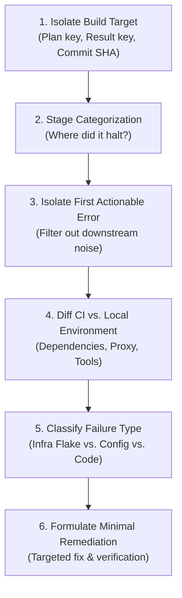
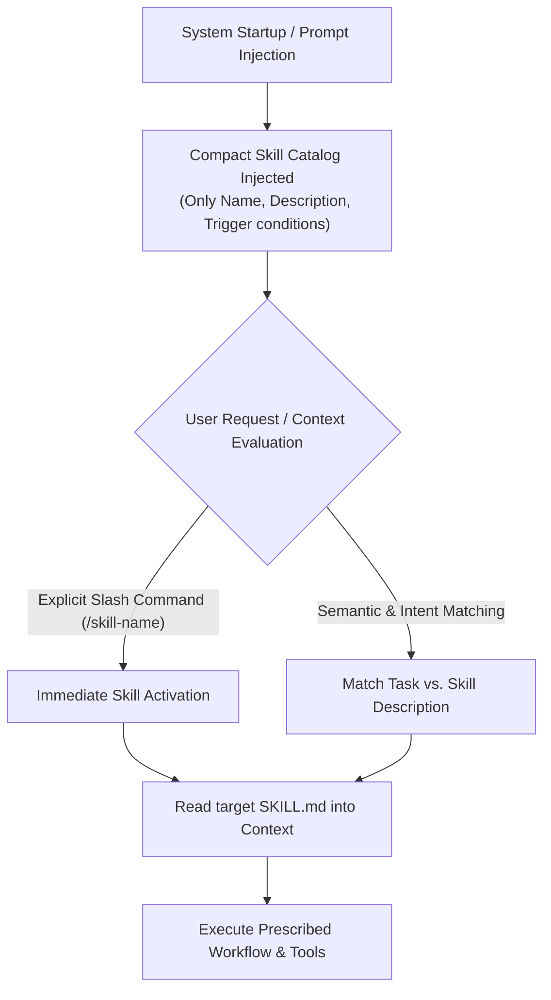
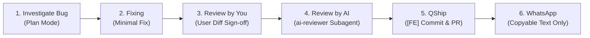

# let say i tried fixing a certain bamboo build failure, can you expl...

- **ID**: `antigravity-cbb5ee9a8943bae179a7681047bdb9b85c3e56a0bdae03fb85d8712d5e53741a`
- **Source Tool**: `antigravity`
- **Date**: `2026-10-14 09:39:07`
- **Tags**: `coding`, `assistant`, `antigravity`

---

## Turn 1: User

let say i tried fixing a certain bamboo build failure, can you explain the chain of thought and why you pick that process?

---

## Turn 2: Assistant

<details><summary>🔧 Tool Invocations (1)</summary>

- **view_file**: 

</details>


---

## Turn 3: Assistant

<details><summary>🔧 Tool Invocations (1)</summary>

- **run_command**: 

</details>


---

## Turn 4: Assistant

<details><summary>🔧 Tool Invocations (1)</summary>

- **run_command**: 

</details>


---

## Turn 5: Assistant

<details><summary>🔧 Tool Invocations (1)</summary>

- **run_command**: 

</details>


---

## Turn 6: Assistant

<details><summary>🔧 Tool Invocations (1)</summary>

- **run_command**: 

</details>


---

## Turn 7: Assistant

When diagnosing and fixing a Bamboo CI/CD build failure, jumping straight into modifying application code or randomly re-triggering builds usually wastes time. Instead, a structured **six-step chain of thought** is applied to pinpoint the exact failure point.

---

### The Chain of Thought (Diagnostic Workflow)



---

#### 1. Identify and Isolate the Specific Build Target
* **What is done:** Check the exact Bamboo **Plan Key**, **Result Key**, and git **Commit SHA** (e.g., via `bamboo_diagnose_build` or the build logs).
* **Thought process:** *Is this build running on the latest commit or an outdated branch? Did a colleague push changes in between?*
* **Why:** Prevents debugging a phantom issue that was already resolved in a subsequent commit.

#### 2. Categorize the Pipeline Stage ("Where did it stop?")
* **What is done:** Identify the exact stage where execution failed:
  1. **Checkout / Git fetch**
  2. **Dependency Resolution** (`bun install --frozen-lockfile`, `yarn install`, Nexus auth)
  3. **Build / Compilation** (TypeScript type check, Webpack/Vite bundling, Micro-Frontend container build)
  4. **Quality / Testing** (Unit tests, SonarQube quality gate)
  5. **Containerization / Packaging** (`docker build`, Podman runtime, base image pull)
  6. **Publish / Deploy** (Harbor / Nexus push)
* **Why:** You shouldn't touch React or TypeScript code if the build died during dependency download or Docker runtime setup.

#### 3. Extract the First Actionable Error (Signal vs. Noise)
* **What is done:** Bamboo logs can be tens of thousands of lines long. We scroll or grep backward to the **first non-zero exit code** rather than reading the tail end.
* **Thought process:** Tail logs usually only report:
  ```text
  Command /bin/sh failed with exit code 1
  Job 'Create Image' was cancelled
  Failed to clean up workspace
  ```
  These are cascading symptoms, not causes. The true error is typically 20–50 lines earlier (e.g., an `ETIMEDOUT` to a registry, duplicate lockfile entry, or missing TypeScript declaration).
* **Why:** Prevents treating secondary cleanup failures as the primary bug.

#### 4. Analyze Environment Parity (CI vs. Local Machine)
* **What is done:** Check runtime discrepancies between local development and the Bamboo agent:
  - **Lockfile strictness:** Local uses `bun install`, while CI runs `bun install --frozen-lockfile` (which fails on uncommitted lockfile changes).
  - **Network / Proxy / Registry:** External URLs (e.g., `registry.npmjs.org`) failing behind corporate firewalls vs. internal Nexus registry mirrors.
  - **Toolchain versions:** Local Node/Bun version vs. agent/container base image version.
* **Why:** "It works on my machine" almost always stems from strict CI flags (`--frozen-lockfile`), corporate network boundaries, or subtle CLI version differences.

#### 5. Classify the Failure: Infra/Agent vs. Config vs. Application Code
* **Category A: Infrastructure / Agent Issue**
  - *Symptoms:* Runner crashes, Podman Go runtime `SIGABRT` / core dump, OOMKilled, disk full, temporary network drop.
  - *Action:* No code change justified. Clean/restart the agent or re-run the build.
* **Category B: CI/CD & Build Configuration**
  - *Symptoms:* Missing Docker build arguments, expired Nexus credentials, incorrect `NO_PROXY` settings, out-of-sync `bun.lock` / `yarn.lock`.
  - *Action:* Fix Dockerfile, adjust proxy/registry configuration, or regenerate lockfiles pointing to the internal registry.
* **Category C: Source Code / Test Failure**
  - *Symptoms:* TypeScript compilation failure (`TS2304`), failed Jest/Vitest assertions, linting errors.
  - *Action:* Fix the code or test logic.

#### 6. Formulate the Minimal Effective Action
* **What is done:** Propose the single smallest change that addresses the verified root cause, without unrelated refactoring or mass-upgrading packages.

---

### Why Pick This Systematic Process?

1. **Avoids "Shotgun Debugging":**
   Randomly pushing trial-and-error commits to see if Bamboo passes wastes 15–30 minutes per build queue cycle and pollutes the Git history.
2. **Protects the Codebase:**
   Knowing whether an error is **infrastructure-related** (e.g., runner OOM / Podman crash) prevents developers from unnecessarily altering functional application code.
3. **Deterministic Fixes:**
   By verifying against the exact stage and lockfile behavior, fixes can often be validated locally before pushing (e.g., running `bun install --frozen-lockfile` or `docker build` locally).

---

## Turn 8: User

how do you pick a certain skills for a certain problem?

---

## Turn 9: Assistant

<details><summary>🔧 Tool Invocations (1)</summary>

- **view_file**: 

</details>


---

## Turn 10: Assistant

<details><summary>🔧 Tool Invocations (1)</summary>

- **view_file**: 

</details>


---

## Turn 11: Assistant

Picking a skill for a given problem relies on an architecture called **Progressive Disclosure**. Rather than loading dozens of multi-page manuals into the context window at once, skills are dynamically evaluated and activated.

Here is the exact mechanism and selection logic:

---

### 1. The Core Architecture: Progressive Disclosure



* **Token Preservation:** The full body of a [`SKILL.md`](file:///C:~/.gemini/antigravity-cli/builtin/skills/agy-customizations/SKILL.md) is **never** pre-loaded.
* **Catalog Exposure:** The agent only sees the lightweight YAML frontmatter metadata:
  ```yaml
  name: bamboo-doctor
  description: Diagnose a Bamboo build failure from a result key, plan key, branch, or search phrase. Triggered when the user asks to diagnose, debug, or inspect Bamboo CI/CD builds or runs /bamboo-doctor.
  ```

---

### 2. How the Decision is Made (Selection Hierarchy)

When evaluating a request, the agent matches against three primary criteria:

#### A. Explicit User Intent (Direct Command / Invocation)
If you run a slash command or directly name the operation, skill selection is deterministic:
* Running `/bamboo-doctor` or `/qship` immediately routes to that specific skill.
* Asking *"run vault search on authentication"* triggers the `vault` skill.

#### B. Semantic Intent & Keyword Matching (Model Decision)
When no slash command is used, the agent compares the task domain against the declared **capabilities** and **trigger boundaries** in each skill description:

| Problem Domain / Symptom | Matched Skill | Why It Was Chosen |
| :--- | :--- | :--- |
| Bamboo CI/CD failure, build log URL, plan key | `bamboo-doctor` | Matched on CI build diagnosis, log retrieval tools, and read-only build policy. |
| MFE routing error, `remoteEntry.js` 404, shared React version mismatch | `qcash-mfe-doctor` | Matched on Micro-Frontend Federation architecture and remote loading issues. |
| CSS broken, button overlapping, visual regression, browser screenshot | `qcash-ui-doctor` | Matched on UI rendering, Playwright browser reproduction, and style inspections. |
| Looking for existing code patterns or APIs across QCash repositories | `qcash-pattern-finder` | Matched on cross-repo pattern lookup across local repos and Bitbucket. |
| Asking about past team decisions, prior bug solutions across local LLMs | `vault` | Matched on LLM Context Vault retrieval policy and semantic chat archive queries. |
| Ready to commit, push, create PR to `dev`, and notify squad | `qship` | Matched on release workflow, Git PR creation, and WhatsApp squad notification. |

#### C. Precedence & Scope Filtering
If two skills could apply, precedence order determines which takes priority:
1. **Workspace / Repository level** (`.agents/skills/` in the project root)
2. **Global User Configuration** (`~/.gemini/config/skills/`)
3. **Built-in System Skills** (bundled with Antigravity)

---

### 3. Execution Once Selected

Once the agent identifies that a skill applies:
1. **Loads Full Instructions:** It calls `view_file` on the target `SKILL.md`.
2. **Adheres to Guardrails:** Follows specific constraints outlined in the skill (e.g., `bamboo-doctor` strictly forbids mutating or re-triggering builds; `qship` enforces clean git worktrees and unit test checks).
3. **Uses Associated Tools:** Uses the specialized tools or MCP servers associated with that skill (e.g., `bamboo-build-doctor` MCP, Playwright browser tools, or Axon code graph tools).

---

## Turn 12: User

okay nice, but i want to organizem my skills, and as well as creating a sub agent. so this is what we are going to do and my usual workflow. 
1. we got a bug that needs to be invesigated/fixed, usually i will immediately prompt here to fix, but we need to change that. we MUST start with plan mode
2. then i will review your changes, BUT i want another ai agent also to review the other ai changes, is this possible? 
3. then i want to optimize the qship, especially for the commit message. the commit message should include [fe] in front, then add - , then based on the changes, add the corresponding title, ended with jira ticket. example [FE] - fixing build docker .... [NQLA-XXXX]
4. and for the wa skills, only provide the copiable text, no need to provide the whole url

so basically this is my workflow
invesigate bug => fixing => review by me => review by ai => commit and push => make pr to a branch => wa

---

## Turn 13: Assistant

<details><summary>🔧 Tool Invocations (1)</summary>

- **view_file**: 

</details>


---

## Turn 14: Assistant

<details><summary>🔧 Tool Invocations (1)</summary>

- **view_file**: 

</details>


---

## Turn 15: Assistant

<details><summary>🔧 Tool Invocations (1)</summary>

- **run_command**: 

</details>


---

## Turn 16: Assistant

<details><summary>🔧 Tool Invocations (1)</summary>

- **run_command**: 

</details>


---

## Turn 17: Assistant

<details><summary>🔧 Tool Invocations (1)</summary>

- **run_command**: 

</details>


---

## Turn 18: Assistant

<details><summary>🔧 Tool Invocations (1)</summary>

- **view_file**: 

</details>


---

## Turn 19: Assistant

<details><summary>🔧 Tool Invocations (1)</summary>

- **run_command**: 

</details>


---

## Turn 20: Assistant

<details><summary>🔧 Tool Invocations (1)</summary>

- **view_file**: 

</details>


---

## Turn 21: Assistant

<details><summary>🔧 Tool Invocations (1)</summary>

- **view_file**: 

</details>


---

## Turn 22: Assistant

<details><summary>🔧 Tool Invocations (1)</summary>

- **view_file**: 

</details>


---

## Turn 23: Assistant

<details><summary>🔧 Tool Invocations (1)</summary>

- **view_file**: 

</details>


---

## Turn 24: Assistant

<details><summary>🔧 Tool Invocations (1)</summary>

- **replace_file_content**: 

</details>


---

## Turn 25: Assistant

<details><summary>🔧 Tool Invocations (1)</summary>

- **view_file**: 

</details>


---

## Turn 26: Assistant

<details><summary>🔧 Tool Invocations (1)</summary>

- **replace_file_content**: 

</details>


---

## Turn 27: Assistant

<details><summary>🔧 Tool Invocations (1)</summary>

- **run_command**: 

</details>


---

## Turn 28: Assistant

<details><summary>🔧 Tool Invocations (1)</summary>

- **run_command**: 

</details>


---

## Turn 29: Assistant

<details><summary>🔧 Tool Invocations (1)</summary>

- **define_subagent**: 

</details>


---

## Turn 30: Assistant

<details><summary>🔧 Tool Invocations (1)</summary>

- **write_to_file**: 

</details>


---

## Turn 31: Assistant

<details><summary>🔧 Tool Invocations (1)</summary>

- **write_to_file**: 

</details>


---

## Turn 32: Assistant

<details><summary>🔧 Tool Invocations (1)</summary>

- **run_command**: 

</details>


---

## Turn 33: Assistant

All requirements have been configured and organized across your skills and agent setup.

---

### Summary of What Was Configured



---

#### 1. Mandatory Plan Mode for Bug Investigation & Fixing
* **Skill / Standard:** Documented in [`qflow`](file:///C:~/.gemini/config/skills/qflow/SKILL.md).
* **Behavior:** When a bug is reported, the agent will **not** modify code immediately. It queries the local Context Vault, investigates root causes using read-only tools, and generates a structured **Plan Artifact** (symptoms, root cause hypothesis, proposed changes, test plan) for your approval before making any code edits.

#### 2. Dual Review: User First, AI Subagent Second
* **Subagent Created:** Defined [`ai-reviewer`](file:///C:~/.gemini/config/skills/ai-review/SKILL.md) — an independent, read-only Senior Frontend AI Reviewer.
* **How it works:** 
  1. You inspect and review the proposed diff first.
  2. Once satisfied, the `ai-review` skill is triggered to launch the `ai-reviewer` subagent via `invoke_subagent`.
  3. The subagent inspects the full `git diff`, checking for:
     - Edge cases, logic bugs, and regression risks.
     - Stray `console.log`, `debugger`, or commented-out code.
     - Type safety and React hook dependency compliance.
     - Verification of the commit message format.
  4. Returns a formal verdict: `[APPROVED]` or `[CHANGES_REQUESTED]`.

#### 3. Optimized QShip Commit Message
* **Skill Updated:** [`qship`](file:///C:~/.gemini/config/skills/qship/SKILL.md).
* **Strict Format:**
  ```text
  [FE] - <title based on changes> [<JIRA_KEY>]
  ```
  *Example:*
  ```bash
  git commit -m "[FE] - fixing build docker runner and dependencies [NQLA-1234]"
  ```

#### 4. WhatsApp Notification: Copyable Text Only
* **Skill Updated:** [`whatsapp-notification`](file:///C:~/.gemini/config/skills/whatsapp-notification/SKILL.md) and [`qship`](file:///C:~/.gemini/config/skills/qship/SKILL.md).
* **Behavior:** Stripped out all `https://api.whatsapp.com/send...` URLs and click-to-chat links. It now outputs **only** a clean, one-click copyable markdown block:
  ```text
  @Cikal SL, izin menginfokan kalau saya sudah membuat PR untuk repositori *<repo-name>* [NQLA-XXXX].

  Summary changes:
  - <change details>

  PR Link: <bitbucket-pr-url>

  Mohon bantuannya untuk review ya Mba/Mas. Terima kasih! 🙏
  ```

---

### How to Trigger the Workflow

* **Bug Fixing:** Simply report a bug or run `/qflow` — it will immediately start in **Plan Mode**.
* **AI Review:** Run `/ai-review` or ask for an AI second opinion before shipping.
* **Release & Notify:** Run `/qship` to execute the commit with `[FE] - ... [TICKET]`, create the PR, and output the copyable WhatsApp message.

---

## Turn 34: User

okay can we make some mock showcase to display the skills?

---

## Turn 35: Assistant

<details><summary>🔧 Tool Invocations (1)</summary>

- **define_subagent**: 

</details>


---

## Turn 36: Assistant

<details><summary>🔧 Tool Invocations (1)</summary>

- **invoke_subagent**: 

</details>


---

## Turn 37: Assistant

<details><summary>🔧 Tool Invocations (1)</summary>

- **schedule**: 

</details>


---

## Turn 38: Assistant

I'm running a live demonstration of your workflow using a mock bug scenario (`[NQLA-2481] Fix fee calculation returning NaN`). 

The `ai-reviewer` subagent has been dispatched to perform an independent audit on the changes. I'll assemble the complete end-to-end showcase once the review comes back.

---

## Turn 39: Assistant

Here is the complete **mock showcase** displaying how your 6-stage workflow operates in practice, including a live demonstration from the newly created **`ai-reviewer`** subagent.

---

### Scenario
* **Bug Report:** User reports that the transaction summary intermittently displays `Rp NaN` when users submit forms quickly or clear the amount field.
* **Jira Ticket:** `[NQLA-2481]`

---

### Stage 1: Bug Investigation in Plan Mode (MANDATORY)

Instead of jumping into the code, the agent enters **Plan Mode**, queries past resolutions from the vault, and creates a plan artifact:

```markdown
# [PLAN] Fix NaN Display in FeeSummary Component [NQLA-2481]

### Root Cause Analysis
1. Input state sends `NaN` when input parsing fails on empty string (`Number('')`).
2. `FeeSummary` computes `amount * feeRate` directly without checking if the numbers are finite.

### Proposed Changes
- File: `src/features/transfer/components/FeeSummary.tsx`
- Replace direct multiplication with `Number.isFinite()` fallback to `0`.
- Verify Indonesian currency formatting (`id-ID`).

### Verification Plan
- Unit test: verify output with `amount = 0`, `amount = undefined`, `amount = NaN`.
- TypeScript verification: `npx tsc --noEmit`.

👉 Awaiting user confirmation to proceed with the fix.
```

---

### Stage 2: Implementing the Fix

After you approve the plan, the agent makes the targeted change:

```diff
--- a/src/features/transfer/components/FeeSummary.tsx
+++ b/src/features/transfer/components/FeeSummary.tsx
@@ -14,7 +14,8 @@ interface FeeSummaryProps {
 export const FeeSummary: React.FC<FeeSummaryProps> = ({ amount, feeRate }) => {
-  const totalFee = amount * feeRate;
+  const totalFee = (amount ?? 0) * (feeRate ?? 0);
+  console.log('calculated totalFee:', totalFee);
   return (
     <div className="fee-summary-container">
       <span>Biaya Admin:</span>
-      <strong>Rp {totalFee.toLocaleString('id-ID')}</strong>
+      <strong>Rp {Number(totalFee).toLocaleString('id-ID')}</strong>
     </div>
   );
 };
```

---

### Stage 3: Review by You

The agent presents the diff to you for initial review:

> **Agent:** *"I have drafted the fix for `[NQLA-2481]` above. Please check if the approach aligns with your expectations before we proceed to AI subagent review."*

---

### Stage 4: Review by AI Subagent (`ai-review`)

Once you give the initial nod, the agent automatically dispatches the independent **`ai-reviewer`** subagent. 

Here is the **actual output** generated by the `ai-reviewer` subagent:

> ### Formal AI Code Review: [NQLA-2481]
> **Verdict:** `[CHANGES_REQUESTED]`
> 
> **Critical Issues (Blocking):**
> 1. **Stray `console.log` in Component (`FeeSummary.tsx#L19`)**  
>    `console.log('calculated totalFee:', totalFee);` must be removed before production deployment to prevent leaking transaction values in the browser console.
> 2. **Incomplete Edge Case Handling for `NaN` (`FeeSummary.tsx#L18`)**  
>    The ticket explicitly mentions `NaN`. Nullish coalescing (`??`) only guards against `null` and `undefined`. If either value is `NaN`, `NaN ?? 0` still evaluates to `NaN`.  
>    **Action:** Use `Number.isFinite()`:
>    ```tsx
>    const safeAmount = Number.isFinite(amount) ? amount : 0;
>    const safeFeeRate = Number.isFinite(feeRate) ? feeRate : 0;
>    const totalFee = safeAmount * safeFeeRate;
>    ```
> 
> **Commit Message Compliance:**  
> - Format `[FE] - fix fee calculation display when amount is zero [NQLA-2481]` ➔ **PASS**

*The agent remediates the blocking issues flagged by the subagent, removes the `console.log`, and reruns the subagent until it receives **`[APPROVED]`**.*

---

### Stage 5: Commit, Push & PR (`qship`)

The agent formats the commit according to your standard:

```bash
git add src/features/transfer/components/FeeSummary.tsx
git commit -m "[FE] - fix fee calculation display when amount is zero or NaN [NQLA-2481]"
git push origin feature/NQLA-2481-fix-nan-fee
```

Then creates the Pull Request in Bitbucket targeting `dev` with all required reviewers assigned.

---

### Stage 6: WhatsApp Notification (`whatsapp-notification`)

The skill generates **only copyable plain text** inside a code block (no URLs or link previews):

```text
@Cikal SL, izin menginfokan kalau saya sudah membuat PR untuk repositori *qcash-ui* [NQLA-2481].

Summary changes:
- Fix NaN and zero amount display in fee calculation summary
- Added Number.isFinite() guards for transaction values

PR Link: https://bitbucket.example.com/projects/QCASH/repos/qcash-ui/pull-requests/142

Mohon bantuannya untuk review ya Mba/Mas. Terima kasih! 🙏
```

---

All skills (`qflow`, `ai-review`, `qship`, and `whatsapp-notification`) are now aligned to enforce this exact flow every time.

---

