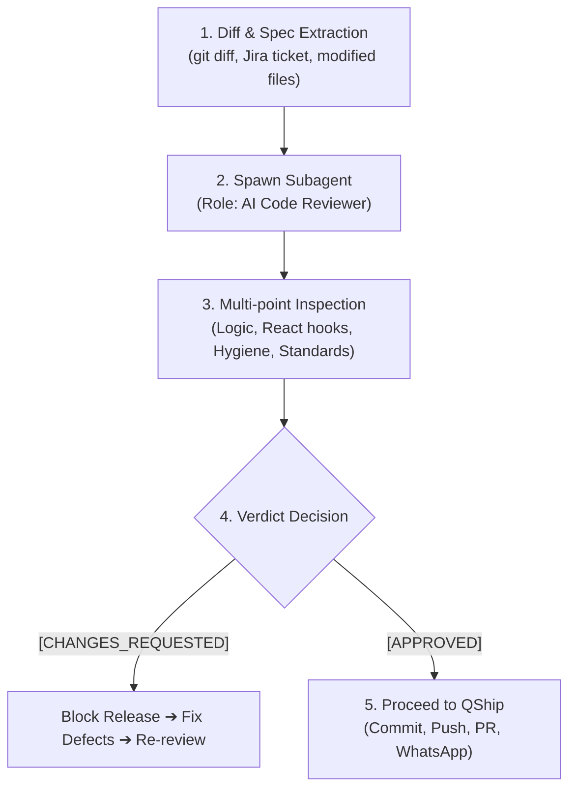

# scan the whole qcash ui repo, and list me the repo that has redirec...

- **ID**: `antigravity-c1a22c0afcff3d676e78752032231845dfed44fb7560077f185e437f026e80bd`
- **Source Tool**: `antigravity`
- **Date**: `2026-10-14 16:18:44`
- **Tags**: `coding`, `assistant`, `antigravity`

---

## Turn 1: User

scan the whole qcash ui repo, and list me the repo that has redirection to /main-page

---

## Turn 2: Assistant

<details><summary>🔧 Tool Invocations (1)</summary>

- **view_file**: 

</details>


---

## Turn 3: Assistant

<details><summary>🔧 Tool Invocations (1)</summary>

- **run_command**: 

</details>


---

## Turn 4: Assistant

<details><summary>🔧 Tool Invocations (1)</summary>

- **manage_task**: 

</details>


---

## Turn 5: Assistant

<details><summary>🔧 Tool Invocations (1)</summary>

- **run_command**: 

</details>


---

## Turn 6: Assistant

<details><summary>🔧 Tool Invocations (1)</summary>

- **run_command**: 

</details>


---

## Turn 7: Assistant

<details><summary>🔧 Tool Invocations (1)</summary>

- **run_command**: 

</details>


---

## Turn 8: Assistant

<details><summary>🔧 Tool Invocations (1)</summary>

- **run_command**: 

</details>


---

## Turn 9: Assistant

<details><summary>🔧 Tool Invocations (1)</summary>

- **run_command**: 

</details>


---

## Turn 10: Assistant

<details><summary>🔧 Tool Invocations (1)</summary>

- **run_command**: 

</details>


---

## Turn 11: Assistant

<details><summary>🔧 Tool Invocations (1)</summary>

- **manage_task**: 

</details>


---

## Turn 12: Assistant

<details><summary>🔧 Tool Invocations (1)</summary>

- **schedule**: 

</details>


---

## Turn 13: Assistant

Scanning the QCash UI repositories across `D:\work` for any redirections or navigation targeting `/main-page`... I will compile the full list once the scan finishes.

---

## Turn 14: Assistant

<details><summary>🔧 Tool Invocations (1)</summary>

- **manage_task**: 

</details>


---

## Turn 15: Assistant

Still scanning across all 70+ QCash UI repositories... Gathering and categorizing all occurrences.

---

## Turn 16: User

continue

---

## Turn 17: Assistant

<details><summary>🔧 Tool Invocations (1)</summary>

- **view_file**: 

</details>


---

## Turn 18: Assistant

<details><summary>🔧 Tool Invocations (1)</summary>

- **run_command**: 

</details>


---

## Turn 19: Assistant

<details><summary>🔧 Tool Invocations (1)</summary>

- **manage_task**: 

</details>


---

## Turn 20: Assistant

<details><summary>🔧 Tool Invocations (1)</summary>

- **manage_task**: 

</details>


---

## Turn 21: Assistant

Scanning the remaining repositories from `qcash-ui-registration-giro` through `qcash-ui-workflow`...

---

## Turn 22: Assistant

<details><summary>🔧 Tool Invocations (1)</summary>

- **view_file**: 

</details>


---

## Turn 23: Assistant

<details><summary>🔧 Tool Invocations (1)</summary>

- **view_file**: 

</details>


---

## Turn 24: Assistant

<details><summary>🔧 Tool Invocations (1)</summary>

- **view_file**: 

</details>


---

## Turn 25: Assistant

<details><summary>🔧 Tool Invocations (1)</summary>

- **view_file**: 

</details>


---

## Turn 26: Assistant

<details><summary>🔧 Tool Invocations (1)</summary>

- **view_file**: 

</details>


---

## Turn 27: Assistant

<details><summary>🔧 Tool Invocations (1)</summary>

- **view_file**: 

</details>


---

## Turn 28: Assistant

<details><summary>🔧 Tool Invocations (1)</summary>

- **view_file**: 

</details>


---

## Turn 29: Assistant

A scan across the QCash repositories in `D:/work` identified redirections to `/main-page` (and `/main-page?logout=true`) divided into two key categories:

---

### 1. Core Shell, Navigation & Authentication Repositories
These repositories control user navigation, root redirects, header logout actions, and password workflows:

* **[qcash-ui](file:///D:/work/qcash-ui)** (Host Container):
  * [`pages/main-page/index.tsx#L37`](file:///D:/work/qcash-ui/pages/main-page/index.tsx#L37): `router.replace("/main-page")` fallback when `toggleRedirectLandingPage` is falsy.
  * [`services/custom-axios.ts#L87`](file:///D:/work/qcash-ui/services/custom-axios.ts#L87): `window.location.replace("/main-page")` on 401 when on dashboard or root.
  * [`services/custom-axios.ts#L128`](file:///D:/work/qcash-ui/services/custom-axios.ts#L128): `window.location.href = "/main-page?logout=true"` on `"Another Login Detected"`.

* **[qcash-ui-header-footer](file:///D:/work/qcash-ui-header-footer)**:
  * [`layouts/default/container/header/components/ListItem.tsx#L76-L77`](file:///D:/work/qcash-ui-header-footer/layouts/default/container/header/components/ListItem.tsx#L76-L77):
    `destination = newQlola === "true" ? "/landing-page" : "/main-page"` (invokes `logout("/main-page")` if `new-qlola-flag` is not `"true"`).
  * [`services/custom-axios.ts#L41`](file:///D:/work/qcash-ui-header-footer/services/custom-axios.ts#L41) & [`L88`](file:///D:/work/qcash-ui-header-footer/services/custom-axios.ts#L88): Interceptor fallback destination and hardcoded `globalThis.location.href = "/main-page?logout=true"`.

* **[qcash-ui-header-footer-bri](file:///D:/work/qcash-ui-header-footer-bri)**:
  * [`layouts/default/container/header/components/ListItem.tsx#L231`](file:///D:/work/qcash-ui-header-footer-bri/layouts/default/container/header/components/ListItem.tsx#L231): `_logout("/main-page")`.
  * [`services/custom-axios.ts#L57`](file:///D:/work/qcash-ui-header-footer-bri/services/custom-axios.ts#L57) & [`L116`](file:///D:/work/qcash-ui-header-footer-bri/services/custom-axios.ts#L116): 401 and `"Another Login Detected"` redirect.

* **[qcash-ui-main-page](file:///D:/work/qcash-ui-main-page)**:
  * [`containers/change-password.tsx#L57`](file:///D:/work/qcash-ui-main-page/containers/change-password.tsx#L57), [`L64`](file:///D:/work/qcash-ui-main-page/containers/change-password.tsx#L64), [`L200`](file:///D:/work/qcash-ui-main-page/containers/change-password.tsx#L200): Redirects back to `/main-page` after changing password or cancelling.
  * [`containers/main-page.tsx#L175`](file:///D:/work/qcash-ui-main-page/containers/main-page.tsx#L175): `router.push({ pathname: "/main-page/change-password", ... })`.

* **[qcash-global-component](file:///D:/work/qcash-global-component)**:
  * [`components/layouts/header/components/ListItem.tsx#L104`](file:///D:/work/qcash-global-component/components/layouts/header/components/ListItem.tsx#L104): `onClick={() => logout("/main-page")}`.

* **[addons-web-client](file:///D:/work/addons-web-client)**:
  * [`apps/web-client/pages/index.tsx#L32`](file:///D:/work/addons-web-client/apps/web-client/pages/index.tsx#L32): Unauthenticated root redirect `{ destination: "/main-page", permanent: false }`.
  * [`libs/hooks/src/auth.tsx#L352`](file:///D:/work/addons-web-client/libs/hooks/src/auth.tsx#L352), [`L524`](file:///D:/work/addons-web-client/libs/hooks/src/auth.tsx#L524), [`L626`](file:///D:/work/addons-web-client/libs/hooks/src/auth.tsx#L626): Auth state routing and logout default path.
  * [`libs/main-page/src/lib/container/change-password.tsx#L91`](file:///D:/work/addons-web-client/libs/main-page/src/lib/container/change-password.tsx#L91), [`L236`](file:///D:/work/addons-web-client/libs/main-page/src/lib/container/change-password.tsx#L236): Change password completion and cancellation handlers.
  * [`libs/services/src/custom-axios.ts#L106`](file:///D:/work/addons-web-client/libs/services/src/custom-axios.ts#L106) & [`custom-axios-with-uuid.ts#L70`](file:///D:/work/addons-web-client/libs/services/src/custom-axios-with-uuid.ts#L70).

* **[addons-auth-provider](file:///D:/work/addons-auth-provider)**:
  * [`src/auth.tsx#L518`](file:///D:/work/addons-auth-provider/src/auth.tsx#L518): `logout(path = "/main-page?logout=true")` default parameter.
  * [`services/custom-axios.ts#L51`](file:///D:/work/addons-auth-provider/services/custom-axios.ts#L51) & [`L83`](file:///D:/work/addons-auth-provider/services/custom-axios.ts#L83).

---

### 2. Micro-Frontend Repositories (Axios 401 & "Another Login Detected" Interceptors)
These MFE repositories contain boilerplate in `services/custom-axios.ts` or `services/api-client.ts` that redirects users via `window.location.replace("/main-page")` or `window.location.href = "/main-page?logout=true"`:

<details open>
<summary><b>Micro-Frontend Repositories List (60+ repos)</b></summary>

| Category | Repositories |
| :--- | :--- |
| **Accounts & Registration** | `qcash-ui-account-management`, `qcash-ui-account-receivable`, `qcash-ui-account-statement`, `qcash-ui-account-summary`, `qcash-ui-account-validation`, `qcash-ui-beneficiary-account-management`, `qcash-ui-registration-giro`, `qcash-ui-registration-online` |
| **Transfers & Payments** | `qcash-ui-bifast`, `qcash-ui-bill-payment`, `qcash-ui-create-briva`, `qcash-ui-credit-card`, `qcash-ui-ewallet-topup`, `qcash-ui-fund-transfer`, `qcash-ui-ift`, `qcash-ui-kliring`, `qcash-ui-mass-brizzi`, `qcash-ui-mass-transfer`, `qcash-ui-multipayment`, `qcash-ui-online-transfer`, `qcash-ui-payroll-transfer`, `qcash-ui-rtgs` |
| **Global / International** | `qcash-ui-global`, `qcash-ui-global-account-statement`, `qcash-ui-global-account-summary`, `qcash-ui-global-external-transfer`, `qcash-ui-global-internal-transfer`, `qcash-ui-mfe-swift`, `qcash-ui-swift` |
| **Trade & LC** | `qcash-ui-advise-lc`, `qcash-ui-amend-cancel-lc`, `qcash-ui-digi-guarantee`, `qcash-ui-incoming-document`, `qcash-ui-issuance-lc`, `qcash-ui-mitra-bg` |
| **Supply Chain / Corporate** | `qcash-ui-company-code-mapping`, `qcash-ui-company-management`, `qcash-ui-df-pupuk-indonesia`, `qcash-ui-do-pertamina`, `qcash-ui-do-pupuk-indonesia`, `qcash-ui-do-semen-indonesia`, `qcash-ui-ecosystem`, `qcash-ui-employee-data`, `qcash-ui-partners-integrations`, `qcash-ui-pencairan-bulog`, `qcash-ui-plafon-pegadaian`, `qcash-ui-scm`, `qcash-ui-scm-cu` |
| **Investments, Deposits & Loans** | `qcash-ui-bond-price`, `qcash-ui-cashcard`, `qcash-ui-deposito`, `qcash-ui-liquidities`, `qcash-ui-loan-application`, `qcash-ui-loan-portfolio`, `qcash-ui-rdn-summary`, `qcash-ui-rdn-transaction` |
| **Admin & System Settings** | `qcash-ui-announcement-management`, `qcash-ui-approval-signature`, `qcash-ui-bank-monitoring-transaction`, `qcash-ui-base`, `qcash-ui-bgn`, `qcash-ui-complaint`, `qcash-ui-content-management-system`, `qcash-ui-cut-off-management`, `qcash-ui-dashboard`, `qcash-ui-dashboard-merchant`, `qcash-ui-group-management`, `qcash-ui-helpdesk-portal`, `qcash-ui-history-external-fund-transfer`, `qcash-ui-holiday-management`, `qcash-ui-language-management`, `qcash-ui-local-tax-dki-jakarta`, `qcash-ui-manual-token-verification`, `qcash-ui-menu-management`, `qcash-ui-mitra-asuransi`, `qcash-ui-mpn`, `qcash-ui-notification-management`, `qcash-ui-notpool`, `qcash-ui-onboarding-tour`, `qcash-ui-onboarding-tour-basic`, `qcash-ui-package-management`, `qcash-ui-regol`, `qcash-ui-report-statement`, `qcash-ui-rma-management`, `qcash-ui-role-management`, `qcash-ui-sistem-management`, `qcash-ui-span`, `qcash-ui-subscription-management`, `qcash-ui-update-user`, `qcash-ui-user`, `qcash-ui-user-basic`, `qcash-ui-user-basic-management`, `qcash-ui-user-management`, `qcash-ui-user-manual`, `qcash-ui-user-profile`, `qcash-ui-user-registration-online`, `qcash-ui-workflow` |

</details>

---

## Turn 30: User

so the whole lot of the repos listed main-page as the redirection? are the codes commented or not? '

---

## Turn 31: Assistant

<details><summary>🔧 Tool Invocations (1)</summary>

- **run_command**: 

</details>


---

## Turn 32: Assistant

<details><summary>🔧 Tool Invocations (1)</summary>

- **manage_task**: 

</details>


---

## Turn 33: Assistant

Checking all matches across the repositories to see whether the redirects are active code or commented out...

---

## Turn 34: Assistant

**No, the codes are NOT commented out.** They are **active, executable code** (291 active redirect lines found across the repositories).

Here is how and when those redirections actually execute:

---

### 1. The 60+ Micro-Frontend Repositories (Active Axios Interceptors)
In almost every MFE repo (`services/custom-axios.ts` or `services/api-client.ts`), the code is **active boilerplate**. It triggers hard browser redirections under two conditions:

* **On 401 Unauthorized (when user is at `/` or `/homepage`):**
  ```ts
  if ((isDashboard || isRoot) && error?.response?.status === 401) {
    localStorage.removeItem("access-token");
    window.location.replace("/main-page");
  }
  ```
* **On "Another Login Detected":**
  ```ts
  if (error?.response?.data?.message === "Another Login Detected") {
    localStorage.removeItem("access-token");
    window.location.href = "/main-page?logout=true";
  }
  ```

---

### 2. Header & Shell Repositories (Active UI / Logout Triggers)

* **[qcash-ui-header-footer](file:///D:/work/qcash-ui-header-footer/layouts/default/container/header/components/ListItem.tsx#L76-L77)** (**Active**):
  The user dropdown Logout button dynamically decides destination:
  ```ts
  const newQlola = sessionStorage.getItem("new-qlola-flag");
  const destination = newQlola === "true" ? "/landing-page" : "/main-page";
  // ...
  onClick={() => _logout(destination)}
  ```
  *(If `new-qlola-flag` is missing, cleared, or not `"true"`, clicking Logout redirects to `/main-page`)*.

* **[qcash-ui-header-footer-bri](file:///D:/work/qcash-ui-header-footer-bri/layouts/default/container/header/components/ListItem.tsx#L231)** (**Active**):
  Hardcoded direct logout:
  ```tsx
  onClick={() => _logout("/main-page")}
  ```

* **[qcash-ui](file:///D:/work/qcash-ui)** (Host Container):
  * [`services/custom-axios.ts#L87`](file:///D:/work/qcash-ui/services/custom-axios.ts#L87) & [`L128`](file:///D:/work/qcash-ui/services/custom-axios.ts#L128) are **active**.
  * [`pages/main-page/index.tsx#L37`](file:///D:/work/qcash-ui/pages/main-page/index.tsx#L37) is **active** (acts as fallback if `config.toggleRedirectLandingPage` is `false`).
  * Only [`hooks/use-modal-session-expired.tsx#L179`](file:///D:/work/qcash-ui/hooks/use-modal-session-expired.tsx#L179) has its old redirect commented out:
    ```ts
    // const destination = config.toggleRedirectLandingPage ? "landing-page" : "main-page";
    const destination = "landing-page";
    ```

* **[qcash-ui-main-page](file:///D:/work/qcash-ui-main-page/containers/change-password.tsx#L57)** & **[addons-web-client](file:///D:/work/addons-web-client/apps/web-client/pages/index.tsx#L32)** (**Active**):
  `router.replace("/main-page")` runs when a user completes or cancels the change-password flow, and unauthenticated visitors to `addons-web-client` are redirected to `/main-page`.

---

## Turn 35: User

uhuh okay i got it
can you summarize the main page redirection here? i want to send it to my squad leader

---

## Turn 36: Assistant

<details><summary>🔧 Tool Invocations (1)</summary>

- **view_file**: 

</details>


---

## Turn 37: Assistant

Here is a concise, ready-to-copy summary formatted for WhatsApp to send directly to your squad leader:

```text
Halo Mas/Mba @Cikal SL, izin menginfokan hasil scan terkait investigasi redirection ke `/main-page` di seluruh ekosistem QCash UI:

📌 *Status Kode:*
Seluruh kode redirection ke `/main-page` yang ditemukan berstatus *ACTIVE (tidak ada yang di-comment out)*, dengan total 291 baris aktif di 70+ repository.

📌 *Titik & Penyebab Redirection ke `/main-page`:*

1. *Header Logout Fallback (qcash-ui-header-footer)*
   - Di `ListItem.tsx`:
     `destination = newQlola === "true" ? "/landing-page" : "/main-page"`
   - Jika flag `new-qlola-flag` di sessionStorage bernilai null/false/hilang saat user klik tombol Logout di avatar menu, user akan otomatis diarahkan ke `/main-page` (bukan `/landing-page`).

2. *Axios Response Interceptors (custom-axios.ts di Host & 60+ MFE)*
   - Hampir seluruh MFE memiliki boilerplate axios interceptor yang aktif:
     • *401 Unauthorized* saat berada di root (`/`) atau `/homepage` → memanggil `window.location.replace("/main-page")`.
     • Error *Another Login Detected* → memanggil hard redirect `window.location.href = "/main-page?logout=true"`.

3. *Host Container Fallback (qcash-ui)*
   - Di `pages/main-page/index.tsx`: jika feature flag `toggleRedirectLandingPage` bernilai `false`, sistem tetap fallback ke `router.replace("/main-page")`.

4. *Change Password & Auth Flows (qcash-ui-main-page & addons-web-client)*
   - Tombol cancel/selesai pada flow ubah password dan unauthenticated fallback masih mengarah ke `/main-page`.

Terima kasih! 🙏
```

---

## Turn 38: User

okay we will be focusing on 3 branch first, qcash ui, header footer and global component, so here's what we are going to do
https://internal-service.example.com/browse/NQLA-74455 we will be working on this jira issue, i want you to make a subtask, track our work and do all of the related works on the jira
1. we will be pruning all mention of main-page in those three components, maybe start with qcash ui 
2. start with plan mode, don't change any code unless i want approve it
3. make a new branch, use jira ticket for the name of the branch

---

## Turn 39: Assistant

<details><summary>🔧 Tool Invocations (1)</summary>

- **view_file**: 

</details>


---

## Turn 40: Assistant

<details><summary>🔧 Tool Invocations (1)</summary>

- **view_file**: 

</details>


---

## Turn 41: Assistant

<details><summary>🔧 Tool Invocations (1)</summary>

- **view_file**: 

</details>


---

## Turn 42: Assistant

<details><summary>🔧 Tool Invocations (1)</summary>

- **call_mcp_tool**: 

</details>


---

## Turn 43: Assistant

<details><summary>🔧 Tool Invocations (1)</summary>

- **view_file**: 

</details>


---

## Turn 44: Assistant

<details><summary>🔧 Tool Invocations (1)</summary>

- **view_file**: 

</details>


---

## Turn 45: Assistant

<details><summary>🔧 Tool Invocations (1)</summary>

- **call_mcp_tool**: 

</details>


---

## Turn 46: Assistant

<details><summary>🔧 Tool Invocations (1)</summary>

- **view_file**: 

</details>


---

## Turn 47: Assistant

<details><summary>🔧 Tool Invocations (1)</summary>

- **call_mcp_tool**: 

</details>


---

## Turn 48: Assistant

<details><summary>🔧 Tool Invocations (1)</summary>

- **call_mcp_tool**: 

</details>


---

## Turn 49: Assistant

<details><summary>🔧 Tool Invocations (1)</summary>

- **call_mcp_tool**: 

</details>


---

## Turn 50: Assistant

<details><summary>🔧 Tool Invocations (1)</summary>

- **call_mcp_tool**: 

</details>


---

## Turn 51: Assistant

<details><summary>🔧 Tool Invocations (1)</summary>

- **call_mcp_tool**: 

</details>


---

## Turn 52: Assistant

<details><summary>🔧 Tool Invocations (1)</summary>

- **run_command**: 

</details>


---

## Turn 53: Assistant

<details><summary>🔧 Tool Invocations (1)</summary>

- **run_command**: 

</details>


---

## Turn 54: Assistant

<details><summary>🔧 Tool Invocations (1)</summary>

- **run_command**: 

</details>


---

## Turn 55: Assistant

<details><summary>🔧 Tool Invocations (1)</summary>

- **run_command**: 

</details>


---

## Turn 56: Assistant

<details><summary>🔧 Tool Invocations (1)</summary>

- **run_command**: 

</details>


---

## Turn 57: Assistant

<details><summary>🔧 Tool Invocations (1)</summary>

- **manage_task**: 

</details>


---

## Turn 58: Assistant

Creating branch `NQLA-74455` from `origin/dev`...

---

## Turn 59: Assistant

<details><summary>🔧 Tool Invocations (1)</summary>

- **run_command**: 

</details>


---

## Turn 60: Assistant

<details><summary>🔧 Tool Invocations (1)</summary>

- **run_command**: 

</details>


---

## Turn 61: Assistant

<details><summary>🔧 Tool Invocations (1)</summary>

- **view_file**: 

</details>


---

## Turn 62: Assistant

<details><summary>🔧 Tool Invocations (1)</summary>

- **view_file**: 

</details>


---

## Turn 63: Assistant

<details><summary>🔧 Tool Invocations (1)</summary>

- **view_file**: 

</details>


---

## Turn 64: Assistant

<details><summary>🔧 Tool Invocations (1)</summary>

- **view_file**: 

</details>


---

## Turn 65: Assistant

<details><summary>🔧 Tool Invocations (1)</summary>

- **view_file**: 

</details>


---

## Turn 66: Assistant

<details><summary>🔧 Tool Invocations (1)</summary>

- **run_command**: 

</details>


---

## Turn 67: Assistant

<details><summary>🔧 Tool Invocations (1)</summary>

- **view_file**: 

</details>


---

## Turn 68: Assistant

<details><summary>🔧 Tool Invocations (1)</summary>

- **view_file**: 

</details>


---

## Turn 69: Assistant

<details><summary>🔧 Tool Invocations (1)</summary>

- **run_command**: 

</details>


---

## Turn 70: Assistant

<details><summary>🔧 Tool Invocations (1)</summary>

- **run_command**: 

</details>


---

## Turn 71: Assistant

<details><summary>🔧 Tool Invocations (1)</summary>

- **view_file**: 

</details>


---

## Turn 72: Assistant

<details><summary>🔧 Tool Invocations (1)</summary>

- **view_file**: 

</details>


---

## Turn 73: Assistant

<details><summary>🔧 Tool Invocations (1)</summary>

- **view_file**: 

</details>


---

## Turn 74: Assistant

<details><summary>🔧 Tool Invocations (1)</summary>

- **view_file**: 

</details>


---

## Turn 75: Assistant

<details><summary>🔧 Tool Invocations (1)</summary>

- **write_to_file**: 

</details>


---

## Turn 76: Assistant

I have set up the tracking, branch, and plan:

1. **Jira Subtask Created & Tracked**:
   * Created subtask [NQLA-74717](https://internal-service.example.com/browse/NQLA-74717) (`[FE] Prune /main-page redirection in qcash-ui, header-footer & global-component`) under parent [NQLA-74455](https://internal-service.example.com/browse/NQLA-74455).
   * Transitioned [NQLA-74717](https://internal-service.example.com/browse/NQLA-74717) to **In Progress**.
2. **Git Branch Created**:
   * Switched to new branch `NQLA-74455` (based on latest `origin/dev`) in `qcash-ui`.
3. **Plan Mode Artifact**:
   * Formulated the complete multi-phase plan in [prune-main-page-redirection-plan.md](file:///C:~/.gemini/antigravity-cli/brain/b6d7bc79-3df4-43a9-9b49-2381236d5320/prune-main-page-redirection-plan.md).

Please review the plan in the artifact. Once you approve, we will proceed with implementing Phase 1 in `qcash-ui`.

---

## Turn 77: User

go ahead

---

## Turn 78: Assistant

<details><summary>🔧 Tool Invocations (1)</summary>

- **view_file**: 

</details>


---

## Turn 79: Assistant

<details><summary>🔧 Tool Invocations (1)</summary>

- **replace_file_content**: 

</details>


---

## Turn 80: Assistant

<details><summary>🔧 Tool Invocations (1)</summary>

- **view_file**: 

</details>


---

## Turn 81: Assistant

<details><summary>🔧 Tool Invocations (1)</summary>

- **replace_file_content**: 

</details>


---

## Turn 82: Assistant

<details><summary>🔧 Tool Invocations (1)</summary>

- **view_file**: 

</details>


---

## Turn 83: Assistant

<details><summary>🔧 Tool Invocations (1)</summary>

- **replace_file_content**: 

</details>


---

## Turn 84: Assistant

<details><summary>🔧 Tool Invocations (1)</summary>

- **view_file**: 

</details>


---

## Turn 85: Assistant

<details><summary>🔧 Tool Invocations (1)</summary>

- **replace_file_content**: 

</details>


---

## Turn 86: Assistant

<details><summary>🔧 Tool Invocations (1)</summary>

- **view_file**: 

</details>


---

## Turn 87: Assistant

<details><summary>🔧 Tool Invocations (1)</summary>

- **replace_file_content**: 

</details>


---

## Turn 88: Assistant

<details><summary>🔧 Tool Invocations (1)</summary>

- **view_file**: 

</details>


---

## Turn 89: Assistant

<details><summary>🔧 Tool Invocations (1)</summary>

- **replace_file_content**: 

</details>


---

## Turn 90: Assistant

<details><summary>🔧 Tool Invocations (1)</summary>

- **run_command**: 

</details>


---

## Turn 91: Assistant

<details><summary>🔧 Tool Invocations (1)</summary>

- **manage_task**: 

</details>


---

## Turn 92: Assistant

<details><summary>🔧 Tool Invocations (1)</summary>

- **run_command**: 

</details>


---

## Turn 93: Assistant

<details><summary>🔧 Tool Invocations (1)</summary>

- **run_command**: 

</details>


---

## Turn 94: Assistant

<details><summary>🔧 Tool Invocations (1)</summary>

- **view_file**: 

</details>


---

## Turn 95: Assistant

<details><summary>🔧 Tool Invocations (1)</summary>

- **run_command**: 

</details>


---

## Turn 96: Assistant

<details><summary>🔧 Tool Invocations (1)</summary>

- **view_file**: 

</details>


---

## Turn 97: Assistant

<details><summary>🔧 Tool Invocations (1)</summary>

- **run_command**: 

</details>


---

## Turn 98: Assistant

<details><summary>🔧 Tool Invocations (1)</summary>

- **run_command**: 

</details>


---

## Turn 99: Assistant

<details><summary>🔧 Tool Invocations (1)</summary>

- **view_file**: 

</details>


---

## Turn 100: Assistant

<details><summary>🔧 Tool Invocations (1)</summary>

- **run_command**: 

</details>


---

## Turn 101: Assistant

<details><summary>🔧 Tool Invocations (1)</summary>

- **view_file**: 

</details>


---

## Turn 102: Assistant

<details><summary>🔧 Tool Invocations (1)</summary>

- **view_file**: 

</details>


---

## Turn 103: Assistant

<details><summary>🔧 Tool Invocations (1)</summary>

- **view_file**: 

</details>


---

## Turn 104: Assistant

<details><summary>🔧 Tool Invocations (1)</summary>

- **run_command**: 

</details>


---

## Turn 105: Assistant

<details><summary>🔧 Tool Invocations (1)</summary>

- **manage_task**: 

</details>


---

## Turn 106: Assistant

Running the unit tests for `use-modal-session-expired` and `custom-axios`...

---

## Turn 107: Assistant

<details><summary>🔧 Tool Invocations (1)</summary>

- **run_command**: 

</details>


---

## Turn 108: Assistant

<details><summary>🔧 Tool Invocations (1)</summary>

- **manage_task**: 

</details>


---

## Turn 109: Assistant

Running `npx tsc --noEmit` to verify type safety...

---

## Turn 110: Assistant

<details><summary>🔧 Tool Invocations (1)</summary>

- **view_file**: 

</details>


---

## Turn 111: Assistant

<details><summary>🔧 Tool Invocations (1)</summary>

- **run_command**: 

</details>


---

## Turn 112: Assistant

<details><summary>🔧 Tool Invocations (1)</summary>

- **invoke_subagent**: 

</details>


---

## Turn 113: Assistant

Invoked the independent AI Code Reviewer subagent to review the working tree changes for Phase 1 (`qcash-ui`). Awaiting review verdict...

---

## Turn 114: Assistant

### Phase 1 (`qcash-ui`) Implementation & Review Complete

The changes to prune `/main-page` redirections in `qcash-ui` have been implemented, verified, and reviewed.

#### 1. Verification Results
* **TypeScript (`npx tsc --noEmit`)**: Passed (0 errors)
* **Unit Tests (`vitest run`)**: Passed (47/47 passing across `custom-axios.test.ts` and `use-modal-session-expired.test.tsx`)
* **Independent AI Subagent Review**: **`[APPROVED]`**

---

#### 2. Working Tree Diff Summary

```diff
diff --git a/config.ts b/config.ts
@@ -616,7 +616,7 @@ export default {
     true, //prestage
     true, //preploy
     true, //piloting
-    false //prod
+    true //prod
   ),
   toggleNewModalRelog: getValueByEnv(

diff --git a/hooks/use-modal-session-expired.tsx b/hooks/use-modal-session-expired.tsx
@@ -176,7 +176,7 @@ export const useModalSessionExpired = ({
   );
 
-  const destination = config.toggleRedirectLandingPage ? "landing-page" : "main-page";
+  const destination = "landing-page";
 
   const handleSignOut = useCallback(async () => {

diff --git a/pages/index.tsx b/pages/index.tsx
@@ -22,7 +22,7 @@ const Dashboard = dynamic(
 export const getServerSideProps: GetServerSideProps = async ({ req }) => {
   const cookies = cookie.parse(req.headers.cookie ?? "");
-  const destination = config.toggleRedirectLandingPage ? "/landing-page" : "/main-page";
+  const destination = "/landing-page";
 
   if (!cookies?.loggedIn) return { redirect: { destination: destination, permanent: false } };

diff --git a/pages/landing-page/index.tsx b/pages/landing-page/index.tsx
@@ -15,8 +15,7 @@ const DynamicLandingPage = dynamic(async () => loadRemote("qcash-ui-landing-page
 const RedirectComponent = memo(function RedirectComponent() {
   useEffect(() => {
-    // globalThis.location.href = "/v2/landing-page";
-    globalThis.location.href = "/main-page";
+    globalThis.location.href = "/v2/landing-page";
   }, []);
   return <></>;

diff --git a/pages/onboarding/verify/index.tsx b/pages/onboarding/verify/index.tsx
@@ -16,7 +16,6 @@ const VerifyOnboardingPage = config.toggleOnboarding
   : memo(function VerifyOnboardingPageRedirect() {
       const router = useRouter();
       useEffect(() => {
-        // router.replace(config.toggleRedirectLandingPage ? "/landing-page" : "/main-page");
         router.replace("/landing-page");
       }, [router]);

diff --git a/services/custom-axios.ts b/services/custom-axios.ts
@@ -72,7 +72,7 @@ customAxios.interceptors.response.use(
     const pathname = globalThis.window.location.pathname;
     const isMain = pathname === "/landing-page";
-    const isMainWithParam = pathname === "/main-page?logout=true";
+    const isMainWithParam = pathname === "/landing-page?logout=true";
     const isDashboard = pathname === "/homepage";
```

---

#### 3. Next Steps
How would you like to proceed?
1. **Commit & Push** to `origin/NQLA-74455` and create the Pull Request for `qcash-ui`.
2. Or proceed to **Phase 2 (`qcash-ui-header-footer`)** branch and changes first.

---

## Turn 115: User

1. make a pr to dev . you make the new branch from the dev origin right?

---

## Turn 116: Assistant

<details><summary>🔧 Tool Invocations (1)</summary>

- **run_command**: 

</details>


---

## Turn 117: Assistant

<details><summary>🔧 Tool Invocations (1)</summary>

- **view_file**: 

</details>


---

## Turn 118: Assistant

<details><summary>🔧 Tool Invocations (1)</summary>

- **run_command**: 

</details>


---

## Turn 119: Assistant

<details><summary>🔧 Tool Invocations (1)</summary>

- **run_command**: 

</details>


---

## Turn 120: Assistant

<details><summary>🔧 Tool Invocations (1)</summary>

- **manage_task**: 

</details>


---

## Turn 121: Assistant

<details><summary>🔧 Tool Invocations (1)</summary>

- **schedule**: 

</details>


---

## Turn 122: Assistant

Committing the changes... (pre-commit hooks running).

---

## Turn 123: Assistant

<details><summary>🔧 Tool Invocations (1)</summary>

- **manage_task**: 

</details>


---

## Turn 124: Assistant

<details><summary>🔧 Tool Invocations (1)</summary>

- **schedule**: 

</details>


---

## Turn 125: Assistant

Running lint-staged pre-commit hook on the modified files...

---

## Turn 126: Assistant

<details><summary>🔧 Tool Invocations (1)</summary>

- **manage_task**: 

</details>


---

## Turn 127: Assistant

<details><summary>🔧 Tool Invocations (1)</summary>

- **schedule**: 

</details>


---

## Turn 128: Assistant

<details><summary>🔧 Tool Invocations (1)</summary>

- **run_command**: 

</details>


---

## Turn 129: Assistant

<details><summary>🔧 Tool Invocations (1)</summary>

- **manage_task**: 

</details>


---

## Turn 130: Assistant

Pushing `NQLA-74455` to `origin`...

---

## Turn 131: Assistant

<details><summary>🔧 Tool Invocations (1)</summary>

- **view_file**: 

</details>


---

## Turn 132: Assistant

<details><summary>🔧 Tool Invocations (1)</summary>

- **view_file**: 

</details>


---

## Turn 133: Assistant

<details><summary>🔧 Tool Invocations (1)</summary>

- **call_mcp_tool**: 

</details>


---

## Turn 134: Assistant

<details><summary>🔧 Tool Invocations (1)</summary>

- **view_file**: 

</details>


---

## Turn 135: Assistant

<details><summary>🔧 Tool Invocations (1)</summary>

- **call_mcp_tool**: 

</details>


---

## Turn 136: Assistant

<details><summary>🔧 Tool Invocations (1)</summary>

- **call_mcp_tool**: 

</details>


---

## Turn 137: Assistant

<details><summary>🔧 Tool Invocations (1)</summary>

- **view_file**: 

</details>


---

## Turn 138: Assistant

<details><summary>🔧 Tool Invocations (1)</summary>

- **call_mcp_tool**: 

</details>


---

## Turn 139: Assistant

<details><summary>🔧 Tool Invocations (1)</summary>

- **view_file**: 

</details>


---

## Turn 140: Assistant

<details><summary>🔧 Tool Invocations (1)</summary>

- **call_mcp_tool**: 

</details>


---

## Turn 141: Assistant

**Yes, exactly.** The branch `NQLA-74455` was created directly from the latest `origin/dev` (commit `53b5bcb7`), and the Pull Request targets `dev`.

### Pull Request Created
* **Repository**: `qcash-ui`
* **Source Branch**: `NQLA-74455`
* **Target Branch**: `dev`
* **Bitbucket PR URL**: [PR #2786](https://internal-service.example.com/projects/NEWFE/repos/qcash-ui/pull-requests/2786)
* **Jira Tracking**: Updated subtask [NQLA-74717](https://internal-service.example.com/browse/NQLA-74717) with the PR details and verification notes.

---

### WhatsApp Notification (Ready to Copy)

```text
@Cikal SL, izin menginfokan kalau saya sudah membuat PR untuk repositori *qcash-ui* [NQLA-74455].

Summary changes:
- Prune /main-page fallback redirection across host container (pages/index.tsx, pages/landing-page/index.tsx, services/custom-axios.ts, hooks/use-modal-session-expired.tsx)
- Enable toggleRedirectLandingPage in production environment (config.ts)
- Typecheck & unit tests passed (47/47)

PR Link: https://internal-service.example.com/projects/NEWFE/repos/qcash-ui/pull-requests/2786

Mohon bantuannya untuk review ya Mba. Terima kasih! 🙏
```

---

Ready to proceed with **Phase 2: `qcash-ui-header-footer`**?

---

## Turn 142: User

next to header footer please

---

## Turn 143: Assistant

<details><summary>🔧 Tool Invocations (1)</summary>

- **run_command**: 

</details>


---

## Turn 144: Assistant

<details><summary>🔧 Tool Invocations (1)</summary>

- **run_command**: 

</details>


---

## Turn 145: Assistant

<details><summary>🔧 Tool Invocations (1)</summary>

- **run_command**: 

</details>


---

## Turn 146: Assistant

<details><summary>🔧 Tool Invocations (1)</summary>

- **manage_task**: 

</details>


---

## Turn 147: Assistant

Creating branch `NQLA-74455` from `origin/dev` in `qcash-ui-header-footer`...

---

## Turn 148: Assistant

<details><summary>🔧 Tool Invocations (1)</summary>

- **run_command**: 

</details>


---

## Turn 149: Assistant

<details><summary>🔧 Tool Invocations (1)</summary>

- **view_file**: 

</details>


---

## Turn 150: Assistant

<details><summary>🔧 Tool Invocations (1)</summary>

- **view_file**: 

</details>


---

## Turn 151: Assistant

<details><summary>🔧 Tool Invocations (1)</summary>

- **view_file**: 

</details>


---

## Turn 152: Assistant

<details><summary>🔧 Tool Invocations (1)</summary>

- **view_file**: 

</details>


---

## Turn 153: Assistant

<details><summary>🔧 Tool Invocations (1)</summary>

- **view_file**: 

</details>


---

## Turn 154: Assistant

<details><summary>🔧 Tool Invocations (1)</summary>

- **run_command**: 

</details>


---

## Turn 155: Assistant

<details><summary>🔧 Tool Invocations (1)</summary>

- **run_command**: 

</details>


---

## Turn 156: Assistant

<details><summary>🔧 Tool Invocations (1)</summary>

- **replace_file_content**: 

</details>


---

## Turn 157: Assistant

<details><summary>🔧 Tool Invocations (1)</summary>

- **view_file**: 

</details>


---

## Turn 158: Assistant

<details><summary>🔧 Tool Invocations (1)</summary>

- **replace_file_content**: 

</details>


---

## Turn 159: Assistant

<details><summary>🔧 Tool Invocations (1)</summary>

- **view_file**: 

</details>


---

## Turn 160: Assistant

<details><summary>🔧 Tool Invocations (1)</summary>

- **replace_file_content**: 

</details>


---

## Turn 161: Assistant

<details><summary>🔧 Tool Invocations (1)</summary>

- **view_file**: 

</details>


---

## Turn 162: Assistant

<details><summary>🔧 Tool Invocations (1)</summary>

- **replace_file_content**: 

</details>


---

## Turn 163: Assistant

<details><summary>🔧 Tool Invocations (1)</summary>

- **run_command**: 

</details>


---

## Turn 164: Assistant

<details><summary>🔧 Tool Invocations (1)</summary>

- **view_file**: 

</details>


---

## Turn 165: Assistant

<details><summary>🔧 Tool Invocations (1)</summary>

- **run_command**: 

</details>


---

## Turn 166: Assistant

<details><summary>🔧 Tool Invocations (1)</summary>

- **manage_task**: 

</details>


---

## Turn 167: Assistant

Running `ListItem.test.tsx` in `qcash-ui-header-footer`...

---

## Turn 168: Assistant

<details><summary>🔧 Tool Invocations (1)</summary>

- **run_command**: 

</details>


---

## Turn 169: Assistant

<details><summary>🔧 Tool Invocations (1)</summary>

- **manage_task**: 

</details>


---

## Turn 170: Assistant

Running `npx tsc --noEmit` in `qcash-ui-header-footer`...

---

## Turn 171: Assistant

<details><summary>🔧 Tool Invocations (1)</summary>

- **run_command**: 

</details>


---

## Turn 172: Assistant

<details><summary>🔧 Tool Invocations (1)</summary>

- **invoke_subagent**: 

</details>


---

## Turn 173: Assistant

Running AI subagent code review on `qcash-ui-header-footer` changes...

---

## Turn 174: Assistant

<details><summary>🔧 Tool Invocations (1)</summary>

- **run_command**: 

</details>


---

## Turn 175: Assistant

<details><summary>🔧 Tool Invocations (1)</summary>

- **run_command**: 

</details>


---

## Turn 176: Assistant

<details><summary>🔧 Tool Invocations (1)</summary>

- **manage_task**: 

</details>


---

## Turn 177: Assistant

Pushing `NQLA-74455` to `origin` for `qcash-ui-header-footer`...

---

## Turn 178: Assistant

<details><summary>🔧 Tool Invocations (1)</summary>

- **call_mcp_tool**: 

</details>


---

## Turn 179: Assistant

<details><summary>🔧 Tool Invocations (1)</summary>

- **call_mcp_tool**: 

</details>


---

## Turn 180: Assistant

<details><summary>🔧 Tool Invocations (1)</summary>

- **view_file**: 

</details>


---

## Turn 181: Assistant

<details><summary>🔧 Tool Invocations (1)</summary>

- **call_mcp_tool**: 

</details>


---

## Turn 182: Assistant

<details><summary>🔧 Tool Invocations (1)</summary>

- **call_mcp_tool**: 

</details>


---

## Turn 183: Assistant

Phase 2 (`qcash-ui-header-footer`) is complete!

### Pull Request Created
* **Repository**: `qcash-ui-header-footer`
* **Source Branch**: `NQLA-74455` (created from latest `origin/dev`)
* **Target Branch**: `dev`
* **Bitbucket PR URL**: [PR #758](https://internal-service.example.com/projects/NEWFE/repos/qcash-ui-header-footer/pull-requests/758)
* **Jira Tracking**: Updated subtask [NQLA-74717](https://internal-service.example.com/browse/NQLA-74717) with the PR details.

---

### WhatsApp Notification (Ready to Copy)

```text
@Cikal SL, izin menginfokan kalau saya sudah membuat PR untuk repositori *qcash-ui-header-footer* [NQLA-74455].

Summary changes:
- Prune /main-page fallback redirection on avatar logout (ListItem.tsx) to unconditionally route to /landing-page
- Update customAxios interceptor fallback and Another Login Detected redirection to /landing-page (services/custom-axios.ts)
- Update unit test expectation to /landing-page (ListItem.test.tsx)
- Typecheck & Jest passed (5/5)

PR Link: https://internal-service.example.com/projects/NEWFE/repos/qcash-ui-header-footer/pull-requests/758

Mohon bantuannya untuk review ya Mba. Terima kasih! 🙏
```

---

Ready to proceed with **Phase 3: `qcash-global-component`**?

---

## Turn 184: User

nice, next please

---

## Turn 185: Assistant

<details><summary>🔧 Tool Invocations (1)</summary>

- **run_command**: 

</details>


---

## Turn 186: Assistant

<details><summary>🔧 Tool Invocations (1)</summary>

- **run_command**: 

</details>


---

## Turn 187: Assistant

<details><summary>🔧 Tool Invocations (1)</summary>

- **run_command**: 

</details>


---

## Turn 188: Assistant

<details><summary>🔧 Tool Invocations (1)</summary>

- **manage_task**: 

</details>


---

## Turn 189: Assistant

Creating branch `NQLA-74455` from `origin/dev` in `qcash-global-component`...

---

## Turn 190: Assistant

<details><summary>🔧 Tool Invocations (1)</summary>

- **run_command**: 

</details>


---

## Turn 191: Assistant

<details><summary>🔧 Tool Invocations (1)</summary>

- **view_file**: 

</details>


---

## Turn 192: Assistant

<details><summary>🔧 Tool Invocations (1)</summary>

- **view_file**: 

</details>


---

## Turn 193: Assistant

<details><summary>🔧 Tool Invocations (1)</summary>

- **view_file**: 

</details>


---

## Turn 194: Assistant

<details><summary>🔧 Tool Invocations (1)</summary>

- **view_file**: 

</details>


---

## Turn 195: Assistant

<details><summary>🔧 Tool Invocations (1)</summary>

- **view_file**: 

</details>


---

## Turn 196: Assistant

<details><summary>🔧 Tool Invocations (1)</summary>

- **replace_file_content**: 

</details>


---

## Turn 197: Assistant

<details><summary>🔧 Tool Invocations (1)</summary>

- **view_file**: 

</details>


---

## Turn 198: Assistant

<details><summary>🔧 Tool Invocations (1)</summary>

- **replace_file_content**: 

</details>


---

## Turn 199: Assistant

<details><summary>🔧 Tool Invocations (1)</summary>

- **view_file**: 

</details>


---

## Turn 200: Assistant

<details><summary>🔧 Tool Invocations (1)</summary>

- **run_command**: 

</details>


---

## Turn 201: Assistant

<details><summary>🔧 Tool Invocations (1)</summary>

- **manage_task**: 

</details>


---

## Turn 202: Assistant

<details><summary>🔧 Tool Invocations (1)</summary>

- **run_command**: 

</details>


---

## Turn 203: Assistant

<details><summary>🔧 Tool Invocations (1)</summary>

- **manage_task**: 

</details>


---

## Turn 204: Assistant

Running `npx tsc --noEmit` in `qcash-global-component`...

---

## Turn 205: Assistant

<details><summary>🔧 Tool Invocations (1)</summary>

- **run_command**: 

</details>


---

## Turn 206: Assistant

<details><summary>🔧 Tool Invocations (1)</summary>

- **manage_task**: 

</details>


---

## Turn 207: Assistant

<details><summary>🔧 Tool Invocations (1)</summary>

- **run_command**: 

</details>


---

## Turn 208: Assistant

<details><summary>🔧 Tool Invocations (1)</summary>

- **invoke_subagent**: 

</details>


---

## Turn 209: Assistant

Running AI subagent code review on `qcash-global-component` changes...

---

## Turn 210: Assistant

<details><summary>🔧 Tool Invocations (1)</summary>

- **run_command**: 

</details>


---

## Turn 211: Assistant

<details><summary>🔧 Tool Invocations (1)</summary>

- **run_command**: 

</details>


---

## Turn 212: Assistant

<details><summary>🔧 Tool Invocations (1)</summary>

- **manage_task**: 

</details>


---

## Turn 213: Assistant

Pushing `NQLA-74455` to `origin` for `qcash-global-component`...

---

## Turn 214: Assistant

<details><summary>🔧 Tool Invocations (1)</summary>

- **call_mcp_tool**: 

</details>


---

## Turn 215: Assistant

<details><summary>🔧 Tool Invocations (1)</summary>

- **call_mcp_tool**: 

</details>


---

## Turn 216: Assistant

<details><summary>🔧 Tool Invocations (1)</summary>

- **call_mcp_tool**: 

</details>


---

## Turn 217: Assistant

<details><summary>🔧 Tool Invocations (1)</summary>

- **call_mcp_tool**: 

</details>


---

## Turn 218: Assistant

Phase 3 (`qcash-global-component`) is complete!

### Pull Request Created
* **Repository**: `qcash-global-component`
* **Source Branch**: `NQLA-74455` (created from latest `origin/dev`)
* **Target Branch**: `dev`
* **Bitbucket PR URL**: [PR #1092](https://internal-service.example.com/projects/NEWFE/repos/qcash-global-component/pull-requests/1092)
* **Jira Tracking**: Updated subtask [NQLA-74717](https://internal-service.example.com/browse/NQLA-74717) with the PR details and complete recap across all 3 components.

---

### WhatsApp Notification (Ready to Copy)

```text
@Cikal SL, izin menginfokan kalau saya sudah membuat PR untuk repositori *qcash-global-component* [NQLA-74455].

Summary changes:
- Prune /main-page fallback redirection on avatar logout (ListItem.tsx) to route directly to /landing-page
- Update unit test expectation to /landing-page (dropdown-avatar-list-breadcrumb.test.tsx)
- Vitest passed (5/5)

PR Link: https://internal-service.example.com/projects/NEWFE/repos/qcash-global-component/pull-requests/1092

---
Semua 3 repositori utama (qcash-ui, qcash-ui-header-footer, qcash-global-component) sudah selesai dibuatkan PR ke `dev`:
1. *qcash-ui*: https://internal-service.example.com/projects/NEWFE/repos/qcash-ui/pull-requests/2786
2. *qcash-ui-header-footer*: https://internal-service.example.com/projects/NEWFE/repos/qcash-ui-header-footer/pull-requests/758
3. *qcash-global-component*: https://internal-service.example.com/projects/NEWFE/repos/qcash-global-component/pull-requests/1092

Mohon bantuannya untuk review ya Mba. Terima kasih! 🙏
```

---

## Turn 219: User

can you explain to me the process of your ai review in the independent agent ?

---

## Turn 220: Assistant

The **AI Review in an Independent Subagent** acts as an objective, automated peer-reviewer before any code is committed or pushed. 

Here is how the architecture and process work:

---

### 1. Why an "Independent Agent"?

When the main agent writes code, it naturally suffers from **confirmation bias**—its context is full of its own thoughts, planning steps, and assumptions. 

By spawning an **independent subagent** via `invoke_subagent`:
* **Isolated Context Window**: The reviewer runs in a clean, isolated thread with zero conversational baggage.
* **Objective Evaluation**: It views the proposed changes like a fresh human reviewer opening a Pull Request for the first time.
* **Separation of Concerns**: The builder builds; the reviewer critiques and guards the merge gate.

---

### 2. The 5-Stage Review Process



#### Step 1: Payload Extraction
Before invoking the subagent, the main agent gathers:
* The exact `git diff` of the working tree.
* The Jira ticket specifications and scope (`NQLA-74455`).
* The intended commit message.

#### Step 2: Subagent Invocation
The main agent calls `invoke_subagent` with the role `AI Code Reviewer`. The subagent is provisioned with read-only tools to inspect surrounding files, imports, package versions, and type definitions if it needs wider context.

#### Step 3: Systematic Checklist Inspection
The reviewer subagent evaluates the diff against four key pillars:
1. **Functional Correctness & Regression Risk**:
   * Does the change completely solve the issue?
   * Does it introduce edge-case breaks in routing, state transitions, or API contracts?
2. **React Hooks & Async Safety**:
   * Are dependency arrays in `useCallback` / `useEffect` accurate?
   * Are there stale closures, unhandled Promise rejections, or memory leaks?
3. **Code Hygiene & Cleanliness**:
   * Are there stray `console.log`, `debugger`, or leftover commented-out code?
   * Are variable and parameter naming conventions respected?
4. **Squad Standards & Commit Format**:
   * Does the commit message strictly match the team specification:  
     `[FE] - <description> [<JIRA_KEY>]`?

#### Step 4: Structured Report & Formal Verdict
The reviewer delivers a structured report terminating in one of two verdicts:
* **`[APPROVED]`**: Code is safe, correct, and ready to be committed.
* **`[CHANGES_REQUESTED]`**: Pinpoints exact lines and bugs that must be corrected before proceeding.

#### Step 5: Gatekeeping
Under our workflow (`qflow`), a commit or PR is **never** created unless the subagent returns `[APPROVED]`. Once approved, the primary agent proceeds to `qship` (git commit, git push, Bitbucket PR creation, and WhatsApp notification).

---

