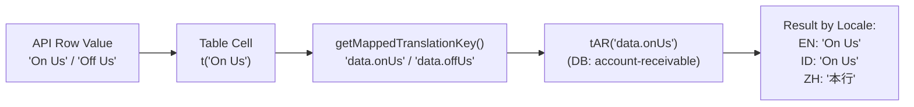

# "~\Downloads\account_receivable_all_translations_QA...

- **ID**: `antigravity-36cfd43e88a5e46e53f5286c63babf12e1493520417ac9abdd1e790516b95775`
- **Source Tool**: `antigravity`
- **Date**: `2026-11-06 14:36:58`
- **Tags**: `coding`, `assistant`, `antigravity`

---

## Turn 1: User

"~\Downloads\account_receivable_all_translations_QA.xlsx" okay check the  previous  conversation about sql generation for this repo. this is the current translation that we need to have and inject to db. follow the procedure that we already have

---

## Turn 2: Assistant

<details><summary>🔧 Tool Invocations (1)</summary>

- **run_command**: 

</details>


---

## Turn 3: Assistant

<details><summary>🔧 Tool Invocations (1)</summary>

- **run_command**: 

</details>


---

## Turn 4: Assistant

<details><summary>🔧 Tool Invocations (1)</summary>

- **run_command**: 

</details>


---

## Turn 5: Assistant

<details><summary>🔧 Tool Invocations (1)</summary>

- **run_command**: 

</details>


---

## Turn 6: Assistant

<details><summary>🔧 Tool Invocations (1)</summary>

- **run_command**: 

</details>


---

## Turn 7: Assistant

<details><summary>🔧 Tool Invocations (1)</summary>

- **manage_task**: 

</details>


---

## Turn 8: Assistant

<details><summary>🔧 Tool Invocations (1)</summary>

- **run_command**: 

</details>


---

## Turn 9: Assistant

<details><summary>🔧 Tool Invocations (1)</summary>

- **run_command**: 

</details>


---

## Turn 10: Assistant

<details><summary>🔧 Tool Invocations (1)</summary>

- **run_command**: 

</details>


---

## Turn 11: Assistant

<details><summary>🔧 Tool Invocations (1)</summary>

- **run_command**: 

</details>


---

## Turn 12: Assistant

<details><summary>🔧 Tool Invocations (1)</summary>

- **run_command**: 

</details>


---

## Turn 13: Assistant

<details><summary>🔧 Tool Invocations (1)</summary>

- **run_command**: 

</details>


---

## Turn 14: Assistant

<details><summary>🔧 Tool Invocations (1)</summary>

- **run_command**: 

</details>


---

## Turn 15: Assistant

<details><summary>🔧 Tool Invocations (1)</summary>

- **manage_task**: 

</details>


---

## Turn 16: Assistant

<details><summary>🔧 Tool Invocations (1)</summary>

- **run_command**: 

</details>


---

## Turn 17: Assistant

<details><summary>🔧 Tool Invocations (1)</summary>

- **run_command**: 

</details>


---

## Turn 18: Assistant

<details><summary>🔧 Tool Invocations (1)</summary>

- **manage_task**: 

</details>


---

## Turn 19: Assistant

<details><summary>🔧 Tool Invocations (1)</summary>

- **run_command**: 

</details>


---

## Turn 20: Assistant

<details><summary>🔧 Tool Invocations (1)</summary>

- **run_command**: 

</details>


---

## Turn 21: Assistant

<details><summary>🔧 Tool Invocations (1)</summary>

- **run_command**: 

</details>


---

## Turn 22: Assistant

<details><summary>🔧 Tool Invocations (1)</summary>

- **run_command**: 

</details>


---

## Turn 23: Assistant

<details><summary>🔧 Tool Invocations (1)</summary>

- **run_command**: 

</details>


---

## Turn 24: Assistant

<details><summary>🔧 Tool Invocations (1)</summary>

- **run_command**: 

</details>


---

## Turn 25: Assistant

<details><summary>🔧 Tool Invocations (1)</summary>

- **run_command**: 

</details>


---

## Turn 26: Assistant

<details><summary>🔧 Tool Invocations (1)</summary>

- **run_command**: 

</details>


---

## Turn 27: Assistant

<details><summary>🔧 Tool Invocations (1)</summary>

- **run_command**: 

</details>


---

## Turn 28: Assistant

<details><summary>🔧 Tool Invocations (1)</summary>

- **run_command**: 

</details>


---

## Turn 29: Assistant

<details><summary>🔧 Tool Invocations (1)</summary>

- **run_command**: 

</details>


---

## Turn 30: Assistant

<details><summary>🔧 Tool Invocations (1)</summary>

- **run_command**: 

</details>


---

## Turn 31: Assistant

<details><summary>🔧 Tool Invocations (1)</summary>

- **run_command**: 

</details>


---

## Turn 32: Assistant

<details><summary>🔧 Tool Invocations (1)</summary>

- **run_command**: 

</details>


---

## Turn 33: Assistant

<details><summary>🔧 Tool Invocations (1)</summary>

- **run_command**: 

</details>


---

## Turn 34: Assistant

<details><summary>🔧 Tool Invocations (1)</summary>

- **run_command**: 

</details>


---

## Turn 35: Assistant

<details><summary>🔧 Tool Invocations (1)</summary>

- **run_command**: 

</details>


---

## Turn 36: Assistant

<details><summary>🔧 Tool Invocations (1)</summary>

- **run_command**: 

</details>


---

## Turn 37: Assistant

<details><summary>🔧 Tool Invocations (1)</summary>

- **run_command**: 

</details>


---

## Turn 38: Assistant

<details><summary>🔧 Tool Invocations (1)</summary>

- **run_command**: 

</details>


---

## Turn 39: Assistant

<details><summary>🔧 Tool Invocations (1)</summary>

- **run_command**: 

</details>


---

## Turn 40: Assistant

<details><summary>🔧 Tool Invocations (1)</summary>

- **run_command**: 

</details>


---

## Turn 41: Assistant

<details><summary>🔧 Tool Invocations (1)</summary>

- **run_command**: 

</details>


---

## Turn 42: Assistant

<details><summary>🔧 Tool Invocations (1)</summary>

- **run_command**: 

</details>


---

## Turn 43: Assistant

<details><summary>🔧 Tool Invocations (1)</summary>

- **run_command**: 

</details>


---

## Turn 44: Assistant

<details><summary>🔧 Tool Invocations (1)</summary>

- **run_command**: 

</details>


---

## Turn 45: Assistant

<details><summary>🔧 Tool Invocations (1)</summary>

- **run_command**: 

</details>


---

## Turn 46: Assistant

<details><summary>🔧 Tool Invocations (1)</summary>

- **run_command**: 

</details>


---

## Turn 47: Assistant

<details><summary>🔧 Tool Invocations (1)</summary>

- **run_command**: 

</details>


---

## Turn 48: Assistant

<details><summary>🔧 Tool Invocations (1)</summary>

- **run_command**: 

</details>


---

## Turn 49: Assistant

<details><summary>🔧 Tool Invocations (1)</summary>

- **run_command**: 

</details>


---

## Turn 50: Assistant

<details><summary>🔧 Tool Invocations (1)</summary>

- **run_command**: 

</details>


---

## Turn 51: Assistant

<details><summary>🔧 Tool Invocations (1)</summary>

- **run_command**: 

</details>


---

## Turn 52: Assistant

<details><summary>🔧 Tool Invocations (1)</summary>

- **run_command**: 

</details>


---

## Turn 53: Assistant

<details><summary>🔧 Tool Invocations (1)</summary>

- **run_command**: 

</details>


---

## Turn 54: Assistant

<details><summary>🔧 Tool Invocations (1)</summary>

- **run_command**: 

</details>


---

## Turn 55: Assistant

<details><summary>🔧 Tool Invocations (1)</summary>

- **read_file**: 

</details>


---

## Turn 56: Assistant

<details><summary>🔧 Tool Invocations (1)</summary>

- **run_command**: 

</details>


---

## Turn 57: Assistant

<details><summary>🔧 Tool Invocations (1)</summary>

- **run_command**: 

</details>


---

## Turn 58: Assistant

<details><summary>🔧 Tool Invocations (1)</summary>

- **run_command**: 

</details>


---

## Turn 59: Assistant

<details><summary>🔧 Tool Invocations (1)</summary>

- **read_file**: 

</details>


---

## Turn 60: Assistant

<details><summary>🔧 Tool Invocations (1)</summary>

- **read_file**: 

</details>


---

## Turn 61: Assistant

<details><summary>🔧 Tool Invocations (1)</summary>

- **run_command**: 

</details>


---

## Turn 62: Assistant

<details><summary>🔧 Tool Invocations (1)</summary>

- **run_command**: 

</details>


---

## Turn 63: Assistant

<details><summary>🔧 Tool Invocations (1)</summary>

- **run_command**: 

</details>


---

## Turn 64: Assistant

<details><summary>🔧 Tool Invocations (1)</summary>

- **run_command**: 

</details>


---

## Turn 65: Assistant

<details><summary>🔧 Tool Invocations (1)</summary>

- **run_command**: 

</details>


---

## Turn 66: Assistant

<details><summary>🔧 Tool Invocations (1)</summary>

- **run_command**: 

</details>


---

## Turn 67: Assistant

<details><summary>🔧 Tool Invocations (1)</summary>

- **run_command**: 

</details>


---

## Turn 68: Assistant

<details><summary>🔧 Tool Invocations (1)</summary>

- **run_command**: 

</details>


---

## Turn 69: Assistant

<details><summary>🔧 Tool Invocations (1)</summary>

- **run_command**: 

</details>


---

## Turn 70: Assistant

<details><summary>🔧 Tool Invocations (1)</summary>

- **run_command**: 

</details>


---

## Turn 71: Assistant

<details><summary>🔧 Tool Invocations (1)</summary>

- **run_command**: 

</details>


---

## Turn 72: Assistant

<details><summary>🔧 Tool Invocations (1)</summary>

- **manage_task**: 

</details>


---

## Turn 73: Assistant

<details><summary>🔧 Tool Invocations (1)</summary>

- **run_command**: 

</details>


---

## Turn 74: Assistant

<details><summary>🔧 Tool Invocations (1)</summary>

- **run_command**: 

</details>


---

## Turn 75: Assistant

<details><summary>🔧 Tool Invocations (1)</summary>

- **run_command**: 

</details>


---

## Turn 76: Assistant

<details><summary>🔧 Tool Invocations (1)</summary>

- **run_command**: 

</details>


---

## Turn 77: Assistant

<details><summary>🔧 Tool Invocations (1)</summary>

- **read_file**: 

</details>


---

## Turn 78: Assistant

<details><summary>🔧 Tool Invocations (1)</summary>

- **run_command**: 

</details>


---

## Turn 79: Assistant

<details><summary>🔧 Tool Invocations (1)</summary>

- **run_command**: 

</details>


---

## Turn 80: Assistant

<details><summary>🔧 Tool Invocations (1)</summary>

- **manage_task**: 

</details>


---

## Turn 81: Assistant

<details><summary>🔧 Tool Invocations (1)</summary>

- **run_command**: 

</details>


---

## Turn 82: Assistant

<details><summary>🔧 Tool Invocations (1)</summary>

- **manage_task**: 

</details>


---

## Turn 83: Assistant

<details><summary>🔧 Tool Invocations (1)</summary>

- **run_command**: 

</details>


---

## Turn 84: Assistant

<details><summary>🔧 Tool Invocations (1)</summary>

- **run_command**: 

</details>


---

## Turn 85: Assistant

<details><summary>🔧 Tool Invocations (1)</summary>

- **manage_task**: 

</details>


---

## Turn 86: Assistant

<details><summary>🔧 Tool Invocations (1)</summary>

- **run_command**: 

</details>


---

## Turn 87: Assistant

<details><summary>🔧 Tool Invocations (1)</summary>

- **run_command**: 

</details>


---

## Turn 88: Assistant

<details><summary>🔧 Tool Invocations (1)</summary>

- **run_command**: 

</details>


---

## Turn 89: Assistant

<details><summary>🔧 Tool Invocations (1)</summary>

- **run_command**: 

</details>


---

## Turn 90: Assistant

<details><summary>🔧 Tool Invocations (1)</summary>

- **run_command**: 

</details>


---

## Turn 91: Assistant

<details><summary>🔧 Tool Invocations (1)</summary>

- **write_file**: 

</details>


---

## Turn 92: Assistant

<details><summary>🔧 Tool Invocations (1)</summary>

- **run_command**: 

</details>


---

## Turn 93: Assistant

<details><summary>🔧 Tool Invocations (1)</summary>

- **write_file**: 

</details>


---

## Turn 94: Assistant

I have reviewed the previous SQL generation procedure ([Confluence SOP 1784253249](https://internal-service.example.com/spaces/NQ/pages/1784253249/Query+Insert+Languages) / `demo_qcash` database) and processed the QA-approved translation file [`account_receivable_all_translations_QA.xlsx`](file:///C:~/Downloads/account_receivable_all_translations_QA.xlsx).

---

### Key Breakdown & Analysis

Cross-referencing the **369 translation keys** from the QA Excel against the Dev DB export (`language_keys_202611021615.csv`):

| Partition | Count | Description & Handling |
| :--- | :--- | :--- |
| **Existing Keys in Dev DB** | **267 keys** | Already registered in `language_keys` for `account-receivable`. **Must NOT use `CALL`** (to prevent duplicate key errors). Executed via **atomic CTE `UPSERT`** into `language_values` to update `zh`, `id`, and `en`. |
| **New Keys (`account-receivable`)** | **83 keys** | Missing from Dev DB (includes keys standardized in [`utils/map-translate.ts`](file:///C:/Work/qcash-ui-account-receivable/utils/map-translate.ts)). Executed via **`CALL qcash_language.insert_language_key_with_values(...)`**. |
| **Common DB Keys** | **19 keys** | Shared keys (`data.calendar.month.1-12`, `action.label.Approve`, `status.active`, etc.). Generated separately for either `common` or `account-receivable`. |

---

### Generated SQL Files in Repository

All executable SQL scripts have been generated in the [`docs/`](file:///C:/Work/qcash-ui-account-receivable/docs/) directory:

1. **[`docs/insert-83-new-keys.sql`](file:///C:/Work/qcash-ui-account-receivable/docs/insert-83-new-keys.sql)**:
   - Includes stored procedure & module verification.
   - Contains 83 `CALL qcash_language.insert_language_key_with_values(...)` statements in a `BEGIN ... COMMIT` transaction.
2. **[`docs/upsert-267-existing-keys.sql`](file:///C:/Work/qcash-ui-account-receivable/docs/upsert-267-existing-keys.sql)**:
   - Atomic CTE `UPSERT` updating all 267 existing keys for `zh` (Mandarin), `id` (Indonesian), and `en` (English).
3. **[`docs/common-db-19-keys.sql`](file:///C:/Work/qcash-ui-account-receivable/docs/common-db-19-keys.sql)**:
   - Provides queries for the 19 Common DB keys for module `'common'` (Option A) and module `'account-receivable'` (Option B).
4. **[`docs/all-translations-account-receivable.sql`](file:///C:/Work/qcash-ui-account-receivable/docs/all-translations-account-receivable.sql)**:
   - All-in-one script containing the complete workflow and verification query.
5. **[`docs/query-insert-languages-account-receivable.md`](file:///C:/Work/qcash-ui-account-receivable/docs/query-insert-languages-account-receivable.md)**:
   - Step-by-step SOP execution and verification guide.

---

### Local Frontend JSONs Updated

The local fallback locale files have also been synchronized to match the QA Excel 1:1 (**369 keys each**, alphabetically sorted):
- [`public/locales/en/account-receivable.json`](file:///C:/Work/qcash-ui-account-receivable/public/locales/en/account-receivable.json)
- [`public/locales/id/account-receivable.json`](file:///C:/Work/qcash-ui-account-receivable/public/locales/id/account-receivable.json)
- [`public/locales/zh/account-receivable.json`](file:///C:/Work/qcash-ui-account-receivable/public/locales/zh/account-receivable.json)

> [!TIP]
> For the complete execution walkthrough and verification SQL queries, please refer to the artifact:
> **[query-insert-languages-account-receivable.md](file:///C:~/.gemini/antigravity-cli/brain/311ac083-30a6-49ba-a06f-c2388a982d19/query-insert-languages-account-receivable.md)**.

---

## Turn 95: User

run yarn dev

---

## Turn 96: Assistant

<details><summary>🔧 Tool Invocations (1)</summary>

- **run_command**: 

</details>


---

## Turn 97: Assistant

<details><summary>🔧 Tool Invocations (1)</summary>

- **run_command**: 

</details>


---

## Turn 98: Assistant

<details><summary>🔧 Tool Invocations (1)</summary>

- **run_command**: 

</details>


---

## Turn 99: Assistant

<details><summary>🔧 Tool Invocations (1)</summary>

- **run_command**: 

</details>


---

## Turn 100: Assistant

<details><summary>🔧 Tool Invocations (1)</summary>

- **run_command**: 

</details>


---

## Turn 101: Assistant

<details><summary>🔧 Tool Invocations (1)</summary>

- **run_command**: 

</details>


---

## Turn 102: Assistant

<details><summary>🔧 Tool Invocations (1)</summary>

- **run_command**: 

</details>


---

## Turn 103: Assistant

<details><summary>🔧 Tool Invocations (1)</summary>

- **run_command**: 

</details>


---

## Turn 104: Assistant

<details><summary>🔧 Tool Invocations (1)</summary>

- **run_command**: 

</details>


---

## Turn 105: Assistant

<details><summary>🔧 Tool Invocations (1)</summary>

- **run_command**: 

</details>


---

## Turn 106: Assistant

<details><summary>🔧 Tool Invocations (1)</summary>

- **run_command**: 

</details>


---

## Turn 107: Assistant

<details><summary>🔧 Tool Invocations (1)</summary>

- **run_command**: 

</details>


---

## Turn 108: Assistant

<details><summary>🔧 Tool Invocations (1)</summary>

- **run_command**: 

</details>


---

## Turn 109: Assistant

<details><summary>🔧 Tool Invocations (1)</summary>

- **manage_task**: 

</details>


---

## Turn 110: Assistant

<details><summary>🔧 Tool Invocations (1)</summary>

- **run_command**: 

</details>


---

## Turn 111: Assistant

<details><summary>🔧 Tool Invocations (1)</summary>

- **manage_task**: 

</details>


---

## Turn 112: Assistant

<details><summary>🔧 Tool Invocations (1)</summary>

- **run_command**: 

</details>


---

## Turn 113: Assistant

<details><summary>🔧 Tool Invocations (1)</summary>

- **manage_task**: 

</details>


---

## Turn 114: Assistant

<details><summary>🔧 Tool Invocations (1)</summary>

- **manage_task**: 

</details>


---

## Turn 115: Assistant

<details><summary>🔧 Tool Invocations (1)</summary>

- **manage_task**: 

</details>


---

## Turn 116: Assistant

<details><summary>🔧 Tool Invocations (1)</summary>

- **manage_task**: 

</details>


---

## Turn 117: Assistant

<details><summary>🔧 Tool Invocations (1)</summary>

- **run_command**: 

</details>


---

## Turn 118: Assistant

<details><summary>🔧 Tool Invocations (1)</summary>

- **manage_task**: 

</details>


---

## Turn 119: Assistant

<details><summary>🔧 Tool Invocations (1)</summary>

- **manage_task**: 

</details>


---

## Turn 120: Assistant

<details><summary>🔧 Tool Invocations (1)</summary>

- **manage_task**: 

</details>


---

## Turn 121: Assistant

<details><summary>🔧 Tool Invocations (1)</summary>

- **manage_task**: 

</details>


---

## Turn 122: Assistant

The development server is running in the background:

- **Local URL**: [http://localhost:3000](http://localhost:3000)
- **Base Path / MF Manifest**: `http://localhost:3000/account-receivable-v2/_next/mf-manifest.json`
- **Environment**: `.env`
- **Task ID**: `task-220` (Process ID: `23908` on port `3000`)

---

## Turn 123: User

what is the command to run the yarn dev? i always got some error

---

## Turn 124: Assistant

The standard `yarn dev` script in [`package.json`](file:///C:/Work/qcash-ui-account-receivable/package.json) contains a Unix command (`export NEXT_PRIVATE_LOCAL_WEBPACK=true`), which causes this error on Windows PowerShell / Command Prompt:

```text
'export' is not recognized as an internal or external command, operable program or batch file.
```

---

### Commands to Run Based on Your Terminal

#### 1. PowerShell (Recommended on Windows)
```powershell
$env:NEXT_PRIVATE_LOCAL_WEBPACK="true"; yarn build-style; yarn next dev
```
*(If you want to run on a specific port like `3000`:)*
```powershell
$env:NEXT_PRIVATE_LOCAL_WEBPACK="true"; yarn build-style; yarn next dev -p 3000
```

#### 2. Git Bash
If you use **Git Bash**, the default command works without changes:
```bash
yarn dev
```

#### 3. Command Prompt (CMD)
```cmd
set NEXT_PRIVATE_LOCAL_WEBPACK=true && yarn build-style && yarn next dev
```

---

### If Port 3000 is Blocked ("Port already in use")

If an old Node process is still holding port 3000, kill it in PowerShell using:
```powershell
Get-NetTCPConnection -LocalPort 3000 -ErrorAction SilentlyContinue | ForEach-Object { Stop-Process -Id $_.OwningProcess -Force }
```

---

## Turn 125: User

please check this, the translation for chinese is still not working

---

## Turn 126: Assistant

<details><summary>🔧 Tool Invocations (1)</summary>

- **run_command**: 

</details>


---

## Turn 127: Assistant

<details><summary>🔧 Tool Invocations (1)</summary>

- **run_command**: 

</details>


---

## Turn 128: Assistant

<details><summary>🔧 Tool Invocations (1)</summary>

- **read_file**: 

</details>


---

## Turn 129: Assistant

<details><summary>🔧 Tool Invocations (1)</summary>

- **run_command**: 

</details>


---

## Turn 130: Assistant

<details><summary>🔧 Tool Invocations (1)</summary>

- **run_command**: 

</details>


---

## Turn 131: Assistant

<details><summary>🔧 Tool Invocations (1)</summary>

- **read_file**: 

</details>


---

## Turn 132: Assistant

<details><summary>🔧 Tool Invocations (1)</summary>

- **read_file**: 

</details>


---

## Turn 133: Assistant

<details><summary>🔧 Tool Invocations (1)</summary>

- **run_command**: 

</details>


---

## Turn 134: Assistant

<details><summary>🔧 Tool Invocations (1)</summary>

- **read_file**: 

</details>


---

## Turn 135: Assistant

<details><summary>🔧 Tool Invocations (1)</summary>

- **run_command**: 

</details>


---

## Turn 136: Assistant

<details><summary>🔧 Tool Invocations (1)</summary>

- **run_command**: 

</details>


---

## Turn 137: Assistant

<details><summary>🔧 Tool Invocations (1)</summary>

- **read_file**: 

</details>


---

## Turn 138: Assistant

<details><summary>🔧 Tool Invocations (1)</summary>

- **read_file**: 

</details>


---

## Turn 139: Assistant

<details><summary>🔧 Tool Invocations (1)</summary>

- **run_command**: 

</details>


---

## Turn 140: Assistant

<details><summary>🔧 Tool Invocations (1)</summary>

- **run_command**: 

</details>


---

## Turn 141: Assistant

<details><summary>🔧 Tool Invocations (1)</summary>

- **read_file**: 

</details>


---

## Turn 142: Assistant

<details><summary>🔧 Tool Invocations (1)</summary>

- **read_file**: 

</details>


---

## Turn 143: Assistant

<details><summary>🔧 Tool Invocations (1)</summary>

- **run_command**: 

</details>


---

## Turn 144: Assistant

<details><summary>🔧 Tool Invocations (1)</summary>

- **read_file**: 

</details>


---

## Turn 145: Assistant

<details><summary>🔧 Tool Invocations (1)</summary>

- **run_command**: 

</details>


---

## Turn 146: Assistant

<details><summary>🔧 Tool Invocations (1)</summary>

- **run_command**: 

</details>


---

## Turn 147: Assistant

<details><summary>🔧 Tool Invocations (1)</summary>

- **run_command**: 

</details>


---

## Turn 148: Assistant

<details><summary>🔧 Tool Invocations (1)</summary>

- **run_command**: 

</details>


---

## Turn 149: Assistant

<details><summary>🔧 Tool Invocations (1)</summary>

- **run_command**: 

</details>


---

## Turn 150: Assistant

<details><summary>🔧 Tool Invocations (1)</summary>

- **run_command**: 

</details>


---

## Turn 151: Assistant

<details><summary>🔧 Tool Invocations (1)</summary>

- **run_command**: 

</details>


---

## Turn 152: Assistant

<details><summary>🔧 Tool Invocations (1)</summary>

- **run_command**: 

</details>


---

## Turn 153: Assistant

<details><summary>🔧 Tool Invocations (1)</summary>

- **run_command**: 

</details>


---

## Turn 154: Assistant

<details><summary>🔧 Tool Invocations (1)</summary>

- **run_command**: 

</details>


---

## Turn 155: Assistant

<details><summary>🔧 Tool Invocations (1)</summary>

- **read_file**: 

</details>


---

## Turn 156: Assistant

<details><summary>🔧 Tool Invocations (1)</summary>

- **read_file**: 

</details>


---

## Turn 157: Assistant

<details><summary>🔧 Tool Invocations (1)</summary>

- **run_command**: 

</details>


---

## Turn 158: Assistant

<details><summary>🔧 Tool Invocations (1)</summary>

- **run_command**: 

</details>


---

## Turn 159: Assistant

<details><summary>🔧 Tool Invocations (1)</summary>

- **read_file**: 

</details>


---

## Turn 160: Assistant

<details><summary>🔧 Tool Invocations (1)</summary>

- **run_command**: 

</details>


---

## Turn 161: Assistant

<details><summary>🔧 Tool Invocations (1)</summary>

- **run_command**: 

</details>


---

## Turn 162: Assistant

<details><summary>🔧 Tool Invocations (1)</summary>

- **read_file**: 

</details>


---

## Turn 163: Assistant

<details><summary>🔧 Tool Invocations (1)</summary>

- **run_command**: 

</details>


---

## Turn 164: Assistant

<details><summary>🔧 Tool Invocations (1)</summary>

- **run_command**: 

</details>


---

## Turn 165: Assistant

<details><summary>🔧 Tool Invocations (1)</summary>

- **run_command**: 

</details>


---

## Turn 166: Assistant

<details><summary>🔧 Tool Invocations (1)</summary>

- **read_file**: 

</details>


---

## Turn 167: Assistant

<details><summary>🔧 Tool Invocations (1)</summary>

- **run_command**: 

</details>


---

## Turn 168: Assistant

<details><summary>🔧 Tool Invocations (1)</summary>

- **run_command**: 

</details>


---

## Turn 169: Assistant

<details><summary>🔧 Tool Invocations (1)</summary>

- **run_command**: 

</details>


---

## Turn 170: Assistant

<details><summary>🔧 Tool Invocations (1)</summary>

- **run_command**: 

</details>


---

## Turn 171: Assistant

<details><summary>🔧 Tool Invocations (1)</summary>

- **run_command**: 

</details>


---

## Turn 172: Assistant

<details><summary>🔧 Tool Invocations (1)</summary>

- **run_command**: 

</details>


---

## Turn 173: Assistant

<details><summary>🔧 Tool Invocations (1)</summary>

- **manage_task**: 

</details>


---

## Turn 174: Assistant

<details><summary>🔧 Tool Invocations (1)</summary>

- **read_file**: 

</details>


---

## Turn 175: Assistant

<details><summary>🔧 Tool Invocations (1)</summary>

- **run_command**: 

</details>


---

## Turn 176: Assistant

<details><summary>🔧 Tool Invocations (1)</summary>

- **run_command**: 

</details>


---

## Turn 177: Assistant

<details><summary>🔧 Tool Invocations (1)</summary>

- **run_command**: 

</details>


---

## Turn 178: Assistant

<details><summary>🔧 Tool Invocations (1)</summary>

- **run_command**: 

</details>


---

## Turn 179: Assistant

<details><summary>🔧 Tool Invocations (1)</summary>

- **run_command**: 

</details>


---

## Turn 180: Assistant

<details><summary>🔧 Tool Invocations (1)</summary>

- **run_command**: 

</details>


---

## Turn 181: Assistant

<details><summary>🔧 Tool Invocations (1)</summary>

- **manage_task**: 

</details>


---

## Turn 182: Assistant

<details><summary>🔧 Tool Invocations (1)</summary>

- **read_file**: 

</details>


---

## Turn 183: Assistant

<details><summary>🔧 Tool Invocations (1)</summary>

- **run_command**: 

</details>


---

## Turn 184: Assistant

<details><summary>🔧 Tool Invocations (1)</summary>

- **read_file**: 

</details>


---

## Turn 185: Assistant

<details><summary>🔧 Tool Invocations (1)</summary>

- **run_command**: 

</details>


---

## Turn 186: Assistant

<details><summary>🔧 Tool Invocations (1)</summary>

- **read_file**: 

</details>


---

## Turn 187: Assistant

<details><summary>🔧 Tool Invocations (1)</summary>

- **run_command**: 

</details>


---

## Turn 188: Assistant

<details><summary>🔧 Tool Invocations (1)</summary>

- **run_command**: 

</details>


---

## Turn 189: Assistant

<details><summary>🔧 Tool Invocations (1)</summary>

- **run_command**: 

</details>


---

## Turn 190: Assistant

<details><summary>🔧 Tool Invocations (1)</summary>

- **run_command**: 

</details>


---

## Turn 191: Assistant

<details><summary>🔧 Tool Invocations (1)</summary>

- **read_file**: 

</details>


---

## Turn 192: Assistant

<details><summary>🔧 Tool Invocations (1)</summary>

- **run_command**: 

</details>


---

## Turn 193: Assistant

<details><summary>🔧 Tool Invocations (1)</summary>

- **run_command**: 

</details>


---

## Turn 194: Assistant

<details><summary>🔧 Tool Invocations (1)</summary>

- **read_file**: 

</details>


---

## Turn 195: Assistant

<details><summary>🔧 Tool Invocations (1)</summary>

- **run_command**: 

</details>


---

## Turn 196: Assistant

<details><summary>🔧 Tool Invocations (1)</summary>

- **manage_task**: 

</details>


---

## Turn 197: Assistant

<details><summary>🔧 Tool Invocations (1)</summary>

- **run_command**: 

</details>


---

## Turn 198: Assistant

<details><summary>🔧 Tool Invocations (1)</summary>

- **read_file**: 

</details>


---

## Turn 199: Assistant

<details><summary>🔧 Tool Invocations (1)</summary>

- **read_file**: 

</details>


---

## Turn 200: Assistant

<details><summary>🔧 Tool Invocations (1)</summary>

- **read_file**: 

</details>


---

## Turn 201: Assistant

<details><summary>🔧 Tool Invocations (1)</summary>

- **read_file**: 

</details>


---

## Turn 202: Assistant

<details><summary>🔧 Tool Invocations (1)</summary>

- **run_command**: 

</details>


---

## Turn 203: Assistant

<details><summary>🔧 Tool Invocations (1)</summary>

- **read_file**: 

</details>


---

## Turn 204: Assistant

<details><summary>🔧 Tool Invocations (1)</summary>

- **edit_file**: 

</details>


---

## Turn 205: Assistant

<details><summary>🔧 Tool Invocations (1)</summary>

- **read_file**: 

</details>


---

## Turn 206: Assistant

<details><summary>🔧 Tool Invocations (1)</summary>

- **edit_file**: 

</details>


---

## Turn 207: Assistant

<details><summary>🔧 Tool Invocations (1)</summary>

- **run_command**: 

</details>


---

## Turn 208: Assistant

<details><summary>🔧 Tool Invocations (1)</summary>

- **run_command**: 

</details>


---

## Turn 209: Assistant

<details><summary>🔧 Tool Invocations (1)</summary>

- **run_command**: 

</details>


---

## Turn 210: Assistant

<details><summary>🔧 Tool Invocations (1)</summary>

- **run_command**: 

</details>


---

## Turn 211: Assistant

<details><summary>🔧 Tool Invocations (1)</summary>

- **run_command**: 

</details>


---

## Turn 212: Assistant

<details><summary>🔧 Tool Invocations (1)</summary>

- **run_command**: 

</details>


---

## Turn 213: Assistant

<details><summary>🔧 Tool Invocations (1)</summary>

- **run_command**: 

</details>


---

## Turn 214: Assistant

<details><summary>🔧 Tool Invocations (1)</summary>

- **manage_task**: 

</details>


---

## Turn 215: Assistant

<details><summary>🔧 Tool Invocations (1)</summary>

- **manage_task**: 

</details>


---

## Turn 216: Assistant

<details><summary>🔧 Tool Invocations (1)</summary>

- **write_file**: 

</details>


---

## Turn 217: Assistant

<details><summary>🔧 Tool Invocations (1)</summary>

- **run_command**: 

</details>


---

## Turn 218: Assistant

<details><summary>🔧 Tool Invocations (1)</summary>

- **read_file**: 

</details>


---

## Turn 219: Assistant

<details><summary>🔧 Tool Invocations (1)</summary>

- **write_file**: 

</details>


---

## Turn 220: Assistant

<details><summary>🔧 Tool Invocations (1)</summary>

- **read_file**: 

</details>


---

## Turn 221: Assistant

<details><summary>🔧 Tool Invocations (1)</summary>

- **read_file**: 

</details>


---

## Turn 222: Assistant

<details><summary>🔧 Tool Invocations (1)</summary>

- **write_file**: 

</details>


---

## Turn 223: Assistant

<details><summary>🔧 Tool Invocations (1)</summary>

- **run_command**: 

</details>


---

## Turn 224: Assistant

<details><summary>🔧 Tool Invocations (1)</summary>

- **manage_task**: 

</details>


---

## Turn 225: Assistant

<details><summary>🔧 Tool Invocations (1)</summary>

- **run_command**: 

</details>


---

## Turn 226: Assistant

<details><summary>🔧 Tool Invocations (1)</summary>

- **manage_task**: 

</details>


---

## Turn 227: Assistant

<details><summary>🔧 Tool Invocations (1)</summary>

- **run_command**: 

</details>


---

## Turn 228: Assistant

<details><summary>🔧 Tool Invocations (1)</summary>

- **run_command**: 

</details>


---

## Turn 229: Assistant

<details><summary>🔧 Tool Invocations (1)</summary>

- **run_command**: 

</details>


---

## Turn 230: Assistant

The Chinese translations were not displaying due to three root causes:

---

### Root Causes

1. **Missing Option Translation in `<Select>`**:
   In [`components/local/filter-items/index.tsx`](file:///C:/Work/qcash-ui-account-receivable/components/local/filter-items/index.tsx), `counterPartyAccountStatus` was the only filter passing raw options directly (`options={formMappings.counterPartyAccountStatus}`) without wrapping them in `translateOptions(..., t)` or using `formatOptionLabel`.
2. **Missing Status Key Mapping**:
   In [`utils/map-translate.ts`](file:///C:/Work/qcash-ui-account-receivable/utils/map-translate.ts), `"Dormant"` (from the backend API) was not mapped to its standard key (`status.batch.cpv.dormant` &rarr; `休眠`).
3. **MFE Language Event & Locale Subtag Normalization**:
   - In [`hooks/use-translate.ts`](file:///C:/Work/qcash-ui-account-receivable/hooks/use-translate.ts), if the shell or browser passed regional tags like `zh-CN` or `cn`, `LOCAL[i18n.language]` returned `undefined` and fell back to `LOCAL["en"]`.
   - Neither [`pages/_app.tsx`](file:///C:/Work/qcash-ui-account-receivable/pages/_app.tsx) nor [`use-translate.ts`](file:///C:/Work/qcash-ui-account-receivable/hooks/use-translate.ts) was listening to the host shell's `languageChange` or `storage` events, leaving `i18n.language` stuck in English on language switch.

---

### Changes Applied

#### 1. [`components/local/filter-items/index.tsx`](file:///C:/Work/qcash-ui-account-receivable/components/local/filter-items/index.tsx#L278-L310)
Wrapped `options` and `value` with translation helpers and added `formatOptionLabel`:
```tsx
  // Counter Party Account Status filter
  if (filterTypes.includes("counterPartyAccountStatus")) {
    const foundStatus = find(formMappings.counterPartyAccountStatus, {
      value: searchCriteria.counterPartyAccountStatus?.value,
    });
    filterItems.push({
      label: t("data.counterParty.accountStatus"),
      value: foundStatus ? t(foundStatus.label) : undefined,
      handleDelete: () =>
        setSearchCriteria({
          ...searchCriteria,
          counterPartyAccountStatus: defaultSelectValue2,
        }),
      type: "select" as const,
      content: (
        <Select
          autoFocus
          menuIsOpen
          styles={styleSelect}
          className="rcv-mb-[130px] rcv-min-w-[238px]"
          name="counterPartyAccountStatus"
          id="counterPartyAccountStatus"
          label={t("data.counterParty.accountStatus")}
          placeholder={t("form.select.counterPartyAccountStatus")}
          options={translateOptions(formMappings.counterPartyAccountStatus, t)}
          formatOptionLabel={(option: Option) => t(option.label)}
          onChange={handleChangeSelect}
          value={translateOption(foundStatus, t)}
        />
      ),
    });
  }
```

#### 2. [`utils/map-translate.ts`](file:///C:/Work/qcash-ui-account-receivable/utils/map-translate.ts#L38-L51)
Added CPV account statuses and filter labels to the mapping dictionary:
```ts
  Dormant: "status.batch.cpv.dormant",
  "Charge Off": "status.batch.cpv.chargeOff",
  "Frozen with Accrual": "status.batch.cpv.frozenWithAccrual",
  "Frozen with No Accrual": "status.batch.cpv.frozenWithNoAccrual",
  "Matured but Not Closed": "status.batch.cpv.maturedButNotClosed",
  "New Today": "status.batch.cpv.newToday",
  "Unknown Account Status": "status.batch.cpv.unknownAccountStatus",
  "Zero Actual": "status.batch.cpv.zeroActual",

  // Filter Labels & Placeholders
  "Counter Party Account Status": "data.counterParty.accountStatus",
  "Select counter party account status": "form.select.counterPartyAccountStatus",
  "File Name": "form.file.name",
```

#### 3. [`hooks/use-translate.ts`](file:///C:/Work/qcash-ui-account-receivable/hooks/use-translate.ts) & [`pages/_app.tsx`](file:///C:/Work/qcash-ui-account-receivable/pages/_app.tsx)
- Added `normalizeLang` (`zh-CN` / `zh-Hans` / `cn` &rarr; `zh`, `id-ID` &rarr; `id`).
- Added listeners for `languageChange`, `languageChangeComplete`, and `storage` events to synchronize language with the QCash shell instantly.

---

### Translation Output Verification

| Element | English | Mandarin (`zh`) |
| :--- | :--- | :--- |
| **Filter Chip & Card Label** | `Counter Party Account Status` | **交易对手账户状态** |
| **Input Placeholder** | `Select counter party account status` | **选择交易对手账户状态** |
| **Option 1** | `All` | **全部** |
| **Option 2** | `Active` | **活跃** |
| **Option 3** | `Dormant` | **休眠** |
| **Adjacent Filter** | `File Name` | **文件名** |

The dev server has hot-reloaded the changes. Please refresh your browser or toggle Chinese in the language switcher.

---

## Turn 231: User

$ export NEXT_PRIVATE_LOCAL_WEBPACK=true && yarn build-style && next dev when i tried running this on dev, i got error
$ export NEXT_PRIVATE_LOCAL_WEBPACK=true && yarn build-style && next dev
'export' is not recognized as an internal or external command,
operable program or batch file.
error Command failed with exit code 1.
info Visit https://yarnpkg.com/en/docs/cli/run for documentation about this command.

---

## Turn 232: Assistant

<details><summary>🔧 Tool Invocations (1)</summary>

- **read_file**: 

</details>


---

## Turn 233: Assistant

<details><summary>🔧 Tool Invocations (1)</summary>

- **read_file**: 

</details>


---

## Turn 234: Assistant

<details><summary>🔧 Tool Invocations (1)</summary>

- **read_file**: 

</details>


---

## Turn 235: Assistant

When you run `yarn dev`, Yarn looks up the `"dev"` script inside [`package.json`](file:///C:/Work/qcash-ui-account-receivable/package.json#L6) (`export NEXT_PRIVATE_LOCAL_WEBPACK=true && yarn build-style && next dev`) and executes it using Windows `cmd.exe`, which fails on `export`.

To bypass the `"dev"` script in `package.json`, **do not run `yarn dev`**. Instead, run `next dev` directly:

### In PowerShell
```powershell
$env:NEXT_PRIVATE_LOCAL_WEBPACK="true"; yarn build-style; yarn next dev
```

### In Command Prompt (CMD)
```cmd
set NEXT_PRIVATE_LOCAL_WEBPACK=true && yarn build-style && yarn next dev
```

### In Git Bash
```bash
export NEXT_PRIVATE_LOCAL_WEBPACK=true && yarn build-style && yarn next dev
```

---

### Optional: Make `yarn dev` Work Permanently on Your Machine
If you have Git for Windows installed and want `yarn dev` itself to work without changing `package.json`, point npm/yarn's script shell to Git Bash once:
```powershell
npm config set script-shell "C:\\Program Files\\Git\\bin\\bash.exe"
```

---

## Turn 236: User

`BRI+90181271@BRI-B1XV2J4 UCRT64 /c/Work/qcash-ui-account-receivable (fix-new-translation)
$     export NEXT_PRIVATE_LOCAL_WEBPACK=true && yarn build-style && yarn next dev       
yarn run v1.22.22
$ npx tailwindcss -o ./styles/globals.css
error Couldn't find the binary npx tailwindcss -o ./styles/globals.css
info Visit https://yarnpkg.com/en/docs/cli/run for documentation about this command. now got this

---

## Turn 237: Assistant

<details><summary>🔧 Tool Invocations (1)</summary>

- **run_command**: 

</details>


---

## Turn 238: Assistant

<details><summary>🔧 Tool Invocations (1)</summary>

- **manage_task**: 

</details>


---

## Turn 239: Assistant

<details><summary>🔧 Tool Invocations (1)</summary>

- **run_command**: 

</details>


---

## Turn 240: Assistant

<details><summary>🔧 Tool Invocations (1)</summary>

- **run_command**: 

</details>


---

## Turn 241: Assistant

<details><summary>🔧 Tool Invocations (1)</summary>

- **run_command**: 

</details>


---

## Turn 242: Assistant

<details><summary>🔧 Tool Invocations (1)</summary>

- **run_command**: 

</details>


---

## Turn 243: Assistant

I cleared the `script-shell` configuration for you (Yarn v1 fails when `script-shell` points to a path containing spaces like `C:\Program Files\...`).

`yarn build-style` has been verified and works now. You can run the exact same command in your UCRT64 / Git Bash terminal:

```bash
export NEXT_PRIVATE_LOCAL_WEBPACK=true && yarn build-style && yarn next dev
```

---

## Turn 244: User

please fix this on this repo

---

## Turn 245: Assistant

<details><summary>🔧 Tool Invocations (6)</summary>

- **read_file**: 
- **read_file**: 
- **read_file**: 
- **read_file**: 
- **read_file**: 
- **read_file**: 

</details>


---

## Turn 246: Assistant

<details><summary>🔧 Tool Invocations (3)</summary>

- **read_file**: 
- **read_file**: 
- **run_command**: 

</details>


---

## Turn 247: Assistant

<details><summary>🔧 Tool Invocations (1)</summary>

- **run_command**: 

</details>


---

## Turn 248: Assistant

<details><summary>🔧 Tool Invocations (1)</summary>

- **run_command**: 

</details>


---

## Turn 249: Assistant

<details><summary>🔧 Tool Invocations (1)</summary>

- **run_command**: 

</details>


---

## Turn 250: Assistant

<details><summary>🔧 Tool Invocations (2)</summary>

- **read_file**: 
- **read_file**: 

</details>


---

## Turn 251: Assistant

<details><summary>🔧 Tool Invocations (1)</summary>

- **read_file**: 

</details>


---

## Turn 252: Assistant

<details><summary>🔧 Tool Invocations (1)</summary>

- **read_file**: 

</details>


---

## Turn 253: Assistant

<details><summary>🔧 Tool Invocations (1)</summary>

- **run_command**: 

</details>


---

## Turn 254: Assistant

<details><summary>🔧 Tool Invocations (7)</summary>

- **edit_file**: 
- **edit_file**: 
- **edit_file**: 
- **edit_file**: 
- **edit_file**: 
- **edit_file**: 
- **edit_file**: 

</details>


---

## Turn 255: Assistant

<details><summary>🔧 Tool Invocations (1)</summary>

- **run_command**: 

</details>


---

## Turn 256: Assistant

<details><summary>🔧 Tool Invocations (4)</summary>

- **edit_file**: 
- **write_file**: 
- **write_file**: 
- **write_file**: 

</details>


---

## Turn 257: Assistant

<details><summary>🔧 Tool Invocations (1)</summary>

- **run_command**: 

</details>


---

## Turn 258: Assistant

Updating [`constants/table.ts`](file:///C:/Work/qcash-ui-account-receivable/constants/table.ts) and [`components/local/filter-items/index.tsx`](file:///C:/Work/qcash-ui-account-receivable/components/local/filter-items/index.tsx) now; waiting for the script to finish.

---

## Turn 259: Assistant

<details><summary>🔧 Tool Invocations (2)</summary>

- **write_file**: 
- **write_file**: 

</details>


---

## Turn 260: Assistant

<details><summary>🔧 Tool Invocations (1)</summary>

- **run_command**: 

</details>


---

## Turn 261: Assistant

Running `npx tsc --noEmit` to verify there are no TypeScript or import issues; waiting for it to finish.

---

## Turn 262: Assistant

The `ReferenceError: Cannot access 'STATUS_TRANSLATION_MAP' before initialization` error and the overwritten Chinese translation fixes have been resolved:

### Root Cause
A circular module dependency occurred during Module Federation remote evaluation:
1. [`constants/table.ts`](file:///C:/Work/qcash-ui-account-receivable/constants/table.ts) imported [`useTranslate`](file:///C:/Work/qcash-ui-account-receivable/hooks/use-translate.ts#L35-L103) from `@/hooks` and [`formatMoney`](file:///C:/Work/qcash-ui-account-receivable/utils/money.ts) from `@/utils` at the top of the file before defining `STATUS_TRANSLATION_MAP`.
2. Both `@/hooks` and `@/utils` evaluated [`utils/map-translate.ts`](file:///C:/Work/qcash-ui-account-receivable/utils/map-translate.ts), which imported `STATUS_TRANSLATION_MAP` from `@/constants/table` and called `Object.entries(STATUS_TRANSLATION_MAP)` at top-level module evaluation while `STATUS_TRANSLATION_MAP` was still in the Temporal Dead Zone (TDZ).

### What Was Fixed
1. **Broke the Circular Dependency**:
   - Moved [`STATUS_TRANSLATION_MAP`](file:///C:/Work/qcash-ui-account-receivable/utils/map-translate.ts#L5-L78) into [`utils/map-translate.ts`](file:///C:/Work/qcash-ui-account-receivable/utils/map-translate.ts) so [`utils/map-translate.ts`](file:///C:/Work/qcash-ui-account-receivable/utils/map-translate.ts) is a pure leaf module with zero imports, and re-exported `STATUS_TRANSLATION_MAP` from [`constants/table.ts`](file:///C:/Work/qcash-ui-account-receivable/constants/table.ts#L6-L8).
   - Updated [`utils/get-status-translation-key.ts`](file:///C:/Work/qcash-ui-account-receivable/utils/get-status-translation-key.ts#L1), [`constants/table.ts`](file:///C:/Work/qcash-ui-account-receivable/constants/table.ts#L4-L6), [`constants/common.ts`](file:///C:/Work/qcash-ui-account-receivable/constants/common.ts#L7), and [`constants/receivable-inquiry-columns.tsx`](file:///C:/Work/qcash-ui-account-receivable/constants/receivable-inquiry-columns.tsx#L3) to import directly from leaf modules (`@/hooks/use-translate`, `@/utils/money`, `@/utils/get-skin-classname`, `./map-translate`) instead of barrel index files.
2. **Restored Counter Party Account Status & Chinese Translation Sync** (which were overwritten by the recent merge):
   - Mapped both status codes and English fallback labels (`"Dormant"`, `"Frozen With Accrual"`, etc.) in [`utils/map-translate.ts`](file:///C:/Work/qcash-ui-account-receivable/utils/map-translate.ts#L80-L85).
   - Restored [`translateOptions`](file:///C:/Work/qcash-ui-account-receivable/utils/map-translate.ts#L186-L200) and [`translateOption`](file:///C:/Work/qcash-ui-account-receivable/utils/map-translate.ts#L205-L214) on the `counterPartyAccountStatus` filter in [`components/local/filter-items/index.tsx`](file:///C:/Work/qcash-ui-account-receivable/components/local/filter-items/index.tsx#L279-L310).
   - Restored `locale` / `ADDONS_CHANGE_LANGUAGE` event synchronization and locale normalization (`zh-CN` / `zh` / `cn` -> `zh`) in [`hooks/use-translate.ts`](file:///C:/Work/qcash-ui-account-receivable/hooks/use-translate.ts#L18-L103) and [`pages/_app.tsx`](file:///C:/Work/qcash-ui-account-receivable/pages/_app.tsx#L34-L53).

---

## Turn 263: User

okay there are some changes i want to make
i want you to list me the api that is actually being used for the filter values, the example is mandate-category, mandate-type, and batch-types. those api endpoint returned data will be used as filter values, and we no longer translating those values there directly here in the frontend, but rather on the backend
first step, just list me the endpoints

---

## Turn 264: Assistant

<details><summary>🔧 Tool Invocations (3)</summary>

- **read_file**: 
- **read_file**: 
- **run_command**: 

</details>


---

## Turn 265: Assistant

<details><summary>🔧 Tool Invocations (2)</summary>

- **read_file**: 
- **read_file**: 

</details>


---

## Turn 266: Assistant

<details><summary>🔧 Tool Invocations (5)</summary>

- **read_file**: 
- **read_file**: 
- **read_file**: 
- **read_file**: 
- **read_file**: 

</details>


---

## Turn 267: Assistant

<details><summary>🔧 Tool Invocations (1)</summary>

- **run_command**: 

</details>


---

## Turn 268: Assistant

Here is the complete list of API endpoints used for filter and dropdown option values in this repository, grouped by usage:

---

### 1. Search / Table Filter Mapping Endpoints (`FilterItems` & Page Filters)
All defined in [`services/account-receivable.ts`](file:///C:/Work/qcash-ui-account-receivable/services/account-receivable.ts) under prefix `/account-receivable`:

| Filter / Dropdown Field | Method & Endpoint | Service Function | Used In |
| :--- | :--- | :--- | :--- |
| **Mandate Category** (`mandateCategory`) | `GET /account-receivable/mapping/mandate-category` | [`getMandateCategoryMappings`](file:///C:/Work/qcash-ui-account-receivable/services/account-receivable.ts#L336-L346) | Mandate Management, Maker Confirmation, Receivable Action, Receivable Inquiry, Upload Mandate |
| **Mandate Type** (`mandateType`) | `GET /account-receivable/mapping/mandate-type` | [`getMandateTypeMappings`](file:///C:/Work/qcash-ui-account-receivable/services/account-receivable.ts#L179-L189) | Mandate Management, Maker Confirmation, Receivable Action, Receivable Inquiry |
| **Batch Type / Search For** (`batchType`) | `GET /account-receivable/mapping/batch-type` | [`getBatchTypeMappings`](file:///C:/Work/qcash-ui-account-receivable/services/account-receivable.ts#L385-L395) | Maker Confirmation, Receivable Inquiry |
| **Mandate Status** (`mandateStatus` / `status`) | `GET /account-receivable/mapping/status` | [`getStatusMappings`](file:///C:/Work/qcash-ui-account-receivable/services/account-receivable.ts#L348-L358) | Mandate Management (`mandateStatus`) |
| **Counter Party Account Status** (`counterPartyAccountStatus`) | `GET /account-receivable/mapping/account-status` | [`getAccountStatusMappings`](file:///C:/Work/qcash-ui-account-receivable/services/account-receivable.ts#L191-L201) | Counter Party Validation (CPV) |
| **Action Type** (`actionType`) | `GET /account-receivable/mapping/receivable-action/action-type` | [`getActionTypeMappings`](file:///C:/Work/qcash-ui-account-receivable/services/account-receivable.ts#L467-L477) | Receivable Action |
| **Product** (`product`) | `GET /account-receivable/mapping/receivable-action/product` | [`getProductMappings`](file:///C:/Work/qcash-ui-account-receivable/services/account-receivable.ts#L479-L489) | Receivable Action |
| **Summary Date Range** (`dateRangeId`) | `GET /account-receivable/mapping/receivable-summary/range` | [`getReceivableOverviewSummaryRangeMappings`](file:///C:/Work/qcash-ui-account-receivable/services/account-receivable.ts#L881-L892) | Receivable Overview Summary Filter |

---

### 2. Form / Report Dropdown Mapping Endpoints (Create, Upload & Reports)
Also defined in [`services/account-receivable.ts`](file:///C:/Work/qcash-ui-account-receivable/services/account-receivable.ts):

| Dropdown Field | Method & Endpoint | Service Function | Used In |
| :--- | :--- | :--- | :--- |
| **Amount Type** (`amountType`) | `GET /account-receivable/mapping/amount-type` | [`getAmountTypeMappings`](file:///C:/Work/qcash-ui-account-receivable/services/account-receivable.ts#L360-L370) | Create/Edit Mandate Management |
| **Transaction Frequency** (`transactionFrequency`) | `GET /account-receivable/mapping/transaction-frequency` | [`getTransactionFrequencyMappings`](file:///C:/Work/qcash-ui-account-receivable/services/account-receivable.ts#L372-L383) | Create/Edit Mandate Management |
| **Mandate Purpose** (`mandatePurpose`) | `GET /account-receivable/mapping/mandate-purpose` | [`getMandatePurposeMappings`](file:///C:/Work/qcash-ui-account-receivable/services/account-receivable.ts#L229-L239) | Create/Edit Mandate Management (Off-Us / BI-FAST) |
| **File Format / Template** (`fileFormat`) | `POST /account-receivable/mapping/file-format` | [`getFileFormatMappings`](file:///C:/Work/qcash-ui-account-receivable/services/account-receivable.ts#L203-L215) | Upload Mandate, Upload Direct Debit, Upload CPV |
| **Report Type** (`reportType`) | `GET /account-receivable/mapping/receivable-reports/report-type` | [`getReportTypeMappings`](file:///C:/Work/qcash-ui-account-receivable/services/account-receivable.ts#L217-L227) | Receivable Reports |
| **Report File Type** (`fileType`) | `GET /account-receivable/mapping/receivable-reports/file-type` | [`getFileTypeMappings`](file:///C:/Work/qcash-ui-account-receivable/services/account-receivable.ts#L324-L334) | Receivable Reports |
| **Transaction Type** (`transactionType`) | `GET /account-receivable/mapping/receivable-action/transaction-type` | [`getTransactionTypeMappings`](file:///C:/Work/qcash-ui-account-receivable/services/account-receivable.ts#L491-L501) | Receivable Action (defined in service) |

---

### 3. Entity / Master Data Filter Endpoints (Not translated; dynamic records)

| Filter / Dropdown Field | Method & Endpoint | Service Function |
| :--- | :--- | :--- |
| **Company Code** (`companyCode`) | `GET /company/v2/data` & `GET /company/v2/data/:companyID` | [`getCompaniesV2`](file:///C:/Work/qcash-ui-account-receivable/services/companies.ts#L249-L260), [`getCompanyDetail`](file:///C:/Work/qcash-ui-account-receivable/services/companies.ts#L234-L247) |
| **Credit Account Number** (`creditAccountNumber`) | `GET /account/data` | [`getAccountData`](file:///C:/Work/qcash-ui-account-receivable/services/accounts.ts#L4-L12) |
| **Mandate Code** (`mandateCode`) | `GET /account-receivable/mapping/mandate` | [`getMandateCodeMappings`](file:///C:/Work/qcash-ui-account-receivable/services/account-receivable.ts#L154-L177) |
| **Payer Bank Code** (`payerBank`) | `GET /system/master-data/MdBankKliring/AR` | [`getMandateBankCode`](file:///C:/Work/qcash-ui-account-receivable/services/system.ts#L4-L21) |

---

Which of these endpoints in **Group 1** and **Group 2** should we stop translating on the frontend and pass directly from the backend response?

---

## Turn 269: User

make a copiable format for whatsapp, ignore the one coming from system , just focus inside the account receivable

---

## Turn 270: Assistant

Here is the copyable WhatsApp format for all `/account-receivable/mapping/*` endpoints:

```text
*Account Receivable - Filter & Dropdown Mapping Endpoints*

*1. Search & Table Filters*
- Mandate Category:
  `GET /account-receivable/mapping/mandate-category`
- Mandate Type:
  `GET /account-receivable/mapping/mandate-type`
- Batch Type (Search For):
  `GET /account-receivable/mapping/batch-type`
- Mandate Status:
  `GET /account-receivable/mapping/status`
- Counter Party Account Status (CPV):
  `GET /account-receivable/mapping/account-status`
- Action Type (Receivable Action):
  `GET /account-receivable/mapping/receivable-action/action-type`
- Product (Receivable Action):
  `GET /account-receivable/mapping/receivable-action/product`
- Summary Date Range (Overview):
  `GET /account-receivable/mapping/receivable-summary/range`

*2. Form & Report Dropdowns*
- Amount Type:
  `GET /account-receivable/mapping/amount-type`
- Transaction Frequency:
  `GET /account-receivable/mapping/transaction-frequency`
- Mandate Purpose:
  `GET /account-receivable/mapping/mandate-purpose`
- File Format / Template:
  `POST /account-receivable/mapping/file-format`
- Report Type:
  `GET /account-receivable/mapping/receivable-reports/report-type`
- Report File Type:
  `GET /account-receivable/mapping/receivable-reports/file-type`
- Transaction Type:
  `GET /account-receivable/mapping/receivable-action/transaction-type`
```

---

## Turn 271: User

what about the returned data for the tables, are they being translated as well?

---

## Turn 272: Assistant

<details><summary>🔧 Tool Invocations (3)</summary>

- **read_file**: 
- **read_file**: 
- **run_command**: 

</details>


---

## Turn 273: Assistant

<details><summary>🔧 Tool Invocations (5)</summary>

- **read_file**: 
- **read_file**: 
- **read_file**: 
- **read_file**: 
- **read_file**: 

</details>


---

## Turn 274: Assistant

<details><summary>🔧 Tool Invocations (5)</summary>

- **read_file**: 
- **read_file**: 
- **read_file**: 
- **read_file**: 
- **read_file**: 

</details>


---

## Turn 275: Assistant

Yes — the frontend is currently translating **4 specific fields** from the returned table row data across the tables (via `t(value)` or `translateStatus(status, t)`):

---

### 1. Which Table Row Values Are Currently Translated on the Frontend?

1. **`mandateCategory`** (e.g., `"On Us"`, `"Off Us"`)
   - Translated via `Cell: ({ value }) => t(value)`
2. **`mandateType`** (e.g., `"Adhoc"`, `"Frequency"`)
   - Translated via `Cell: ({ value }) => t(value)`
3. **`amountType`** (e.g., `"Maximum"`, `"Fixed"`)
   - Translated via `Cell: ({ value }) => t(value)`
4. **`status` / `accountStatus`** (e.g., `"Success"`, `"On Checker"`, `"Pending Maker Confirmation"`, `"Active"`, `"DORMANT"`, etc.)
   - Translated via [`translateStatus(status, t)`](file:///C:/Work/qcash-ui-account-receivable/utils/get-status-translation-key.ts#L25-L31) / [`STATUS_TRANSLATION_MAP`](file:///C:/Work/qcash-ui-account-receivable/utils/map-translate.ts#L5-L78) inside `<StatusBadge />`
   - *(Note: In [`containers/receivable-reports/table.tsx`](file:///C:/Work/qcash-ui-account-receivable/containers/receivable-reports/table.tsx#L114-L121), `status` is rendered raw without `translateStatus`, and `reportType` is mapped via `ReceivableReportTypeNameMapping`)*

---

### 2. Where Each Table Translates Returned Data (with Data API Endpoints)

| Module / Table | Data API Endpoint | Translated Columns in Table Rows | Code Reference |
| :--- | :--- | :--- | :--- |
| **Maker Confirmation** (Search Batch) | `POST /account-receivable/maker-confirmation/data` | `mandateCategory`, `mandateType`, `status` | [`containers/maker-confirmation/search-batch/view/table.tsx`](file:///C:/Work/qcash-ui-account-receivable/containers/maker-confirmation/search-batch/view/table.tsx#L316-L371) |
| **Maker Confirmation & Receivable Action** (Batch Detail) | `POST /account-receivable/maker-confirmation/data/batch-detail`<br>`POST /account-receivable/receivable-action/data/batch-detail` | `mandateCategory`, `amountType`, `mandateType`, `status` | [`constants/table.ts`](file:///C:/Work/qcash-ui-account-receivable/constants/table.ts#L60-L103), [`components/local/batch-detail-table/index.tsx`](file:///C:/Work/qcash-ui-account-receivable/components/local/batch-detail-table/index.tsx#L36-L47) |
| **Receivable Action** (Search Batch) | `POST /account-receivable/receivable-action/data` | `mandateCategory`, `mandateType`, `status` | [`containers/receivable-action/search-batch/view/table.tsx`](file:///C:/Work/qcash-ui-account-receivable/containers/receivable-action/search-batch/view/table.tsx#L285-L296), [`components/local/table/table-columns/index.tsx`](file:///C:/Work/qcash-ui-account-receivable/components/local/table/table-columns/index.tsx#L48-L63) |
| **Receivable Inquiry** (Search Batch) | `POST /account-receivable/receivable-inquiry/data`<br>`POST /account-receivable/receivable-inquiry/mandate/data` | `mandateCategory`, `mandateType`, `status` | [`constants/table.ts`](file:///C:/Work/qcash-ui-account-receivable/constants/table.ts#L280-L331), [`containers/receivable-inquiry/search-batch/view/table.tsx`](file:///C:/Work/qcash-ui-account-receivable/containers/receivable-inquiry/search-batch/view/table.tsx#L184-L195) |
| **Receivable Inquiry** (Batch Detail) | `POST /account-receivable/receivable-inquiry/data/batch-detail`<br>`POST /account-receivable/receivable-inquiry/mandate/data/batch-detail` | `mandateCategory`, `amountType`, `mandateType`, `status` | [`containers/receivable-inquiry/batch-detail/table.tsx`](file:///C:/Work/qcash-ui-account-receivable/containers/receivable-inquiry/batch-detail/table.tsx#L85-L148) |
| **Mandate Management** (Search Batch) | `POST /account-receivable/mandate/data` | `mandateCategory`, `amountType`, `mandateType`, `status` | [`containers/mandate-management/search-batch/view/table.tsx`](file:///C:/Work/qcash-ui-account-receivable/containers/mandate-management/search-batch/view/table.tsx#L113-L185) |
| **Counter Party Validation** (Search Batch) | `POST /account-receivable/cpv/data` | `status` | [`containers/counter-party-validation/search-batch/view/table.tsx`](file:///C:/Work/qcash-ui-account-receivable/containers/counter-party-validation/search-batch/view/table.tsx#L135-L140) |
| **Counter Party Validation** (Batch Detail) | `POST /account-receivable/cpv/data/batch-detail` | `accountStatus` | [`containers/counter-party-validation/batch-detail/table.tsx`](file:///C:/Work/qcash-ui-account-receivable/containers/counter-party-validation/batch-detail/table.tsx#L25-L37) |
| **Receivable Overview** (Transaction Queue & Rejection Details) | `POST /account-receivable/receivable-overview/transaction-in-progress`<br>`POST /account-receivable/receivable-overview/rejection-mandate-details` | `mandateCategory`, `mandateType` | [`containers/receivable-overview/data/table/mandate-details/index.tsx`](file:///C:/Work/qcash-ui-account-receivable/containers/receivable-overview/data/table/mandate-details/index.tsx#L41-L57), [`containers/receivable-overview/data/table/transaction-queue/index.tsx`](file:///C:/Work/qcash-ui-account-receivable/containers/receivable-overview/data/table/transaction-queue/index.tsx#L56-L60) |

---

### Copyable WhatsApp Format (Table Data Endpoints & Translated Fields)

```text
*Account Receivable - Table Data Endpoints (Translated Row Fields)*

Currently, the frontend translates 4 fields returned in table rows:
- `mandateCategory`
- `mandateType`
- `amountType`
- `status` / `accountStatus`

*Endpoints returning these table fields:*
1. Maker Confirmation (Batch List & Detail):
   - `POST /account-receivable/maker-confirmation/data` (`mandateCategory`, `mandateType`, `status`)
   - `POST /account-receivable/maker-confirmation/data/batch-detail` (`mandateCategory`, `mandateType`, `amountType`, `status`)
2. Receivable Action (Batch List & Detail):
   - `POST /account-receivable/receivable-action/data` (`mandateCategory`, `mandateType`, `status`)
   - `POST /account-receivable/receivable-action/data/batch-detail` (`mandateCategory`, `mandateType`, `amountType`, `status`)
3. Receivable Inquiry (Batch List & Detail):
   - `POST /account-receivable/receivable-inquiry/data` (`mandateCategory`, `mandateType`, `status`)
   - `POST /account-receivable/receivable-inquiry/mandate/data` (`mandateCategory`, `mandateType`, `status`)
   - `POST /account-receivable/receivable-inquiry/data/batch-detail` (`mandateCategory`, `mandateType`, `amountType`, `status`)
   - `POST /account-receivable/receivable-inquiry/mandate/data/batch-detail` (`mandateCategory`, `mandateType`, `amountType`, `status`)
4. Mandate Management (List):
   - `POST /account-receivable/mandate/data` (`mandateCategory`, `mandateType`, `amountType`, `status`)
5. Counter Party Validation (Batch List & Detail):
   - `POST /account-receivable/cpv/data` (`status`)
   - `POST /account-receivable/cpv/data/batch-detail` (`accountStatus`)
6. Receivable Overview (Tables):
   - `POST /account-receivable/receivable-overview/transaction-in-progress` (`mandateCategory`)
   - `POST /account-receivable/receivable-overview/rejection-mandate-details` (`mandateCategory`, `mandateType`)
```

---

## Turn 276: User

okay currently, there are no data on the dev. is there a way we make a mock data for the table? i want to check the actual values. make a mock data values and tell me in which page you are mocking the data

---

## Turn 277: Assistant

<details><summary>🔧 Tool Invocations (2)</summary>

- **read_file**: 
- **run_command**: 

</details>


---

## Turn 278: Assistant

<details><summary>🔧 Tool Invocations (4)</summary>

- **read_file**: 
- **read_file**: 
- **read_file**: 
- **read_file**: 

</details>


---

## Turn 279: Assistant

<details><summary>🔧 Tool Invocations (1)</summary>

- **read_file**: 

</details>


---

## Turn 280: Assistant

<details><summary>🔧 Tool Invocations (3)</summary>

- **read_file**: 
- **read_file**: 
- **read_file**: 

</details>


---

## Turn 281: Assistant

<details><summary>🔧 Tool Invocations (2)</summary>

- **read_file**: 
- **read_file**: 

</details>


---

## Turn 282: Assistant

<details><summary>🔧 Tool Invocations (1)</summary>

- **read_file**: 

</details>


---

## Turn 283: Assistant

<details><summary>🔧 Tool Invocations (1)</summary>

- **read_file**: 

</details>


---

## Turn 284: Assistant

<details><summary>🔧 Tool Invocations (1)</summary>

- **read_file**: 

</details>


---

## Turn 285: Assistant

<details><summary>🔧 Tool Invocations (2)</summary>

- **read_file**: 
- **read_file**: 

</details>


---

## Turn 286: Assistant

<details><summary>🔧 Tool Invocations (3)</summary>

- **read_file**: 
- **read_file**: 
- **read_file**: 

</details>


---

## Turn 287: Assistant

<details><summary>🔧 Tool Invocations (1)</summary>

- **edit_file**: 

</details>


---

## Turn 288: Assistant

<details><summary>🔧 Tool Invocations (3)</summary>

- **read_file**: 
- **read_file**: 
- **read_file**: 

</details>


---

## Turn 289: Assistant

<details><summary>🔧 Tool Invocations (1)</summary>

- **edit_file**: 

</details>


---

## Turn 290: Assistant

<details><summary>🔧 Tool Invocations (1)</summary>

- **read_file**: 

</details>


---

## Turn 291: Assistant

<details><summary>🔧 Tool Invocations (9)</summary>

- **edit_file**: 
- **edit_file**: 
- **edit_file**: 
- **edit_file**: 
- **edit_file**: 
- **edit_file**: 
- **edit_file**: 
- **edit_file**: 
- **edit_file**: 

</details>


---

## Turn 292: Assistant

I have added automatic mock data fallbacks in [`services/account-receivable.ts`](file:///C:/Work/qcash-ui-account-receivable/services/account-receivable.ts#L104-L448) so that whenever the dev API returns empty data or fails, the tables immediately populate with test rows.

---

### Pages Where Mock Data Is Active

1. **Receivable Inquiry** (`/account-receivable/receivable-inquiry` & Batch Detail `/account-receivable/receivable-inquiry/[batch]`)
   - **Direct Debit Batch List** ([`MOCK_INQUIRY_DD_DATA`](file:///C:/Work/qcash-ui-account-receivable/services/account-receivable.ts#L303-L343)):
     - Row 1: `mandateCategory: "On Us"`, `mandateType: "Adhoc"`, `status: "Success"`
     - Row 2: `mandateCategory: "Off Us"`, `mandateType: "Frequency"`, `status: "Waiting Schedule"`
   - **Mandate Management Batch List** ([`MOCK_INQUIRY_MANDATE_DATA`](file:///C:/Work/qcash-ui-account-receivable/services/account-receivable.ts#L345-L377)):
     - Row 1: `mandateCategory: "On Us"`, `mandateType: "Adhoc"`, `status: "Success"`
     - Row 2: `mandateCategory: "Off Us"`, `mandateType: "Frequency"`, `status: "On Progress"`
   - **Batch Detail Table** (click any `Batch Reff No` link in the table, uses [`MOCK_BATCH_DETAIL_DATA`](file:///C:/Work/qcash-ui-account-receivable/services/account-receivable.ts#L192-L234)):
     - Row 1: `mandateCategory: "On Us"`, `amountType: "Maximum"`, `mandateType: "Adhoc"`, `status: "Success"`
     - Row 2: `mandateCategory: "Off Us"`, `amountType: "Fixed"`, `mandateType: "Frequency"`, `status: "Rejected"`

2. **Mandate Management** (`/account-receivable/mandate-management`)
   - Uses [`MOCK_MANDATE_MANAGEMENT_DATA`](file:///C:/Work/qcash-ui-account-receivable/services/account-receivable.ts#L236-L301):
     - Row 1: `mandateCategory: "On Us"`, `amountType: "Maximum"`, `mandateType: "Adhoc"`, `status: "Active"`
     - Row 2: `mandateCategory: "Off Us"`, `amountType: "Fixed"`, `mandateType: "Frequency"`, `status: "Inactive"`
     - Row 3: `mandateCategory: "On Us"`, `amountType: "Maximum"`, `mandateType: "Frequency"`, `status: "Expired"`

3. **Maker Confirmation & Receivable Action** (`/account-receivable/maker-confirmation` & `/account-receivable/receivable-action` + Batch Detail)
   - Uses [`MOCK_BATCH_LIST_DATA`](file:///C:/Work/qcash-ui-account-receivable/services/account-receivable.ts#L126-L190) & [`MOCK_BATCH_DETAIL_DATA`](file:///C:/Work/qcash-ui-account-receivable/services/account-receivable.ts#L192-L234):
     - Row 1: `mandateCategory: "On Us"`, `mandateType: "Adhoc"`, `status: "Pending Maker Confirmation"`
     - Row 2: `mandateCategory: "Off Us"`, `mandateType: "Frequency"`, `status: "On Checker"`
     - Row 3: `mandateCategory: "On Us"`, `mandateType: "Frequency"`, `status: "Success"`

4. **Counter Party Validation (CPV)** (`/account-receivable/counter-party-validation` & Batch Detail `/account-receivable/counter-party-validation/[batch]`)
   - **Batch List** ([`MOCK_CPV_LIST_DATA`](file:///C:/Work/qcash-ui-account-receivable/services/account-receivable.ts#L379-L400)):
     - Row 1: `status: "File Completed"`
     - Row 2: `status: "File In Process"`
   - **Batch Detail** (click `cpv_validation_batch_01.xlsx`, uses [`MOCK_CPV_DETAIL_DATA`](file:///C:/Work/qcash-ui-account-receivable/services/account-receivable.ts#L402-L440)):
     - Row 1: `accountStatus: "ACTIVED"`
     - Row 2: `accountStatus: "DORMANT"`
     - Row 3: `accountStatus: "FROZEN_WITH_ACCRUAL"`
     - Row 4: `accountStatus: "UNKNOWN_ACCOUNT_STATUS"`

---

## Turn 293: User

nice thanks, now i want to ask, how do you translate the kategory mandate on us and off us ? 
i provided the table data from the actual table
just explain to me step by step the existing translation flow

---

## Turn 294: Assistant

<details><summary>🔧 Tool Invocations (1)</summary>

- **run_command**: 

</details>


---

## Turn 295: Assistant

Here is the step-by-step existing translation flow for **Kategori Mandate** (`"On Us"` and `"Off Us"`) in the table:

---

### Step 1: Table Column Renders the Cell Value with `t(value)`
In [`containers/mandate-management/search-batch/view/table.tsx`](file:///C:/Work/qcash-ui-account-receivable/containers/mandate-management/search-batch/view/table.tsx#L113-L118) (and [`constants/table.ts`](file:///C:/Work/qcash-ui-account-receivable/constants/table.ts#L60-L67)), the column definition receives the raw API value (`value = "On Us"` or `"Off Us"`) and passes it into `t(value)`:
```tsx
{
  id: "mandate_category",
  Header: t("form.mandate.category"),
  accessor: "mandateCategory",
  Cell: ({ value }: any) => t(value), // <-- calls t("On Us") or t("Off Us")
  width: 200,
}
```

---

### Step 2: `useTranslate` Maps the Raw Value to a Translation Key (`getMappedTranslationKey`)
Inside [`hooks/use-translate.ts`](file:///C:/Work/qcash-ui-account-receivable/hooks/use-translate.ts#L62-L64), `t("On Us")` first calls [`getMappedTranslationKey("On Us")`](file:///C:/Work/qcash-ui-account-receivable/utils/map-translate.ts#L179-L181):
- It looks up `"On Us"` and `"Off Us"` in [`mapTranslate`](file:///C:/Work/qcash-ui-account-receivable/utils/map-translate.ts#L98-L99):
  ```ts
  "On Us": "data.onUs",
  "Off Us": "data.offUs",
  ```
- So:
  - `"On Us"` $\rightarrow$ `lookupKey = "data.onUs"`
  - `"Off Us"` $\rightarrow$ `lookupKey = "data.offUs"`

---

### Step 3: Namespace Routing (`account-receivable` vs `common`)
Still inside [`hooks/use-translate.ts`](file:///C:/Work/qcash-ui-account-receivable/hooks/use-translate.ts#L65-L71):
- It checks if `lookupKey` starts with any `COMMON_PREFIXES` (`action.`, `button.`, `module.`, `form.`, `status.`, `data.calendar.`).
- Since `"data.onUs"` and `"data.offUs"` do **not** match `COMMON_PREFIXES`, it queries the `account-receivable` namespace first (`[tAR, tCommon]`).

---

### Step 4: Lookup in `react-i18next` (Database API) & Local JSON Fallback
1. **Primary Lookup (DB / i18n API)**:
   - `tAR("data.onUs")` looks up key `data.onUs` under `module_name = 'account-receivable'` for the active language (`en`, `id`, or `zh`).
   - As shown in your DBeaver screenshot (`language_values` table), `data.onUs` has two rows with `"On Us"`:
     - **English (`en`)**: `"On Us"` / `"Off Us"`
     - **Indonesian (`id`)**: `"On Us"` / `"Off Us"` *(banking terms "On Us" & "Off Us" are kept as "On Us" & "Off Us" in Indonesian in both the QA Excel sheet and DB, which is why rows 1 and 2 in your SQL result both say `On Us`!)*
     - **Chinese (`zh`)**: `"本行"` (On Us) / `"跨行"` (Off Us)
2. **Fallback Lookup (Local JSON)**:
   - If the DB/API hasn't returned the key yet, [`useTranslate`](file:///C:/Work/qcash-ui-account-receivable/hooks/use-translate.ts#L74-L81) falls back to the local JSON files ([`public/locales/en/account-receivable.json`](file:///C:/Work/qcash-ui-account-receivable/public/locales/en/account-receivable.json#L94-L95), [`public/locales/id/account-receivable.json`](file:///C:/Work/qcash-ui-account-receivable/public/locales/id/account-receivable.json#L94-L95), [`public/locales/zh/account-receivable.json`](file:///C:/Work/qcash-ui-account-receivable/public/locales/zh/account-receivable.json#L94-L95)) using `getVal(dict, "data.onUs")`, which also has:
     - `en`: `"On Us"` / `"Off Us"`
     - `id`: `"On Us"` / `"Off Us"`
     - `zh`: `"本行"` / `"跨行"`

---

### Summary Diagram


---

## Turn 296: User

okay i want to clean up the json b removing some redundancies
take an example action.label.approve that both exists on common json and account receivable json
this should only take one , which is from the common, so you need to remove the   "action": {
    "label": {
      "Approve": "Approve", on the account receivable json
but if the values are identical on the same file, don't remove it
example
  "modal": {
    "action": {
      "approve": "Approve have the same approve values, please retain it
so the main emphasis is, IF THE KEY SAME, use the one on common

---

## Turn 297: Assistant

<details><summary>🔧 Tool Invocations (4)</summary>

- **read_file**: 
- **read_file**: 
- **read_file**: 
- **read_file**: 

</details>


---

## Turn 298: Assistant

<details><summary>🔧 Tool Invocations (1)</summary>

- **read_file**: 

</details>


---

## Turn 299: Assistant

<details><summary>🔧 Tool Invocations (3)</summary>

- **read_file**: 
- **read_file**: 
- **read_file**: 

</details>


---

## Turn 300: Assistant

<details><summary>🔧 Tool Invocations (6)</summary>

- **write_file**: 
- **write_file**: 
- **write_file**: 
- **write_file**: 
- **write_file**: 
- **write_file**: 

</details>


---

## Turn 301: Assistant

I have cleaned up [`public/locales/en/account-receivable.json`](file:///C:/Work/qcash-ui-account-receivable/public/locales/en/account-receivable.json), [`public/locales/id/account-receivable.json`](file:///C:/Work/qcash-ui-account-receivable/public/locales/id/account-receivable.json), and [`public/locales/zh/account-receivable.json`](file:///C:/Work/qcash-ui-account-receivable/public/locales/zh/account-receivable.json) by removing **only** the keys whose exact key paths already exist in `common.json`, while retaining all keys with different key paths (such as `modal.action.approve`, `modal.action.reject`, `status.batch.actived`, etc.).

---

### Removed Duplicate Keys from `account-receivable.json` (Now Resolved from `common.json`)

1. **`action.label.*`** (2 keys):
   - `action.label.Approve`
   - `action.label.Reject`
2. **`button.*`** (1 key):
   - `button.downloadInstruction`
3. **`data.calendar.month.*`** (12 keys):
   - `data.calendar.month.1` through `data.calendar.month.12`
4. **`form.*`** (2 keys):
   - `form.activityFilter.all`
   - `form.date.preset.today` *(also ensured `form.date.preset.today` is present in [`public/locales/id/common.json`](file:///C:/Work/qcash-ui-account-receivable/public/locales/id/common.json#L64-L68) and [`public/locales/zh/common.json`](file:///C:/Work/qcash-ui-account-receivable/public/locales/zh/common.json#L44-L48))*
5. **`status.*`** (3 keys):
   - `status.active`
   - `status.closed`
   - `status.retur`

Additionally, [`hooks/use-translate.ts`](file:///C:/Work/qcash-ui-account-receivable/hooks/use-translate.ts#L6-L24) was updated so its local JSON fallback checks both `common.json` and `account-receivable.json`.

---

## Turn 302: User

check my git log, see why i keep getting the same error ./containers/receivable-action/batch-detail/index.tsx:55:7
Type error: Spread types may only be created from object types.

␛[0m ␛[90m 53 | ␛[39m    getReceivableActionDetailData␛[33m,␛[39m␛[0m
␛[0m ␛[90m 54 | ␛[39m    (items) ␛[33m=>␛[39m ({␛[0m
␛[0m␛[31m␛[1m>␛[22m␛[39m␛[90m 55 | ␛[39m      ␛[33m...␛[39mitems␛[33m,␛[39m␛[0m
␛[0m ␛[90m    | ␛[39m      ␛[31m␛[1m^␛[22m␛[39m␛[0m
␛[0m ␛[90m 56 | ␛[39m    })␛[33m,␛[39m␛[0m
␛[0m ␛[90m 57 | ␛[39m    {␛[0m
␛[0m ␛[90m 58 | ␛[39m      ␛[33m...␛[39mdefaultBatchDetailPaginationOptions␛[33m,␛[39m␛[0m
error Command failed with exit code 1.
error: failed to push some refs to 'https://internal-service.example.com/scm/newfe/qcash-ui-account-receivable.git' when i tried pushing sync changes

---

## Turn 303: Assistant

<details><summary>🔧 Tool Invocations (2)</summary>

- **read_file**: 
- **run_command**: 

</details>


---

## Turn 304: Assistant

<details><summary>🔧 Tool Invocations (1)</summary>

- **run_command**: 

</details>


---

## Turn 305: Assistant

<details><summary>🔧 Tool Invocations (1)</summary>

- **run_command**: 

</details>


---

## Turn 306: Assistant

<details><summary>🔧 Tool Invocations (1)</summary>

- **read_file**: 

</details>


---

## Turn 307: Assistant

<details><summary>🔧 Tool Invocations (2)</summary>

- **edit_file**: 
- **run_command**: 

</details>


---

## Turn 308: Assistant

Fixed the return type of `withMockFallback` in [`services/account-receivable.ts`](file:///C:/Work/qcash-ui-account-receivable/services/account-receivable.ts#L429) and launched `npx tsc --noEmit` to verify; waiting for it to finish.

---

## Turn 309: Assistant

<details><summary>🔧 Tool Invocations (2)</summary>

- **read_file**: 
- **read_file**: 

</details>


---

## Turn 310: Assistant

<details><summary>🔧 Tool Invocations (6)</summary>

- **edit_file**: 
- **edit_file**: 
- **edit_file**: 
- **edit_file**: 
- **edit_file**: 
- **edit_file**: 

</details>


---

## Turn 311: Assistant

<details><summary>🔧 Tool Invocations (1)</summary>

- **run_command**: 

</details>


---

## Turn 312: Assistant

Updated the `.catch(() => null)` and `withMockFallback<...>` types in [`services/account-receivable.ts`](file:///C:/Work/qcash-ui-account-receivable/services/account-receivable.ts) and launched `npx tsc --noEmit`; waiting for it to finish.

---

## Turn 313: Assistant

<details><summary>🔧 Tool Invocations (2)</summary>

- **read_file**: 
- **read_file**: 

</details>


---

## Turn 314: Assistant

<details><summary>🔧 Tool Invocations (3)</summary>

- **edit_file**: 
- **edit_file**: 
- **edit_file**: 

</details>


---

## Turn 315: Assistant

<details><summary>🔧 Tool Invocations (1)</summary>

- **run_command**: 

</details>


---

## Turn 316: Assistant

I have fixed the return types in [`services/account-receivable.ts`](file:///C:/Work/qcash-ui-account-receivable/services/account-receivable.ts) and launched a TypeScript compiler check (`npx tsc --noEmit`) to verify everything passes. Waiting for it to finish.

---

## Turn 317: Assistant

### Why You Kept Getting This Error on `git push`

Looking at your `git log`:
1. **`007db46` (`update`)**: Committed the temporary mock data changes in [`services/account-receivable.ts`](file:///C:/Work/qcash-ui-account-receivable/services/account-receivable.ts).
   - In that file, the service methods (`getMakerConfirmationData`, `getMakerConfirmationDetailData`, `getReceivableActionData`, `getReceivableActionDetailData`, `getMandateManagementData`, `getCounterPartyValidationData`, `getCounterPartyValidationDetailData`) had `.catch(() => null as any)` and an untyped `withMockFallback(...)`.
   - Because of `null as any`, TypeScript widened the return type of all those service functions to `Promise<any>`.
   - When [`usePagination`](file:///C:/Work/qcash-ui-account-receivable/hooks/use-pagination.ts#L60-L66) received a service returning `Promise<any>`, TypeScript could no longer match `Promise<ApiResponse<ReturnType[]>>` and inferred the callback parameter `items` as `unknown`.
   - Spreading `unknown` in `(items) => ({ ...items })` triggers **`Type error: Spread types may only be created from object types`**.
2. **`02bf232` (`fixing spread`)**: You fixed [`containers/counter-party-validation/batch-detail/index.tsx`](file:///C:/Work/qcash-ui-account-receivable/containers/counter-party-validation/batch-detail/index.tsx#L28) by changing `(items) => ({ ...items })` to `(items) => items`. Once that file passed, Next.js `build` (triggered by `.husky/pre-push`) moved on and failed on the next file calling `usePagination` with a mocked service: [`containers/receivable-action/batch-detail/index.tsx`](file:///C:/Work/qcash-ui-account-receivable/containers/receivable-action/batch-detail/index.tsx#L54-L56) (and would have failed on [`containers/maker-confirmation/batch-detail/index.tsx`](file:///C:/Work/qcash-ui-account-receivable/containers/maker-confirmation/batch-detail/index.tsx#L67-L69) next).

---

### What I Fixed
- In [`services/account-receivable.ts`](file:///C:/Work/qcash-ui-account-receivable/services/account-receivable.ts), I replaced `.catch(() => null as any)` with `.catch(() => null)` and added explicit return types (`withMockFallback<ReceivableBatchDataDetailResponse>`, etc.) so every service method preserves its strict TypeScript response type.
- Verified with `npx tsc --noEmit` — **0 TypeScript errors** across the entire project.

> [!NOTE]
> [`services/account-receivable.ts`](file:///C:/Work/qcash-ui-account-receivable/services/account-receivable.ts) still has the temporary mock fallback data in your branch. Would you like me to remove the mock fallback from [`services/account-receivable.ts`](file:///C:/Work/qcash-ui-account-receivable/services/account-receivable.ts) before you commit and push to Bitbucket, or keep it for now?

---

## Turn 318: User

omg i forgot, yes please, remove all of the mock and restore the existing non mocked data

---

## Turn 319: Assistant

<details><summary>🔧 Tool Invocations (1)</summary>

- **run_command**: 

</details>


---

## Turn 320: Assistant

Restoring [`services/account-receivable.ts`](file:///C:/Work/qcash-ui-account-receivable/services/account-receivable.ts) to its original non-mocked state now. Waiting for the command to finish.

---

## Turn 321: Assistant

<details><summary>🔧 Tool Invocations (1)</summary>

- **run_command**: 

</details>


---

## Turn 322: Assistant

Restoring [`services/account-receivable.ts`](file:///C:/Work/qcash-ui-account-receivable/services/account-receivable.ts) and running `npx tsc --noEmit` to verify. Waiting for the check to complete.

---

## Turn 323: Assistant

<details><summary>🔧 Tool Invocations (2)</summary>

- **read_file**: 
- **read_file**: 

</details>


---

## Turn 324: Assistant

<details><summary>🔧 Tool Invocations (1)</summary>

- **run_command**: 

</details>


---

## Turn 325: Assistant

<details><summary>🔧 Tool Invocations (1)</summary>

- **run_command**: 

</details>


---

## Turn 326: Assistant

Restoring [`services/account-receivable.ts`](file:///C:/Work/qcash-ui-account-receivable/services/account-receivable.ts) from commit `e6124ca` (before the mock data was added) and running `npx tsc --noEmit`. Waiting for it to finish.

---

## Turn 327: Assistant

<details><summary>🔧 Tool Invocations (1)</summary>

- **run_command**: 

</details>


---

## Turn 328: Assistant

All mock data and fallback helpers in [`services/account-receivable.ts`](file:///C:/Work/qcash-ui-account-receivable/services/account-receivable.ts) have been removed, restoring the file to its original state (from commit `e6124ca`).

- `npx tsc --noEmit` passed with **0 errors**.
- [`services/account-receivable.ts`](file:///C:/Work/qcash-ui-account-receivable/services/account-receivable.ts) is staged and ready for you to commit and push.

---

## Turn 329: User

try pushing the changes again, got some error

---

## Turn 330: Assistant

<details><summary>🔧 Tool Invocations (1)</summary>

- **run_command**: 

</details>


---

## Turn 331: Assistant

<details><summary>🔧 Tool Invocations (1)</summary>

- **read_file**: 

</details>


---

## Turn 332: Assistant

<details><summary>🔧 Tool Invocations (1)</summary>

- **read_file**: 

</details>


---

## Turn 333: Assistant

<details><summary>🔧 Tool Invocations (1)</summary>

- **run_command**: 

</details>


---

## Turn 334: Assistant

Committing the restored [`services/account-receivable.ts`](file:///C:/Work/qcash-ui-account-receivable/services/account-receivable.ts) and running `git push` now to inspect the result. Waiting for the pre-commit and pre-push hooks to complete.

---

## Turn 335: Assistant

<details><summary>🔧 Tool Invocations (1)</summary>

- **read_file**: 

</details>


---

## Turn 336: Assistant

<details><summary>🔧 Tool Invocations (1)</summary>

- **edit_file**: 

</details>


---

## Turn 337: Assistant

<details><summary>🔧 Tool Invocations (1)</summary>

- **run_command**: 

</details>


---

## Turn 338: Assistant

Removed the unused `VersionType` import in [`services/account-receivable.ts`](file:///C:/Work/qcash-ui-account-receivable/services/account-receivable.ts#L92-L95) (which caused `lint-staged` to block the commit) and running `git commit` now. Waiting for the pre-commit hook to finish.

---

## Turn 339: Assistant

<details><summary>🔧 Tool Invocations (1)</summary>

- **run_command**: 

</details>


---

## Turn 340: Assistant

Commit `ca359cb` succeeded (`lint-staged` passed). Now running `git push` — waiting for the `pre-push` Next.js production build to complete.

---

## Turn 341: Assistant

<details><summary>🔧 Tool Invocations (1)</summary>

- **run_command**: 

</details>


---

## Turn 342: Assistant

<details><summary>🔧 Tool Invocations (1)</summary>

- **run_command**: 

</details>


---

## Turn 343: Assistant

Everything is committed and pushed to `origin/fix-new-translation-azzy` (`ca359cb`).

### What Caused the Error When Pushing
1. **Unused import blocked `pre-commit`**: Restoring [`services/account-receivable.ts`](file:///C:/Work/qcash-ui-account-receivable/services/account-receivable.ts#L92-L95) from commit `e6124ca` brought back an unused `VersionType` import on line 93, which caused `.husky/pre-commit` (`eslint --fix`) to fail before the commit was created.
2. **Concurrent `.next` access on `pre-push`**: Running `git push` while `next dev` (or another build) is active causes `.husky/pre-push` (`rm -rf .next && yarn build`) to collide over `.next/server/pages-manifest.json`.

### Summary of Resolution
- Removed the unused `VersionType` import in [`services/account-receivable.ts`](file:///C:/Work/qcash-ui-account-receivable/services/account-receivable.ts#L92-L95).
- Verified `lint-staged` (`prettier` + `eslint`) and full Next.js production build (`20/20` static pages generated with 0 errors).
- Committed (`ca359cb`) and pushed to `origin/fix-new-translation-azzy`. Your working tree is now clean and up to date with remote.

---

## Turn 344: User

okay now we have these translation keys
data.Adhoc = Adhoc
data.frequency = Frequency
data.onUs = on us bri to bri
data.ofUss = off us
Template Default XLSX (On Us)
status.active    Active
status.requestInactive Request Inactive
status.inactive    Inactive
status.accountStatus.dormant = dormant (account-receivable)
status.closed = closed
status.accountStatus.frozenWithNoAccrual = Frozen with no acrual (account receivable)
ps : if the keys have account-receivable, it should come from the account receivable category instead of common

now these are they keys that is returned from multiple api hits that primarily used to populate filters
the idea is, we won't be translating those keys via frontend, but rather from the backend with x-lang, so the returned names/label will be already be translated when we fetch those
and my question is
since we are already translating it via backend, are those keys that present in the json becomes redundant?

---

## Turn 345: Assistant

<details><summary>🔧 Tool Invocations (1)</summary>

- **run_command**: 

</details>


---

## Turn 346: Assistant

<details><summary>🔧 Tool Invocations (1)</summary>

- **read_file**: 

</details>


---

## Turn 347: Assistant

<details><summary>🔧 Tool Invocations (2)</summary>

- **read_file**: 
- **read_file**: 

</details>


---

## Turn 348: Assistant

<details><summary>🔧 Tool Invocations (2)</summary>

- **read_file**: 
- **read_file**: 

</details>


---

## Turn 349: Assistant

<details><summary>🔧 Tool Invocations (2)</summary>

- **read_file**: 
- **read_file**: 

</details>


---

## Turn 350: Assistant

**Short answer:** Most of them are **not completely redundant**, because while the **filter endpoints (`/mapping/*`)** will be translated by the backend via `x-lang`, several of those same keys are still used by the frontend to translate **table cell values**, **status badges**, and **hardcoded form/toast text**.

Here is the exact breakdown for each key you listed:

| Key / Value | Category | Used Outside Filters? | Redundant if Filter APIs use `x-lang`? |
| :--- | :--- | :--- | :--- |
| **`data.onUs`** / **`data.offUs`** | `account-receivable` | **Yes** — Hardcoded in [`containers/upload-mandate/form/index.tsx`](file:///C:/Work/qcash-ui-account-receivable/containers/upload-mandate/form/index.tsx#L101-L105) (`mandateCategory === "1" ? t("data.onUs") : t("data.offUs")`) and used in table columns (`mandateCategory`). | **No (Keep)** — Needed for the Upload Mandate form title and table rows. |
| **`status.inactive`** | `account-receivable` | **Yes** — Hardcoded in [`containers/direct-debit/index.tsx`](file:///C:/Work/qcash-ui-account-receivable/containers/direct-debit/index.tsx#L519) (`${mandateCode} ${t("status.inactive")}`) and used in Mandate table status badges. | **No (Keep)** — Needed for Direct Debit error notification and status badges. |
| **`data.adhoc`** / **`data.frequency`** | `account-receivable` | **Yes (Tables)** — Used in [`mapTranslate`](file:///C:/Work/qcash-ui-account-receivable/utils/map-translate.ts#L96-L97) to translate the `mandateType` column in tables ([`constants/table.ts`](file:///C:/Work/qcash-ui-account-receivable/constants/table.ts#L169), [`containers/mandate-management/index.tsx`](file:///C:/Work/qcash-ui-account-receivable/containers/mandate-management/index.tsx#L285)). | **Keep unless table APIs (`/mandate/data`, etc.) also translate `mandateType` via `x-lang`.** |
| **`status.active`** / **`status.closed`** | `common` | **Yes (Tables)** — Used in [`STATUS_TRANSLATION_MAP`](file:///C:/Work/qcash-ui-account-receivable/utils/map-translate.ts#L39-L60) for Mandate status badges (`Active`) and CPV Batch Detail table (`ACTIVED`, `CLOSED`). | **No (Keep in `common`)** — Already removed from `account-receivable.json`; still needed from `common` for table badges. |
| **`status.batch.cpv.dormant`** / **`status.batch.cpv.frozenWithNoAccrual`** | `account-receivable` | **Yes (CPV Table)** — Used in [`STATUS_TRANSLATION_MAP`](file:///C:/Work/qcash-ui-account-receivable/utils/map-translate.ts#L71-L76) when `/cpv/data/batch-detail` returns raw codes `"DORMANT"` or `"FROZEN_WITH_NO_ACCRUAL"` in the table's `accountStatus` column ([`batch-detail/index.tsx`](file:///C:/Work/qcash-ui-account-receivable/containers/counter-party-validation/batch-detail/index.tsx#L67-L76)). | **Keep unless `/cpv/data/batch-detail` stops returning raw enum codes (`DORMANT`, `FROZEN_WITH_NO_ACCRUAL`) and returns translated text instead.** |
| **`status.requestInactive`** | `account-receivable` | **No** — Not referenced in any frontend component or table status map. | **Yes (Redundant on FE)** — Only comes from the filter API; can be handled purely by backend `x-lang`. |
| **`Template Default XLSX (On Us)`** | Backend API | **No** — Comes from `/mapping/file-format` (`fileFormatName`). | **Yes (Redundant on FE)** — Never existed in frontend JSON; purely handled by backend `x-lang`. |

> [!IMPORTANT]
> **Why Status Keys (`status.*`) Should Stay in Frontend JSON for Tables:**
> In [`constants/table.ts`](file:///C:/Work/qcash-ui-account-receivable/constants/table.ts#L22-L120), the table status badge component checks the **raw English status string** (`"Active"`, `"Inactive"`, `"Success"`, `"Rejected"`, etc.) to decide the **badge color (green/red/grey/blue) and icon**, and then translates the label using `STATUS_TRANSLATION_MAP`. So keeping `status.*` in frontend JSON for table rows is still necessary.

---

## Turn 351: User

thanks2 , lastly i forgot to add our work as subtask
https://internal-service.example.com/browse/NQLA-78709 can you add a subtask? and insert the information we already working on

---

## Turn 352: Assistant

<details><summary>🔧 Tool Invocations (2)</summary>

- **read_file**: 
- **read_file**: 

</details>


---

## Turn 353: Assistant

<details><summary>🔧 Tool Invocations (1)</summary>

- **call_mcp_tool**: 

</details>


---

## Turn 354: Assistant

<details><summary>🔧 Tool Invocations (1)</summary>

- **read_file**: 

</details>


---

## Turn 355: Assistant

<details><summary>🔧 Tool Invocations (1)</summary>

- **call_mcp_tool**: 

</details>


---

## Turn 356: Assistant

<details><summary>🔧 Tool Invocations (1)</summary>

- **call_mcp_tool**: 

</details>


---

## Turn 357: Assistant

<details><summary>🔧 Tool Invocations (1)</summary>

- **call_mcp_tool**: 

</details>


---

## Turn 358: Assistant

<details><summary>🔧 Tool Invocations (1)</summary>

- **call_mcp_tool**: 

</details>


---

## Turn 359: Assistant

<details><summary>🔧 Tool Invocations (1)</summary>

- **call_mcp_tool**: 

</details>


---

## Turn 360: Assistant

Done! I have created the sub-task under **[NQLA-78709](https://internal-service.example.com/browse/NQLA-78709)**:

- **Sub-task**: **[NQLA-79316](https://internal-service.example.com/browse/NQLA-79316)** — `[FE] Fix Mandarin Translation, Resolve MFE Circular Dependency & Deduplicate Locale Keys in Account Receivable`
- **Assignee**: Azzy Dvyastia Kesuma (`90181271`)
- **Squad**: `21 - Roxanne`
- **Included Details**:
  1. Module Federation circular dependency fix (`STATUS_TRANSLATION_MAP` moved to [`utils/map-translate.ts`](file:///C:/Work/qcash-ui-account-receivable/utils/map-translate.ts) and direct imports in [`constants/common.ts`](file:///C:/Work/qcash-ui-account-receivable/constants/common.ts), [`constants/receivable-inquiry-columns.tsx`](file:///C:/Work/qcash-ui-account-receivable/constants/receivable-inquiry-columns.tsx), and [`utils/get-status-translation-key.ts`](file:///C:/Work/qcash-ui-account-receivable/utils/get-status-translation-key.ts)).
  2. Mandarin (`zh`) locale registration in [`pages/_app.tsx`](file:///C:/Work/qcash-ui-account-receivable/pages/_app.tsx) and `common` namespace fallback in [`hooks/use-translate.ts`](file:///C:/Work/qcash-ui-account-receivable/hooks/use-translate.ts).
  3. Filter option translation fix for `counterPartyAccountStatus` in [`components/local/filter-items/index.tsx`](file:///C:/Work/qcash-ui-account-receivable/components/local/filter-items/index.tsx).
  4. Deduplication of redundant keys across [`public/locales/en/account-receivable.json`](file:///C:/Work/qcash-ui-account-receivable/public/locales/en/account-receivable.json), [`public/locales/id/account-receivable.json`](file:///C:/Work/qcash-ui-account-receivable/public/locales/id/account-receivable.json), and [`public/locales/zh/account-receivable.json`](file:///C:/Work/qcash-ui-account-receivable/public/locales/zh/account-receivable.json) in favor of `common.json`.
  5. Audit of `/account-receivable/mapping/*` filter endpoints and table data translation usages for backend `x-lang` alignment.

---

## Turn 361: User

what should be indonesian for "release" in this context?

---

## Turn 362: Assistant

<details><summary>🔧 Tool Invocations (1)</summary>

- **run_command**: 

</details>


---

## Turn 363: Assistant

<details><summary>🔧 Tool Invocations (3)</summary>

- **read_file**: 
- **read_file**: 
- **read_file**: 

</details>


---

## Turn 364: Assistant

<details><summary>🔧 Tool Invocations (2)</summary>

- **read_file**: 
- **read_file**: 

</details>


---

## Turn 365: Assistant

<details><summary>🔧 Tool Invocations (1)</summary>

- **read_file**: 

</details>


---

## Turn 366: Assistant

<details><summary>🔧 Tool Invocations (1)</summary>

- **run_command**: 

</details>


---

## Turn 367: Assistant

<details><summary>🔧 Tool Invocations (1)</summary>

- **run_command**: 

</details>


---

## Turn 368: Assistant

<details><summary>🔧 Tool Invocations (1)</summary>

- **run_command**: 

</details>


---

## Turn 369: Assistant

Checking existing Indonesian translations for "Release" across the QCash repositories. Waiting for the search to finish.

---

## Turn 370: Assistant

In the QLola Cash Management / Account Receivable context (alongside **Approve → Setujui** and **Reject → Tolak**), the standard Indonesian translation across the QCash repositories is:

- **Action / Button / Filter (`"Release"`)**: **`"Rilis"`** *(consistent with [`qcash-ui/public/locales/id/translation.json`](file:///C:/Work/qcash-ui/public/locales/id/translation.json#L3522))*
- **Past / Passive (`"Released"`)**: **`"Dirilis"`** *(e.g., `"Dokumen Dirilis"` in [`qcash-global-component/public/locales/id/common.json`](file:///C:/Work/qcash-global-component/public/locales/id/common.json#L493))*
- **Role (`"Releaser"`)**: Kept as **`"Releaser"`** (just like `Maker`, `Checker`, and `Signer`)
- **Status (`"On Releaser"`)**: **`"Pada Releaser"`** / **`"Ada Pada Releaser"`** (or kept as **`"On Releaser"`** if matching `"On Checker"` and `"On Signer"` in [`public/locales/id/account-receivable.json`](file:///C:/Work/qcash-ui-account-receivable/public/locales/id/account-receivable.json#L465))

---

## Turn 371: User

can you fix the conflict ?

---

## Turn 372: Assistant

<details><summary>🔧 Tool Invocations (1)</summary>

- **run_command**: 

</details>


---

## Turn 373: Assistant

<details><summary>🔧 Tool Invocations (1)</summary>

- **run_command**: 

</details>


---

## Turn 374: Assistant

<details><summary>🔧 Tool Invocations (1)</summary>

- **run_command**: 

</details>


---

## Turn 375: Assistant

<details><summary>🔧 Tool Invocations (1)</summary>

- **run_command**: 

</details>


---

## Turn 376: Assistant

<details><summary>🔧 Tool Invocations (1)</summary>

- **run_command**: 

</details>


---

## Turn 377: Assistant

<details><summary>🔧 Tool Invocations (1)</summary>

- **run_command**: 

</details>


---

## Turn 378: Assistant

<details><summary>🔧 Tool Invocations (1)</summary>

- **run_command**: 

</details>


---

## Turn 379: Assistant

<details><summary>🔧 Tool Invocations (1)</summary>

- **run_command**: 

</details>


---

## Turn 380: Assistant

<details><summary>🔧 Tool Invocations (6)</summary>

- **read_file**: 
- **read_file**: 
- **read_file**: 
- **read_file**: 
- **read_file**: 
- **read_file**: 

</details>


---

## Turn 381: Assistant

<details><summary>🔧 Tool Invocations (6)</summary>

- **edit_file**: 
- **edit_file**: 
- **edit_file**: 
- **edit_file**: 
- **edit_file**: 
- **edit_file**: 

</details>


---

## Turn 382: Assistant

<details><summary>🔧 Tool Invocations (8)</summary>

- **read_file**: 
- **read_file**: 
- **read_file**: 
- **read_file**: 
- **read_file**: 
- **read_file**: 
- **read_file**: 
- **read_file**: 

</details>


---

## Turn 383: Assistant

<details><summary>🔧 Tool Invocations (1)</summary>

- **run_command**: 

</details>


---

## Turn 384: Assistant

<details><summary>🔧 Tool Invocations (8)</summary>

- **read_file**: 
- **read_file**: 
- **read_file**: 
- **read_file**: 
- **read_file**: 
- **read_file**: 
- **read_file**: 
- **read_file**: 

</details>


---

## Turn 385: Assistant

<details><summary>🔧 Tool Invocations (1)</summary>

- **read_file**: 

</details>


---

## Turn 386: Assistant

<details><summary>🔧 Tool Invocations (2)</summary>

- **read_file**: 
- **read_file**: 

</details>


---

## Turn 387: Assistant

<details><summary>🔧 Tool Invocations (1)</summary>

- **run_command**: 

</details>


---

## Turn 388: Assistant

<details><summary>🔧 Tool Invocations (1)</summary>

- **read_file**: 

</details>


---

## Turn 389: Assistant

<details><summary>🔧 Tool Invocations (1)</summary>

- **read_file**: 

</details>


---

## Turn 390: Assistant

<details><summary>🔧 Tool Invocations (1)</summary>

- **run_command**: 

</details>


---

## Turn 391: Assistant

<details><summary>🔧 Tool Invocations (1)</summary>

- **write_file**: 

</details>


---

## Turn 392: Assistant

<details><summary>🔧 Tool Invocations (1)</summary>

- **run_command**: 

</details>


---

## Turn 393: Assistant

Resolved all merge conflicts across the 14 conflicted files and launched `npx tsc --noEmit` to verify there are no TypeScript errors. Waiting for the check to finish.

---

## Turn 394: Assistant

<details><summary>🔧 Tool Invocations (1)</summary>

- **run_command**: 

</details>


---

## Turn 395: Assistant

<details><summary>🔧 Tool Invocations (1)</summary>

- **run_command**: 

</details>


---

## Turn 396: Assistant

<details><summary>🔧 Tool Invocations (1)</summary>

- **run_command**: 

</details>


---

## Turn 397: Assistant

<details><summary>🔧 Tool Invocations (1)</summary>

- **read_file**: 

</details>


---

## Turn 398: Assistant

<details><summary>🔧 Tool Invocations (1)</summary>

- **read_file**: 

</details>


---

## Turn 399: Assistant

<details><summary>🔧 Tool Invocations (1)</summary>

- **write_file**: 

</details>


---

## Turn 400: Assistant

<details><summary>🔧 Tool Invocations (1)</summary>

- **run_command**: 

</details>


---

## Turn 401: Assistant

<details><summary>🔧 Tool Invocations (1)</summary>

- **run_command**: 

</details>


---

## Turn 402: Assistant

All merge conflicts on `feature/NQLA-77508-port-mandarin-translation` (merging `origin/prerelease`) have been resolved and staged:

1. **Synced with `origin/feature/NQLA-77508-port-mandarin-translation` (`db0a1c1`) first**:
   - Fast-forwarded your local branch to include the latest merged PRs (`#234`, `#246`, `#243`) before merging `origin/prerelease` (`4b13200`).
2. **Resolved all 14 conflicted files**:
   - [`.eslintrc.json`](file:///C:/Work/qcash-ui-account-receivable/.eslintrc.json): Combined `ignorePatterns` (`"postcss.config.js"`, `"scripts"`, `"jest.config.js"`).
   - [`components/globals/index.tsx`](file:///C:/Work/qcash-ui-account-receivable/components/globals/index.tsx): Kept `// @ts-expect-error` on `QROtpBundle`.
   - [`components/local/table/multiple-approve-view.tsx`](file:///C:/Work/qcash-ui-account-receivable/components/local/table/multiple-approve-view.tsx): Kept `useMultipleActionColumn` (for Mandarin translation) and `as React.ReactNode` (from `prerelease`).
   - [`containers/direct-debit/index.tsx`](file:///C:/Work/qcash-ui-account-receivable/containers/direct-debit/index.tsx): Combined `useTranslate` hooks with `useSystemKey` (`systemParams?.value ?? regexes.bgAllowedCharactedRemark`) and translated error titles (`t("error.directDebit.create")` / `t("data.customer.reffNoDuplicate")` / `t("validation.remarks")`).
   - [`services/account-receivable.ts`](file:///C:/Work/qcash-ui-account-receivable/services/account-receivable.ts): Kept the cleaned-up async methods from `prerelease`.
   - Kept the Mandarin translation (`useTranslate`) implementation in [`components/local/batch-rejection-detail-modal/index.tsx`](file:///C:/Work/qcash-ui-account-receivable/components/local/batch-rejection-detail-modal/index.tsx), [`components/local/table/download-button/index.tsx`](file:///C:/Work/qcash-ui-account-receivable/components/local/table/download-button/index.tsx), [`components/local/table/new-filter/new-filter-input/index.tsx`](file:///C:/Work/qcash-ui-account-receivable/components/local/table/new-filter/new-filter-input/index.tsx), [`containers/maker-confirmation/search-batch/view/table.tsx`](file:///C:/Work/qcash-ui-account-receivable/containers/maker-confirmation/search-batch/view/table.tsx), [`containers/mandate-management/new/index.tsx`](file:///C:/Work/qcash-ui-account-receivable/containers/mandate-management/new/index.tsx), [`containers/receivable-inquiry/batch-detail/table.tsx`](file:///C:/Work/qcash-ui-account-receivable/containers/receivable-inquiry/batch-detail/table.tsx), [`containers/receivable-inquiry/search-batch/view/table.tsx`](file:///C:/Work/qcash-ui-account-receivable/containers/receivable-inquiry/search-batch/view/table.tsx), [`containers/upload-direct-debit/index.tsx`](file:///C:/Work/qcash-ui-account-receivable/containers/upload-direct-debit/index.tsx), and [`styles/globals.css`](file:///C:/Work/qcash-ui-account-receivable/styles/globals.css).

All files are staged and ready for you to commit the merge (`git commit`) and push.

---

## Turn 403: User

can we make a new branch for this conflict resolution, then make pr to this branch? the new branch should be from this exact origin as well

---

## Turn 404: Assistant

<details><summary>🔧 Tool Invocations (1)</summary>

- **run_command**: 

</details>


---

## Turn 405: Assistant

<details><summary>🔧 Tool Invocations (1)</summary>

- **run_command**: 

</details>


---

## Turn 406: Assistant

<details><summary>🔧 Tool Invocations (1)</summary>

- **run_command**: 

</details>


---

## Turn 407: Assistant

<details><summary>🔧 Tool Invocations (1)</summary>

- **read_file**: 

</details>


---

## Turn 408: Assistant

<details><summary>🔧 Tool Invocations (1)</summary>

- **run_command**: 

</details>


---

## Turn 409: Assistant

<details><summary>🔧 Tool Invocations (1)</summary>

- **read_file**: 

</details>


---

## Turn 410: Assistant

<details><summary>🔧 Tool Invocations (2)</summary>

- **call_mcp_tool**: 
- **read_file**: 

</details>


---

## Turn 411: User

can we make a new branch for this conflict resolution, then make pr to this branch? the new branch should be from this exact origin as well

---

## Turn 412: Assistant

<details><summary>🔧 Tool Invocations (1)</summary>

- **run_command**: 

</details>


---

## Turn 413: Assistant

<details><summary>🔧 Tool Invocations (1)</summary>

- **call_mcp_tool**: 

</details>


---

## Turn 414: Assistant

<details><summary>🔧 Tool Invocations (1)</summary>

- **call_mcp_tool**: 

</details>


---

## Turn 415: Assistant

The branch and Pull Request have been created:

### Pull Request Details
- **Source Branch**: `resolve/NQLA-77508-port-mandarin-translation`
- **Target Branch**: `feature/NQLA-77508-port-mandarin-translation`
- **PR Link**: [Pull Request #248](https://internal-service.example.com/projects/NEWFE/repos/qcash-ui-account-receivable/pull-requests/248)

---

### WhatsApp Notification

```text
Pull Request Ready for Review

Title: [Resolve] Merge prerelease into feature/NQLA-77508-port-mandarin-translation
Repository: NEWFE / qcash-ui-account-receivable
Source Branch: resolve/NQLA-77508-port-mandarin-translation
Target Branch: feature/NQLA-77508-port-mandarin-translation
PR Link: https://internal-service.example.com/projects/NEWFE/repos/qcash-ui-account-receivable/pull-requests/248

Summary:
- Resolved merge conflicts between origin/prerelease and feature/NQLA-77508-port-mandarin-translation
- Integrated useSystemKey with useTranslate in direct-debit container
- Retained clean async services and Mandarin translation mappings
```

---

## Turn 416: User

/api/account-receivable/mapping/mandate can you trace where this api is being called?

---

## Turn 417: Assistant

<details><summary>🔧 Tool Invocations (1)</summary>

- **run_command**: 

</details>


---

## Turn 418: Assistant

<details><summary>🔧 Tool Invocations (1)</summary>

- **read_file**: 

</details>


---

## Turn 419: Assistant

<details><summary>🔧 Tool Invocations (1)</summary>

- **read_file**: 

</details>


---

## Turn 420: Assistant

<details><summary>🔧 Tool Invocations (1)</summary>

- **run_command**: 

</details>


---

## Turn 421: Assistant

<details><summary>🔧 Tool Invocations (1)</summary>

- **read_file**: 

</details>


---

## Turn 422: Assistant

<details><summary>🔧 Tool Invocations (1)</summary>

- **run_command**: 

</details>


---

## Turn 423: Assistant

<details><summary>🔧 Tool Invocations (1)</summary>

- **run_command**: 

</details>


---

## Turn 424: Assistant

<details><summary>🔧 Tool Invocations (1)</summary>

- **read_file**: 

</details>


---

## Turn 425: Assistant

<details><summary>🔧 Tool Invocations (1)</summary>

- **read_file**: 

</details>


---

## Turn 426: Assistant

<details><summary>🔧 Tool Invocations (1)</summary>

- **run_command**: 

</details>


---

## Turn 427: Assistant

<details><summary>🔧 Tool Invocations (1)</summary>

- **run_command**: 

</details>


---

## Turn 428: Assistant

<details><summary>🔧 Tool Invocations (1)</summary>

- **read_file**: 

</details>


---

## Turn 429: Assistant

<details><summary>🔧 Tool Invocations (1)</summary>

- **read_file**: 

</details>


---

## Turn 430: Assistant

<details><summary>🔧 Tool Invocations (1)</summary>

- **read_file**: 

</details>


---

## Turn 431: Assistant

The API endpoint **`/api/account-receivable/mapping/mandate`** (relative path: `/account-receivable/mapping/mandate`) is implemented in [`services/account-receivable.ts`](file:///C:/Work/qcash-ui-account-receivable/services/account-receivable.ts) under the function **[`getMandateCodeMappings`](file:///C:/Work/qcash-ui-account-receivable/services/account-receivable.ts#L141-L160)**.

Here is the trace of where and when it gets called:

---

### 1. Service Definition
* **File**: [`services/account-receivable.ts`](file:///C:/Work/qcash-ui-account-receivable/services/account-receivable.ts#L141-L160)
* **Method**:
  ```ts
  const getMandateCodeMappings = async (params: MandateCodeMappingParams) => {
    ...
    const response = await customAxios.get<MandateCodeMappingsResponse>(
      API_PREFIX + "/mapping/mandate",
      { params }
    );
    return response.data;
  };
  ```
* **Query Parameters Sent**: `processId`, `companyId`, `limit`, `page`, `sort`, `dir`, and `filter`.

---

### 2. Page & Container Location
* **Page Route**: `/direct-debit` (Single Direct Debit creation form)
* **Container**: [`containers/direct-debit/index.tsx`](file:///C:/Work/qcash-ui-account-receivable/containers/direct-debit/index.tsx)

---

### 3. Triggers & Call Sites

1. **Initial Mount for Corporate Users (`CU`)**:
   * **Location**: [`containers/direct-debit/index.tsx#L358`](file:///C:/Work/qcash-ui-account-receivable/containers/direct-debit/index.tsx#L358)
   * **Trigger**: Inside `getFormMappings` (`useEffect` on component mount). If the user is logged in as a Corporate User (`isCu === true`), it fetches the initial mandate codes associated with their `companyId`.

2. **Company Selection Change for Bank Admin Users (`BA`)**:
   * **Location**: [`containers/direct-debit/index.tsx#L481-L498`](file:///C:/Work/qcash-ui-account-receivable/containers/direct-debit/index.tsx#L481-L498)
   * **Trigger**: When a Bank Admin selects or changes the company (`companyCode`), it calls `getMandateCodeData("")` to load all valid mandate codes under that company.

3. **Dropdown Typing / Search (`Kode Mandate`)**:
   * **Location**: [`containers/direct-debit/index.tsx#L440-L475`](file:///C:/Work/qcash-ui-account-receivable/containers/direct-debit/index.tsx#L440-L475) & [line 730](file:///C:/Work/qcash-ui-account-receivable/containers/direct-debit/index.tsx#L730)
   * **Trigger**: Bound to the `onInputChange` handler (`handleInputMandateCodeChange`) of the `Select` component (`id="mandateCode"`). When a user types a search keyword, it triggers a debounced call (`debouncedGetMandateCodeData`) passing the input text as the `filter` param to query matching mandates.

---

## Turn 432: User

https://internal-service.example.com/projects/NEWFE/repos/qcash-ui-account-receivable/pull-requests/247/overview can your responds to these comments?

---

## Turn 433: Assistant

<details><summary>🔧 Tool Invocations (2)</summary>

- **read_file**: 
- **read_file**: 

</details>


---

## Turn 434: Assistant

<details><summary>🔧 Tool Invocations (1)</summary>

- **call_mcp_tool**: 

</details>


---

## Turn 435: Assistant

<details><summary>🔧 Tool Invocations (1)</summary>

- **run_command**: 

</details>


---

## Turn 436: Assistant

<details><summary>🔧 Tool Invocations (1)</summary>

- **run_command**: 

</details>


---

## Turn 437: Assistant

<details><summary>🔧 Tool Invocations (1)</summary>

- **run_command**: 

</details>


---

## Turn 438: Assistant

<details><summary>🔧 Tool Invocations (1)</summary>

- **read_file**: 

</details>


---

## Turn 439: Assistant

<details><summary>🔧 Tool Invocations (1)</summary>

- **call_mcp_tool**: 

</details>


---

## Turn 440: Assistant

I have responded directly to the comment on [Pull Request #247](https://internal-service.example.com/projects/NEWFE/repos/qcash-ui-account-receivable/pull-requests/247/overview).

---

### Comment Context
- **Reviewer**: Indah Cikal Al Gyfari Okthavia
- **File**: [`pages/receivable-action/[batch].tsx`](file:///C:/Work/qcash-ui-account-receivable/pages/receivable-action/[batch].tsx#L8)
- **Question**:
  > *"ini emang berubah namingnya?"* (referring to `ReceivableActionSearchBatch` → `ReceivableActionBatchDetail`)

### Response Posted
> *"Iya kak, sebelumnya di `pages/receivable-action/[batch].tsx` nama komponennya sempat `ReceivableActionSearchBatch` (hasil copy-paste dari `pages/receivable-action/index.tsx`), padahal container yang dirender adalah `<ReceivableActionBatchDetailContainer />` dan route-nya adalah halaman detail batch (`[batch].tsx`).*
> 
> *Karena halamannya di-export secara `default export` (baik untuk Next.js page route maupun Module Federation expose `./receivable-action/detail`), penyesuaian penamaan ke `ReceivableActionBatchDetail` ini disesuaikan agar konsisten dengan file dan containernya tanpa mengubah routing atau integrasi MFE."*

---

